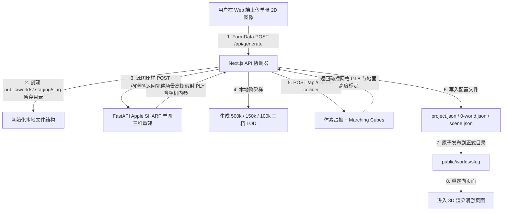

# Image2World 3D 场景生成管线开发报告与使用手册 (Development Report & User Manual)

本文件详细记录了 Image2World 在本次迭代中实现的端到端 3D 场景生成管线、前端拖拽上传与推理状态跟踪 UI、已修改的文件列表、底层代码架构，以及详细的用户使用与后续商业化规划。

---

## 1. 🏗️ 系统架构设计与数据流 (System Architecture & Data Flow)

本项目的核心目标是消除高昂的商业 API（如 Fal.ai、World Labs 等），通过**本地开源 GPU 算力**部署端到端生成管线，并将其完美集成至以 Next.js 15 为基础的 SaaS 前端平台中。

整个端到端生成管线的数据流与逻辑步骤如下：



> 家具等前景物体不再被单独抽取——它们作为真实几何被重建进场景本身。放弃前景道具路线的理由见 §3.7。

---

## 2. 📂 修改与新增的文件明细 (Modified & Added Files)

为了实现以上管线，我们对以下文件进行了修改或新增：

### A. 后端模型推理端 (`backend/`)
1. **`backend/server.py`** *(修改)*：
   * **掩码二进制序列化**：更新了 `/api/segment` 接口。此前后台虽然使用 SAM 2 生成了 PNG 掩码但未包含在 JSON 中返回。通过导入 `base64` 将生成的 PNG 二进制掩码序列化为 base64 字符串，随对象列表一同返回。
   * **新增 `/api/crop` 接口**：接收上传的原图和 SAM 2 掩码。计算掩码的极值边框，使用 Pillow 库以 `RGBA` 格式切出目标物体（背景透明），并裁剪为最小外接矩形以提升 TripoSR 几何计算的比例精度，最终以 PNG 流形式返回。
   * **CORS 中间件调整**：显式设定允许携带 credentials 并支持 Next.js 主机 (`http://localhost:3000`, `http://127.0.0.1:3000` 等) 跨域访问。

2. **`backend/test_pipeline.js`** *(新增)*：
   * 编写了一个纯 Node.js 的端到端测试工具。可从磁盘加载测试图片 `0-home.jpg`，提交给前端路由 `/api/generate`，模拟完整的生成任务以检测管线稳健性。

### B. 前端 Web 平台端 (`src/`)
1. **`src/app/api/generate/route.ts`** *(新增)*：
   * **核心 API 协调器**：负责与 Python 后端通信，实现前文所述的八大生成流程。
   * **刚体物理布局配置**：生成带有刚体物理碰撞属性 (`"physics": "rigidbody"`) 的 `scene.json`，在 `x` 轴上以 `1.5m` 间隔将前 5 个生成物体水平排列在摄像机前。
   * **超时时间延长**：配置 `export const maxDuration = 300`，使 Next.js API 路由能够容忍长达 5 分钟的同步推理执行。

2. **`src/components/WorldSidebar.tsx`** *(修改)*：
   * **上传界面集成**：在侧边栏顶部加入了极具设计感的“+ Create New World”卡片。
   * **添加玻璃微拟态模态框**：基于 Tailwind 编写了全覆式暗色微拟态模态框，包含文件拖拽区、自定义世界命名框、文件预览图。
   * **推理状态跟踪器**：当生成进行时，在模态框内锁定操作并渲染进度指示器与动态状态文本（如 *Segmenting foreground objects (SAM 2)...*, *Generating 3D object meshes (TripoSR)...* 等），提供流畅的生成等待反馈。
   * **引入相关 icon**：从 `@phosphor-icons/react` 引入了 `Plus`, `UploadSimple`, `X`, `Spinner` 图标。

3. **`src/app/globals.css`** *(修改)*：
   * 添加了 `@keyframes loading-progress` 与 `.animate-loading` 样式类，用于控制模态框内加载进度条以 8 秒的周期平滑循环动画。

4. **`src/utils/three-compat.ts`** *(修改)*：
   * 调整了实际 Three.js 模块的相对解析路径为 `../../node_modules/three/build/three.module.js`，避免 Webpack 构建打包边界限制，并消除了旧版 Three 导致的 alias 解析失败与警告。

---

## 3. 🚀 用户使用指南 (User Operations Guide)

### 3.1 环境准备
请确保您的计算机上已经安装了 CUDA (推荐 11.8 - 12.x)、Miniconda，以及 Node.js。

1. **激活 Conda 环境与依赖库**：
   确保使用了带有 PyTorch CUDA 的 Conda 环境：
   ```bash
   conda activate image2world
   ```
   * SAM 2 权重和 LaMa 权重在首次启动时会拉取或使用本地缓存；
   * TripoSR (约 1.6GB) 和 AudioLDM-S (约 196MB) 在接口首次被调用时会自动通过 Hugging Face Hub 下载并缓存。

### 3.2 启动项目
为测试并启动整个 Image2World 场景生成服务，请分别启动以下两个服务：

#### 第一步：启动 AI 推理后端 (FastAPI)
打开终端控制台，激活 Conda 后运行：
```bash
cd "D:\Tyndall Labs\image2world"
C:\Users\tingd\miniconda3\envs\image2world\python.exe backend/server.py
```
* **运行地址**：`http://localhost:8000`
* **Swagger 交互式文档**：默认关闭。用 `IMAGEWORLD_DOCS=true` 启动后可在 `http://localhost:8000/docs` 打开，进行 SAM 2, TripoSR, AudioLDM-S 及 LaMa 的单模块 live 测试。关掉是因为端点全部无鉴权，`/docs` 等于一份可调用清单。

#### 第二步：启动 Next.js 前端服务
打开另一个终端控制台，运行：
```bash
cd "D:\Tyndall Labs\image2world"
npm run dev
```
* **页面访问地址**：`http://localhost:3000`

---

### 3.3 在 Web 页面中使用生成管线
1. 打开浏览器访问 `http://localhost:3000`，页面将默认重定向至第一个场景 `/home-room`。
2. 在左侧的侧边栏顶部，点击 **Create New World** 按钮，会弹出生成模态框。
3. **输入参数**：
   * **World Name**：为您的世界取一个有意义的名字（如 *SciFi Laboratory*）。
   * **Source Image**：拖拽任意 JPEG/PNG 室内物体摆放图，或者点击上传框从文件浏览器选择。
4. 点击 **Generate World**。
5. 模态框将进入等待状态，页面会以动态文字实时更新后台模型的计算进度。
6. 生成完毕后（首次运行约需 1~3 分钟下载模型，后续生成只需 20~40 秒），模态框自动关闭，页面会自动跳转至类似 `http://localhost:3000/scifi-laboratory-xxxxxx` 的新路由，并将生成的刚体 3D 道具与环境完全渲染在画布中！

---

### 3.4 3D 画布交互与编辑
载入您自己生成的 3D 世界后，您可以：
* **FPS 漫游模式**：使用键盘 `W`/`A`/`S`/`D` 控制前后左右走动，`Space` 进行跳跃，鼠标控制旋转视角。
* **物理碰撞与音效**：系统会实时加载生成的 GLB 网格并绑定 Rapier 物理引擎刚体。当您在场景中走动碰倒、踢飞椅子、杯子或显示器时，会发出 AudioLDM 生成的专属真实物体碰撞撞击声效！
* **场景搭建与摆放编辑**：点击侧边栏右上角的 **Pencil (铅笔)** 编辑图标进入场景放置编辑器。您可以选中任意物体，通过平移/旋转轴进行空间重构，点击保存将最新的布局直接写入 `scene.json` 中。
* **重置场景**：在侧边栏中随时点击 **Reset** 图标将物理实体复位到初始位置。

---

## 3.5 🩺 稳定化与跑通验证日志 (2026-06-13)

本次迭代未新增功能，目标是「先稳一稳」：修复被掩盖的工具链缺陷并对现有管线做端到端冒烟验证。

### A. 工具链修复（构建/类型/Lint 全绿）

| 问题 | 根因 | 修复 |
| :--- | :--- | :--- |
| `eslint.config.mjs` 完全失效 | `eslint-config-next` 为旧版 eslintrc 风格，被当成 flat-config 数组直接展开（`nextVitals is not iterable`）；构建时仅静默警告，导致项目实际从未 lint | 改用官方 `FlatCompat` 桥接（Next 15 标准写法），并补 `backend/**` 忽略 |
| 8 个 TypeScript 错误 | `Buffer` 不满足 Web `Blob` 的 `BlobPart`（`SharedArrayBuffer` 不兼容）；`three-compat.ts` 直接 import 构建产物缺类型声明 | 6 处 `new Blob([buffer])` → `new Blob([new Uint8Array(buffer)])`；新增 `src/types/three-build.d.ts` 将该路径映射到官方 `three` 类型 |
| 9 个真实 Lint 错误（修复 config 后暴露） | `any`、`@ts-nocheck`/`@ts-ignore`、Node `require` 等 | 逐个修正：`any`→`unknown`/精确类型；`TransformControls` ref 改用最小事件接口；冗余 `@ts-ignore` 删除；R3F 视图层 `@ts-nocheck` 按既有 `ignoreBuildErrors` 立场在 lint 中放行 |
| 10 个 Lint 警告 | 未使用导入/变量、死代码、`` | 清理未使用项 + 移除 `ObjectHoverGuides` 重复死几何体；``（3 处动态/预览图）按设计保留 |

**结果**：`tsc --noEmit` 退出 0、`eslint .` 0 error、`next build` 成功产出。

### B. 端到端冒烟验证

- **后端**（`image2world` conda 环境）：服务启动正常，`device: cuda`，`GET /` 健康检查 200；`POST /api/segment` 对 `home-room` 原图实时跑通 SAM 2，检出 13 个物体（含 bbox/area/base64 掩码）。
- **前端**（`next dev`）：`/api/worlds` 正确返回 2 个世界（含历史 E2E 生成的 `test-e2e-world-kdgnxq`，5 物体 + 4 档 splat）；路由 `/`→307、`/home-room`→200、`/test-e2e-world-kdgnxq`→200、`/[slug]/edit`→200；`/api/scene-project` 返回合法 JSON；生成的 GLB 资产（3 MB）正常服务。
- **历史产物**：`test-e2e-world-kdgnxq` 包含真实 GLB 网格、SFX WAV、复制的 splat 环境，证明全管线曾完整跑通。

### C. 背景高斯溅射缺口已解决

生成管线已将 inpaint 产出的 clean plate（`0-world-plate.jpg`）发送到 Apple SHARP `/api/image-to-splat`，为每个世界生成独立的 `0-world-full_res.ply`。前端扫描器和 Spark renderer 可直接加载该 PLY；只有在 SHARP 未安装、权重不可用或推理失败时，才降级复制 `home-room` 静态环境，保证整条生成管线仍可完成。

### D. 交付加固（2026-07-31）

- **离线生产构建**：去除 `next/font/google` 的构建期网络依赖，改用本地系统字体栈；`next build` 可在无外网环境完成。
- **类型与质量门禁**：移除 `typescript.ignoreBuildErrors`，生产构建恢复 TypeScript 校验；图片统一使用 `next/image`，ESLint 零告警。
- **可靠发布**：生成任务写入 `public/worlds/.staging/<slug>`，全部完成后再原子移动到正式目录；失败任务自动清理，不再污染侧栏。
- **输入与依赖校验**：前后端都校验 PNG/JPG/WEBP 和 10 MB 上限；`GET /api/generate` 提供本地 AI 后端健康检查，地址可由 `IMAGEWORLD_BACKEND_URL` 配置。
- **创建体验**：弹窗提供后端就绪/离线状态、内联失败信息、Escape 关闭、可见焦点和小屏滚动；使用 portal 规避侧栏动画 transform 对固定定位的影响。

## 3.6 🧩 SAM 3 概念分割后端（可切换，2026-06-13）

在不破坏现有 SAM 2 路径的前提下，新增了 **SAM 3** 概念分割后端，用开关切换，便于 A/B 对比后再决定是否全切。

- **后端 `backend/server.py`**：将 `/api/segment` 重构为 `_segment_sam2` / `_segment_sam3` 双后端 + 调度。SAM 3 用 `build_sam3_image_model()` + `Sam3Processor`，对一份默认室内概念词表（`DEFAULT_INDOOR_CONCEPTS`，chair/monitor/lamp…）逐概念 `set_text_prompt`，按置信度过滤、从掩码反推 bbox（避免 box 格式歧义）、跨概念按 bbox IoU 去重，给每个物体附上**语义 `label`**。SAM 2 路径补 `label: null` 保持响应形状一致；响应新增 `segmenter_used`。
- **优雅降级**：请求 `sam3` 但未安装/无权重时，记录告警并回退 SAM 2，管线绝不硬失败（已实测：`segmenter=sam3` 未装 → `segmenter_used: sam2`，13 物体）。
- **前端 `src/app/api/generate/route.ts`**：`apiSegment` 透传 `IMAGEWORLD_SEGMENTER` 开关；返回的 `label` 贯通到**物体目录命名**（`chair-0`）、**object.json 显示名**与 **SFX 提示词**（"chair collision bump…" 而非 "object 0 …"）。
- **开关**：环境变量 `IMAGEWORLD_SEGMENTER=sam3`（默认 `sam2`）。安装与启用见 `backend/README.md` 的 Step 7 与「Segmentation Backend」节。
- **注意**：SAM 3 权重为 gated（`facebook/sam3`，需申请 + `huggingface-cli login`），且采用 Meta 自定义 SAM License（商用有限制），SaaS 化前需审阅条款。

#### ✅ 端到端验证（2026-06-13，实机跑通）

在 RTX 5060 Ti 16GB / torch 2.11.0+cu128 / numpy 2.2.6 上完成安装并验证：

- **分割实测**：`segmenter=sam3` 对 home 图返回 8 个**带语义标签**的物体——`bed`(0.93)、`backpack`(0.93)、`pillow`(0.91)、`chair`(0.87)、`desk`(0.87)、`cushion`(0.76)、`bag`×2。对比 SAM 2 的 13 个无名色块，更干净、可命名。
- **全管线实测**：`IMAGEWORLD_SEGMENTER=sam3` 下生成世界 `sam3-test-room-pk9iy1`，物体目录按标签命名（`bed-0`/`cushion-1`/`bag-2`/`backpack-3`/`pillow-4`），各含 GLB + SFX；SFX 提示词确认用了标签（`'bed collision bump impact sound effect, foley'`）；页面渲染 200，扫描器识别出 backpack/bag/bed/cushion/pillow。
- **安装踩坑记录**（已写入 README Step 7）：① `pip install -e . --no-deps` 保护 numpy 2.x/torch；② 补 `timm/ftfy/regex/iopath/pycocotools`；③ Windows 需 `triton-windows`（EDT kernel 硬依赖 triton）；④ 权重**直连 hf.co**下载，**勿用 hf-mirror 镜像**（不服务 gated 仓库，报 `LocalEntryNotFoundError`）。
- **代码侧已处理**：BPE 词表经 `sam3.__path__` 解析（规避 editable 安装 `__file__=None`）；推理包在 `torch.autocast(bfloat16)` + `inference_mode` 内（SAM 3 为 bf16，否则 dtype 不匹配）。

## 3.7 🎯 管线收敛为「纯场景重建」（2026-08-01）

### A. 为什么放弃前景物体实例

此前管线的核心假设是「背景 Splat + 可交互前景道具」：用 SAM 分割物体 → LaMa 把它们从图里擦掉 → TripoSR 逐个重建成可挪动的 GLB → AudioLDM 配碰撞音效。

实跑下来这条路不成立：

- **几何与原物差距过大。** TripoSR 从单张裁剪图猜测三维形状，产出的是 marching-cubes 网格 + 顶点色，没有 UV 贴图。与照片里的实物相比，识别度很低。
- **分割选中的往往不是道具。** SAM 2 自动分割取「面积最大的 5 个」，而画面里最大的区域是墙面、地板、门窗。实测 5 个「物体」中有一个高 2.48 m——房间层高才 2.6 m，那是一扇门。
- **代价高昂。** TripoSR 与 AudioLDM 占据了生成时间的绝大部分。

更关键的是**方向性的判断**：产品的价值在于「一个可漫游的三维情景」，而不是「情景里有几件能踢的家具」。

### B. 擦除前景其实在损害场景质量

一个反直觉但确凿的结论：既然目标是场景本身，那么 LaMa 擦除这一步是**净损失**——它把照片里真实的家具几何从场景中抹掉，再用 TripoSR 的猜测填回去。

现在源图**原样**送入 SHARP，家具作为真实重建的几何留在世界里，视觉质量显著高于此前的「空房间 + 猜测道具」。

### C. 结果

生成管线收敛为：`源图 → SHARP 重建 → LOD 分档 → 碰撞体提取 → scene.json`。

| | 改动前 | 改动后 |
| :--- | :--- | :--- |
| 端到端耗时（同一张图，RTX 5060 Ti） | 数分钟 | **43 秒** |
| 参与推理的模型 | SAM 2 / TripoSR / AudioLDM / LaMa / SHARP | **仅 SHARP** |
| 世界体积 | 119 MB | 105 MB |
| 家具几何 | 被擦除后由 TripoSR 猜测 | 真实重建 |

`scene.json` 的 `instances` 现在为空数组；摆放编辑器仍可手动从其他世界引入道具，这条路径未被破坏。

后端 `server.py` 中 `/api/segment`、`/api/crop`、`/api/image-to-3d`、`/api/generate-sfx`、`/api/inpaint`、`/api/place-objects` 等端点**予以保留**——它们均为延迟加载，不被调用就不占显存，日后若重拾物体方向可直接复用。前端不再有任何调用方，`/api/segment-point` 路由已删除。

### D. 过程中修正的既存缺陷

这三项在排查过程中被发现，均已修复并保留在后端：

- **TripoSR 输出 X-up 网格**，而 glTF/three.js 为 Y-up——此前所有道具在场景中其实是**躺倒**的，且 viewer 由包围盒推导落地面，躺倒的网格会连带陷进地板。判定方法：将网格沿各轴正交投影与裁剪图轮廓求 IoU，5 个物体一致指向 Y/X 平面（IoU 0.62–0.95，其余轴对仅 0.12–0.52）。已在导出前绕 Z 轴旋转 90° 修正。
- **LaMa 的 pad 从未裁回。** LaMa 将输入补齐到 8 的倍数后返回整块画布，683 px 高的源图产出 688 px 的结果，导致串行修补时掩码错位、以及与 SHARP `image_size` 的 5 px 偏差。已裁回输入尺寸。
- **串行修补改为单次并集修补。** 此前逐个物体调用 LaMa，每次都在上一次的生成结果上继续臆想。
---

## 3.8 🚶 出生点落在房间内（2026-08-01）

### 问题

角色的出生点长期硬编码为 `z = -0.5`。实测 `scene-only` 世界的碰撞体范围后发现：

```
房间几何 (viewer 空间)   X: -3.96 .. +2.76    Z: -12.82 .. -2.61
角色出生点                                     z = -0.50
```

**角色出生在房间外面 2.1 m 处**——背后是完全的虚空，一进场景就已经在边界之外。

这是单图重建的必然结果：SHARP 把相机放在拍照者的位置，而拍照的人通常站在被拍空间的**外面**（门口、房间一角之外）。原点因此天然位于几何之外。

### 修复

`/api/splat-to-collider` 增加返回 viewer 空间的 `bounds_viewer`；生成管线据此推算出生点——房间宽度居中，并从靠近相机的那条边**向内退 1.5 m**（浅房间则最多退到中点），写入 `scene.json` 的 `spawnPoint`。

前端 `CharacterController` / `FlyController` 接受该字段；旧世界没有此字段，回退到原有硬编码值，因此**向后兼容**。

### 验证

新生成的世界：`spawnPoint = [-0.60, -4.11]`，落在房间 X/Z 范围内 ✓。`/api/worlds` 确认新世界带该字段、两个旧世界为 `None` 并走回退路径。

> 📌 顺带澄清一处此前的误述：角色**不会掉出场景**。`GroundPlane` 提供 200×200 m 的固定碰撞体，另有 y=-10 的兜底网。真实现象是走出重建区域后进入「虚空」——脚下仍有无限地面，但四周没有任何几何。

---

## 3.9 🔬 两个负面结论（2026-08-02）

这一节记录**行不通的做法**，避免日后重复尝试。

### A. 过滤高斯无法消除条纹伪影

偏离原始拍摄视角后，桌面与地面会出现羽毛状条纹涂抹。原假设是「个别又大又细长的高斯」所致，遂删除同时满足「最长轴 > 5 cm 且各向异性 > 4」的高斯（占 3.66%）。

**结果：画面几乎无变化**，条纹丝毫未减，反而在删除处新增黑色噪点。

失败原因是假设本身就错了。实测各向异性中位数仅 2.88、p99 为 9.76，畸形高斯本就极少。真正的成因是：单视角重建为每个像素只分配**一个深度**，因此桌面上的键盘、纸张被重建成**贴合桌面、没有厚度的薄片**——从原始相机看它们是正确的（那本就是照片本身），从其他角度看便成了涂抹。它们的侧面与背面**从未被拍摄到**。

删除这些高斯只会留下空洞：数据本身没错，缺失的是被遮挡的那部分几何。**唯一解法是补全遮挡区域**（世界模型或多视角）。

### B. 场景边界围栏：有效，但不值得为过渡期保留

从出生点向 24 个方向扫描身体高度（0.25–1.7 m）的碰撞几何：

```
    0-105度   有墙，最近 0.3-1.5 m
  135-210度   *** 完全没有几何 ***     <- 相机背后
  240-300度   有墙，最近 1.2-1.5 m
```

**8/24 方向完全敞开**，且全部位于相机背后——单视角拍不到自己背后，故碰撞体不闭合（`is_watertight=False`）。这证实了「墙有碰撞就够了」在单视角重建下**不成立**。

据此实现了不可见围栏（`SceneBoundary`），几何验证通过（可走区域 7.2×10.7 m，跳不出、钻不过）。但随即**回滚**：世界模型生成 360° 场景后，背后的墙会被一并生成，碰撞体自然闭合，围栏即成冗余脚手架。不为一个下一步就会消失的缺口维护过渡机制。

> 提交记录：`98737e5`（实现）→ `d61bce3`（回滚）。出生点修复（`3a56f8b`）**未回滚**——无论几何如何产生，它都成立。

---

## 3.10 🌍 World Labs Marble 实测：世界模型解决了根本问题（2026-08-02）

### A. 一次生成的实测数据

通过 Marble API（`marble-1.1`）以纯文本提示生成一个「封闭办公套间」，与现有 SHARP 管线同口径对比：

| | SHARP（单视角重建） | **Marble（世界模型）** |
| :--- | :--- | :--- |
| 身体高度敞开方向 | **8/24**（全部位于相机背后） | **0/24 — 四周完全封闭** |
| 地面面积 | 68 m² | **211 m²**（约 3 倍） |
| 房间尺寸 | 6.7 × 2.6 × 10.2 m | 14.8 × 2.8 × 14.2 m |
| full_res 体积 | 63 MB（`.ply`，1.18M splats） | **27 MB**（`.spz`，约 2M splats） |
| 碰撞网格 | 60k 面（自行体素化提取） | **220k 面（官方直接提供）** |
| 全景图 | 无 | 提供（可作环境贴图） |
| 生成耗时 | 27–43 秒 | **477 秒**（约 8 分钟） |
| 单次成本 | 电费 | **1500 credits ≈ $1.20** |

封闭性用的是与 SHARP 完全相同的检测方法：把碰撞网格变换到 viewer 空间，从场景内部按 24 个方向扫描身体高度（0.25–1.7 m）的几何。**结果是 0 个敞开方向**——提示词里要求的「身后的走廊与玻璃门」确实被生成了出来。

这一次验证同时解决了此前记录的两个根本缺陷：走进虚空（§3.9-B）与遮挡处的条纹涂抹（§3.9-A）——两者本就是同一个根因「被遮挡区域没有数据」的两面。

### B. 输出格式与本项目原生兼容

Marble 返回的 JSON 结构与本项目 `output/world/0-world.json` 的 `WorldManifest` **完全一致**——`assets.mesh.collider_mesh_url`、`assets.imagery.pano_url`、`assets.splats.spz_urls`（`full_res`/`500k`/`150k`/`100k` 四档）、`semantics_metadata`。

这并非巧合：本项目的 viewer 移植自 `image-blaster`，而后者用的正是 Marble。

实测将资产按既有命名规则落盘后，**前端零改动**即完整识别（`/api/worlds` 返回四档 SPZ、碰撞体、全景图路径均正确）。Spark 渲染器原生支持 `.spz`。

### C. 两个必须注意的坐标参数

- **`metric_scale_factor = 2.0975`**（不是 1）。Marble 输出为归一化坐标，须乘以该系数才是米制。
- **`flip_y = true`**，与 SHARP 一致。判定依据：地面在 `y_local = +0.705`，代入 `y_world = gpo − msf · y_local` 得 `−0.017 ≈ 0`，吻合。

### D. 成本结构的意外结论

自部署未必更省。云 GPU 跑 Matrix-3D 约 $1–2/次（A800 上 720p 约一小时），**并不比 Marble 的 $1.20 便宜**，且质量未经验证。自部署的成本优势只存在于**本地 GPU** 这一种情形。

> ⚠️ API 无免费额度。网页版的 4 次免费与 API 是两套独立钱包。本次消耗后余额 3920 credits（尚可生成 2 次）。

---

## 3.11 🔑 双管线与用户自带 Key（BYOK，2026-08-02）

### A. 设计

生成弹窗新增一个**可选**的 Marble API Key 输入框，旁附 [platform.worldlabs.ai/api-keys](https://platform.worldlabs.ai/api-keys) 获取入口。管线据此自动选择：

| | 未填 Key | 填了 Key |
| :--- | :--- | :--- |
| 后端 | 本地 Apple SHARP | World Labs Marble |
| 成本 | 免费（本地 GPU） | 约 1500 credits ≈ $1.20，**计入用户自己的账户** |
| 耗时 | 16–43 秒 | 约 8 分钟 |
| 空间 | 只重建相机所见，**背后敞开** | **四周完全封闭** |
| 是否需要本地 GPU 后端 | 是 | **否**（纯云端） |

商业含义：**产品不承担 API 成本**。用户想要更好的效果就自带 key，否则用本地免费管线——无门槛先试用，满意再升级。

### B. Key 的安全处理

- 存于浏览器 `localStorage`，**服务端不落盘**
- 随每次生成请求传递，**仅置于 `WLT-Api-Key` 请求头**，绝不出现在 URL 中
- **不写入任何日志**（已通过代码审计核对）
- 输入框为 `type="password"`，`autoComplete="off"`

### C. 验证

- **无效 Key**：`{"code":"marble_error","message":"Marble rejected the API key. Check it on platform.worldlabs.ai.","retryable":false}` —— 401 被翻译为可读提示，且标记为不可重试（换 key 才有意义）。失败后暂存目录已清理，未产生费用。
- **未填 Key**：本地 SHARP 路径 16 秒完成，无回归。
- Marble 路径的产物落盘规则与既有扫描器一致，因此**前端零改动**即可渲染（详见 §3.10-B）。

> `maxDuration` 由 300 秒提升至 900 秒——Marble 单次生成常需 8 分钟以上。

### D. 端到端实测（图生世界，2026-08-02）

用真实 Key 通过 `/api/generate` 完整跑通**图生世界**——即产品的真实用例（用户上传照片，而非打字）：

| world | 敞开方向 | 地面 m² | 尺寸 (m) | splat 体积 | `msf` |
| :--- | :--- | :--- | :--- | :--- | :--- |
| SHARP（本地） | **8/24** | 69 | 6.7 × 2.6 × 10.2 | 63.0 MB | 1.00 |
| Marble 文本生成 | 0/24 | 211 | 14.8 × 2.8 × 14.2 | 27.0 MB | 2.10 |
| **Marble 图生世界** | **0/24** | 105 | 10.3 × 2.9 × 10.2 | 27.8 MB | **1.13** |

**图生世界同时满足了两个此前互斥的诉求**：既忠实还原原照片的房间（白色办公桌、带灯带的书架、圆桌与椅、窗外建筑、地毯纹理逐一对应），又四周完全封闭。且从房间内部观察时画面**锐利无条纹**——SHARP 一旦偏离原始视角就出现的羽毛状涂抹，在这里完全不存在，因为被遮挡区域的几何是真正被生成出来的，而非缺失。

面积 105 m² 介于 SHARP（69）与文本生成（211）之间：它需贴合原照片，不像文本生成可自由发挥。`msf = 1.13` 接近 1，说明输出尺度已近似真实米制。

耗时 **445 秒**，进度回调工作正常（中途上报 55%）。产物含源图留档、环境音、全景图，共 10 个文件。

> 💰 计费实测：生成前 3840 credits。除生成本身的 1500 外，**媒体上传另计 80 credits**——从 5420 到 3840 的差额即由此而来，估算成本时需计入。

---

## 3.12 🔒 后端并发保护（2026-08-02）

### A. 问题：同步推理阻塞了事件循环

`backend/server.py` 的所有端点都是 `async def`，但内部调用的 PyTorch 推理是**同步阻塞**的。后果被实测量化：

```
空闲时  GET /  ->  0.24 s
SHARP 推理期间  ->  9.04 s     ← 事件循环被占死
```

这不只是理论问题：前端的后端健康检查超时设为 **3 秒**（`src/app/api/generate/route.ts`），因此本地推理运行时打开创建弹窗，会显示「AI backend is unavailable」——一个用户可见的误报。

同时，模型均为单 GPU 上的惰性全局单例。当前之所以没有 OOM，只是因为阻塞带来的**意外串行**；一旦有人把某个端点改成同步 `def`（FastAPI 会将其放入线程池），立刻变成真并发争抢显存。

### B. 方案

```python
HEAVY_JOB_LOCK = asyncio.Semaphore(1)

async def run_heavy(fn, *args, **kwargs):
    """Run one blocking GPU/compute job off the event loop, serialised."""
    async with HEAVY_JOB_LOCK:
        return await asyncio.to_thread(fn, *args, **kwargs)
```

两件事一起做才有意义：`to_thread` 让事件循环保持响应，信号量保证重任务严格串行。只做前者会把意外串行变成真并发 OOM；只做后者仍然阻塞。

所有重端点（`segment`、`segment-point`、`inpaint`、`image-to-3d`、`generate-sfx`、`image-to-splat`、`place-objects`、`splat-to-collider`）均走 `run_heavy`；轻量的 `crop` 走不占锁的 `run_off_loop`。

`place-objects`（投影百万高斯）与 `splat-to-collider`（体素化 + Marching Cubes）虽不用 GPU，但同样会阻塞数十秒，因此一并纳入队列。

### C. 验证

| | 改动前 | 改动后 |
| :--- | :--- | :--- |
| 推理期间健康检查 | **9.04 s** | **0.21 s**（与空闲无异） |

三个并发 SHARP 请求：

```
req 1 finished at +11s
req 3 finished at +22s
req 2 finished at +33s      总耗时 33s = 3 × 11s
```

完美串行——各自 11 秒依次完成，全部成功产出 63 MB，服务器全程保持 0.24 s 响应。请求**排队而非争抢显存**。

---

## 3.13 🛡️ 本地开发工具的部署门禁（2026-08-02）

### A. 为什么这个问题现在才变要紧

`/api/open-world-folder` 与 `/api/open-claude-terminal` 会在**运行服务端的那台机器上启动进程**（文件管理器、终端）。笔记本上这是便利，一旦部署就是任何访问者都能触发的 RCE 面——其中 `target=root` 更是直接打开仓库根目录。

此前这只是理论风险，因为生成必须依赖本地 GPU，项目实际上部署不了。**BYOK 改变了这一点**：填了 Marble Key 就不需要本地 GPU，项目变得可部署，风险随之变成现实。

排查中还发现前端的 `canOpenLocalFolders` 被硬编码为 `false`——按钮从未显示过，但**API 路由一直开放**。这恰好印证了真正的暴露面在 API 层而非 UI。

### B. 方案

新增 `src/utils/localTools.ts`，前后端共用同一个表达式（`NEXT_PUBLIC_` 前缀使其在客户端与服务端都可读）：

```ts
export const LOCAL_TOOLS_ENABLED =
  process.env.NODE_ENV !== 'production' ||
  process.env.NEXT_PUBLIC_IMAGEWORLD_LOCAL_TOOLS === 'true'
```

开发环境默认启用；生产环境默认关闭，运营者可用 `NEXT_PUBLIC_IMAGEWORLD_LOCAL_TOOLS=true` 显式打开（用于在自己机器上跑生产构建）。禁用时返回 **404 而非 403**——关闭的端点不应暴露自己的存在。

顺带把 `canOpenLocalFolders` 接上该门禁，使这些按钮在开发环境下**真正可用**（此前恒为隐藏）。

### C. 验证

| 场景 | `/api/open-claude-terminal` |
| :--- | :--- |
| 生产构建，未设变量 | **404** |
| 生产构建，`NEXT_PUBLIC_IMAGEWORLD_LOCAL_TOOLS=true` | 501（"仅支持 macOS"，即门禁已放行） |
| 生产构建，`/api/worlds` | 200（正常路由不受影响） |

门禁表达式另经 5 组环境组合枚举验证，包含 `flag="1"` 这类**不应**放行的边界。

---

## 3.14 🧱 碰撞体表面分类：一个房间不该只有一套摩擦（2026-08-12）

### A. 问题

`build_collider.py` 已经在跑 `体素占据 → marching cubes → 连通分量过滤 → 简化`，
但产出是**一整块** mesh，前端挂成单个 `RigidBody colliders="trimesh"`。地板、墙面、
桌面共用 Rapier 的默认摩擦，直接后果是贴墙行走会被墙面摩擦拖住。

更可惜的是，分类需要的信息**早就算出来了又被丢掉**：

- `build_collider.py:154` 已经 `mesh.split()` 分出连通分量，过滤碎屑后立刻
  `concatenate` 合回去——分量身份就丢在这一行
- `detect_ground_offset` 已经在算面法线朝向 + 高度加权直方图，却只用来求了一个标量

### B. 方案

按"行走者会遇到什么"把面片分成 `floor` / `elevated` / `ramp` / `wall` / `ceiling`，
每类导出成独立 GLB 节点（trimesh 用 geometry key 作节点名，three 的 `GLTFLoader`
把它复制到 `Object3D.name`），前端为每类建独立 `RigidBody` 并给不同摩擦。

系数表在 `src/modules/collider/surfaces.ts`，判据与实测比例见 `backend/README.md`。

### C. 两个不显然的结论

**1. 分类阈值不能与地板检测共用。**

最初复用了 `detect_ground_offset` 的 `0.85`，结果 **36% 的面积落进 `ramp`**——这个类
等于没有判别力。原因是两者问的不是同一个问题：地板检测问"够不够平到能算地板"，
分类问"胶囊体能不能站住"，后者的答案是物理引擎通用的 ~45° 坡度极限。

拆成 `FLOOR_DETECT_NORMAL=0.85`（保持原行为不变）与 `WALKABLE_NORMAL=0.70` /
`VERTICAL_NORMAL=0.60` 后，三个世界上 `ramp` 一致降到 **8.6–10.5%**，且三者比例
高度接近，说明分类是稳定的而非噪声。

**2. `wall` 的 combine rule 比系数本身更重要。**

Rapier 默认把两个 collider 的摩擦**取平均**。0.02 的墙撞上角色胶囊（Rapier 默认
0.5）实际解算成 **0.26**，照样刮住玩家。必须用 `CoefficientCombineRule.Min` 才让低
系数真正生效——这一点已写进 `surfaces.test.ts` 的断言，防止日后被"优化"掉。

### D. 一个负面结论

试过用 `face_adjacency` 平滑法线后再分类，想抵消 marching cubes 的阶梯效应。
实测 `ramp` 从 35.9% **涨到** 36.5%——相邻阶梯面互相拉平，反而更糊。**不要重试。**

顺带修正了一个统计口径错误：最初按**面数**报告各类占比，得出"floor 只有 4%"。
按**面积**才是对的——quadric decimation 把平坦区域留成少量大三角形、把褶皱区域留成
大量小三角形，两种口径的结论正好相反。

### E. 验证

| 项目 | 结果 |
| :--- | :--- |
| 地板检测行为未变 | `ground_plane_offset = +1.299`，与重构前逐位一致 |
| 面数守恒 | 60,000 = 各类之和，无丢失、无重复归类 |
| GLB 节点名 | `floor` / `elevated` / `ramp` / `wall` / `ceiling` |
| 端到端契约 | three `GLTFLoader` 解析真实后端 GLB，5 类全部提取成功 |
| 后端测试 | `backend/test_collider.py` 8 项通过 |
| 前端测试 | 25 → **36** 项通过 |
| 体积代价 | GLB 1.00 → 1.44 MB（边界顶点复制） |

**尚未验证**：实际行走手感（贴墙是否真的不再卡顿）。in-app 浏览器面板隐藏时
`document.hidden = true`，R3F 不渲染、资产不加载，这一项需要人工在真实浏览器里走一遍。

**旧世界需要重跑 collider 才能用上分类**，否则前端检测到单个 `geometry_0` 节点后
退回原有的整体碰撞路径（行为与改动前完全一致）。

---

## 3.15 🪑 可推动道具：一个被实测否掉的前提（2026-08-12）

### A. 原设想与它的问题

设想是"一把椅子自成一个连通分量"，而 `build_collider.py:154` 已经 `mesh.split()`
分出了分量，只是又 `concatenate` 合了回去——看起来只要保留分量身份即可。

**三个世界的实测否掉了这个前提**：

| 世界 | 最大分量占比 | 尺寸 |
| :--- | ---: | :--- |
| sunlit-office | **97.1%** | 6.95×2.70×10.60 m（= 整个房间） |
| multiview-meetingroom | **90.3%** | 14.65×4.65×16.95 m |
| bounded | **98.3%** | 6.70×2.55×10.20 m |

站在地板上的东西在 0.05 m 体素分辨率下与地板**焊死**。剩下的小分量里尺寸像家具的
只有 2–3 个，其余是 Y 向厚度 0.05–0.15 m 的浮空碎片——做成 dynamic 刚体只会让场景
里飘着一堆会掉落的垃圾，比现状更糟。

### B. 改走的路

分割必须来自几何之外。两条选区路径，因为**任何一条单独都不够**：

- **SAM 2 点提示**：用户点一下，SAM 给出精确边界。自动，但会选错东西。
- **手动 box**：用户拖一个框。精确表达意图，也是 SAM 选错时的兜底。

两条都归结为"一组 gaussian 索引"，之后共用同一套 `体素 → marching cubes → 凸包`。
几何自始至终来自世界自己的重建，这是与 2026-08-01 砍掉的 TripoSR 路线的本质区别。

### C. 深度门控：两个都被测试钉住的坑

mask 覆盖的是**整条视线**，椅子背后的墙落在完全相同的像素里。

**1. 不能按峰高选择前景。** 墙在图像里总比物体大，gaussian 数常高一个量级。实测
500 点的物体对 9000 点的墙，按"最高峰的 20%"作阈值**直接跳过物体、选中了墙**。
改为切在"第一段空隙"——空隙的存在与两边体量无关。

**2. 空隙宽度必须用米，不能用 bin 数。** bin 宽随选区跨度变化：同样是"3 个空 bin"，
在跨米的场景里代表 15 cm，在单个表面上只有 6 mm——后者把一个高斯峰的尾巴切掉了。
现在要求空隙至少 0.1 m。

两个表面贴在一起时**不硬切**（保留整个选区），否则会把物体拦腰截断。

### D. 验证

| 项目 | 结果 |
| :--- | :--- |
| 后端测试 | `test_props.py` 15 项 + `test_collider.py` 8 项通过 |
| 真实数据 | sunlit-office 切出 3 个 prop：0.95×0.66×1.65 m / 68 kg、0.46×0.71×1.05 m / 21 kg、0.4×0.56×0.55 m / 12 kg |
| 扫描与配对 | GLB 节点名与 JSON id 完全配对，前端各建一个 dynamic 刚体 |
| 增量合并 | 追加与同 id 替换均正确 |
| 前端 | 36 项测试、lint、typecheck、生产构建全绿 |

### E. Web 端交互（2026-08-13 补完）

顶部一个 **Free an object** 开关，开启后点房间里任何东西即可切出来：

```
点击 → raycast(DROP_TARGET_LAYER) → worldToLocal → splat 空间
     → Next 路由（读 PLY + 源图 + 现有 props GLB）→ FastAPI → 写回 → 刷新
```

**坐标交接是最容易错也最难发现的一环。** collider 空间必须与 splat 空间严格一致，
靠的是 `WorldCollider` 与 `SplatRenderer` 施加同一组变换。两者一旦被改得不一致，
提取**仍会返回成功**，只是悄悄从错误的位置切下几何——没有任何报错。
`propExtractor.test.ts` 用 4 组变换（含翻转、缩放、非常规旋转）把这个不变量钉死。

Next 路由只搬字节不解析 GLB（合并在 Python 侧），并对 slug 做路径遍历防护。

端到端实测（后端 + dev server 全跑）：

| 场景 | 结果 |
| :--- | :--- |
| box 提取 | HTTP 200，2347 gaussians → 21.43 kg，与独立生成的 21.199 kg 一致（可复现） |
| 增量写回 | `prop-0/1/2` → 追加 `prop-3`，GLB 与 JSON 同步 |
| `slug=../../etc` | **404**，路径遍历被挡 |
| 同时给 point 和 box / 都不给 / 坐标非法 | 400 |

**尚未验证**：实际推动手感与点选命中率（同 §3.14，浏览器面板隐藏时
`document.hidden = true`，R3F 不渲染、资产不加载）。SAM 2 的 `point` 路径也只验证了
代码路径，未在真实点击下检验分割质量。

**未安装的依赖**：SAM 3（文本提示分割）、coacd / vhacdx（凸分解）。当前用 SAM 2
点提示 + 单凸包已足够；装上后可分别支持文本提示与凹形道具。

---

## 3.16 🎛️ Viewer UI 一轮（2026-08-13）

### A. 先核查，再动手——三项"缺口"其实不缺

动手前逐项核对了现状，原以为缺的东西大半已经存在：

| 原判断 | 实际情况 |
| :--- | :--- |
| 触控摇杆无可视化 | **已有**。`TouchControls.tsx` 会画出摇杆底盘与拨杆 |
| 首屏加载无进度 | **已有**。`ViewerLoadingOverlay` + `AssetStreamIndicator`，含进度条与文件名 |
| 画质切换只在快捷键 | **已在侧栏**（`WorldSidebar.tsx:522`），只是不在主 UI |

真正缺的只有两项，也就是这一轮做的两项。

### B. 上手提示（`ControlsHint`）

全仓库 grep 不到任何 `WASD` / hint / onboarding 字样——**第一次进入世界时，屏幕上
没有任何东西说明怎么走**。手机上尤其糟：摇杆是在你已经猜到"拖左半屏"之后才画出来的，
提示本身要靠猜。

现在世界就绪后显示一次，按 `(pointer: coarse)` 区分触屏与桌面给不同内容，9 秒后或
用户首次按键/点击即消失，`localStorage` 记住。存储被禁用时选择"照常显示、只是不记住"，
而不是抛错。

### C. 截图（`Screenshot.tsx`）

一个不显然的技术点：canvas 创建时**没有** `preserveDrawingBuffer`，所以在普通帧之后
读 `toDataURL` 只会得到**空白图**——绘制缓冲在呈现后即被清空。解法是在同一个同步块里
`gl.render()` 后立即读取，这样既拿得到像素，又不必为一个本就 GPU 吃紧的 splat 场景
在每一帧上支付那个标志的代价。

按钮放右上角而非塞进右下的源图面板：后者是 `hidden md:block` 的桌面专属，而截图恰恰
是手机最想要的。

### D. 验证状态

lint / typecheck / 45 项测试 / 生产构建全绿。

**但这一轮的 UI 一个都没有在真实浏览器里看过。** 它们全部挂在"世界就绪"之后，而
in-app 浏览器面板隐藏时 `document.hidden = true`、canvas 拿不到尺寸，页面连布局都
不发生，`viewerLoadState` 永远到不了 `ready`。实测确认 `kbd` 元素、截图按钮、
Free an object 按钮在该环境下均不出现——这是环境限制而非代码缺陷，但**外观、位置与
时机都需要人工过目**。

---

## 3.17 🗺️ 可行走区域：第一次把"走进虚空"量化（2026-08-13）

### A. 三道过滤，第三道才是重点

碰撞网格看起来是实心的地方，未必站得上去，更未必走得到。现在按三道过滤生成
`<n>-world-walkable.png`：能站（分类为 `floor`/`elevated`）、站得直（头顶 ≥ 1.6 m）、
**走得到**（从出生点洪水填充）。

第三道是这个功能存在的理由。单视角重建留下大量够得着却走不到的碎片，把它们画成可走
区域，等于**在最该警告"前面是虚空"的地方给出一张骗人的地图**。

| 世界 | 能站 | 走得到 | 不可达 |
| :--- | ---: | ---: | ---: |
| sunlit-office | 21.9 m² | 19.8 m² | 9.6% |
| **multiview-meetingroom** | 75.3 m² | 25.5 m² | **66.2%** |
| bounded | 21.3 m² | 20.1 m² | 5.7% |

多视图那个 66.2% 不是 bug——覆盖更广的同时也更碎。§3.9/§3.12 反复提到的"走进虚空"，
到这里第一次有了可量化的数字。

### B. 两个踩过的坑

**1. 不能用 `triangles_center` 网格化。** 一个三角形只落一个格子，而 quadric
decimation 恰恰把最平坦的区域留成少量大三角形——§3.14 的诊断数据早就写着"最平的 4%
面片承载 38% 面积"。地板是最平的，于是地板几乎整个被漏掉，端到端实测直接得出
**0 m²**。改为按面积采样（每格约 4 个采样点）。

这个坑值得记：**面片统计的口径问题在这个项目里已经出现两次**，§3.14 是按面数报告
占比、这里是按面片中心网格化，两次都被"平坦=大三角形"咬到。

**2. 可达面积不可能大于可站面积。** despeckle 用的 `binary_closing` 会填洞并向外
扩张，实测报出 **−13.8% 不可达**这种自相矛盾的数字。closing 仍需保留（让洪水填充跨过
噪声孔洞），但最终结果必须与原始网格取交集——洞不是能站的地方。

### C. 前端

`Minimap.tsx` 把灰度掩码重新着色：不可达处**透明**而非暗色，否则读起来像"暗一点的
地板"而不是"没有地板"，与整个功能的意图相反。玩家位姿走 ref +
`requestAnimationFrame`，而不是每帧 setState 重渲染整个 overlay。

### D. 验证

34 项后端测试 + 45 项前端测试 + lint + typecheck + 生产构建全绿；扫描器已能正确读出
`walkable` 资产。**minimap 的实际观感未经人工确认**（原因同 §3.14/§3.16）。

---

## 3.18 👁️ 终于看见了：Playwright 打通视觉验证（2026-08-13）

### A. 前两条路都不通，第三条通了

§3.14–3.17 反复写着"未经人工确认"，因为：

1. **in-app 浏览器面板**隐藏时 `document.hidden = true`，canvas 拿不到尺寸，R3F 不渲染、
   `.ply` 不请求，页面连布局都不发生
2. **用户的真实 Chrome** 完全访问不了 `localhost:3000`（`localhost` 与 `127.0.0.1` 均
   返回 error page，而同一个 server 在 in-app 面板里正常）——很可能是加速器/VPN 的代理
   把本地流量也拦了，而浏览器只能以 read tier 授权，改不了它的设置

**Playwright 自带 Chromium 绕开了两者**：软件 WebGL2（SwiftShader）能真渲染，
`document.hidden = false`，canvas 1440×900。代价是渲染 118 万 splat 太慢导致截图超时，
切到 Low 画质（100k LOD）即可。这条路以后应作为本项目视觉验证的默认手段。

### B. 抓到两个真 bug

**1. minimap 被源图缩略图完全遮住。** 我在代码注释里写着"放在源图面板左边"，实际却用了
`right-3`——两者同在右下角，而源图面板是 384×384 且在 DOM 中更靠后，把 99×144 的
minimap 整个盖住。实测 `overlapsSource: true`，裁图里只看得到那张办公室照片。
已移到左下角，不再依赖源图面板的尺寸。

**2. 玩家标记飞出屏幕。** 实测 `top: 120.625%`、`y=903`（视口只有 900）。原因是玩家在
可行走区域之外——而这恰恰是**单视角世界的开场常态**：相机被放在拍照位置，也就是房间
外面。现在 clamp 到边缘并降到 45% 不透明度，读作"你在图外，往这个方向"。

### C. 一个看起来像 bug、其实不是的

点击"Free an object"后点屏幕正中央，**不发任何请求**。逐层排查后场景图完全正常
（5 个 dropTarget clone 都在 `mask=4`），`hitsAllLayers` 也是 0——与图层无关。

真相是几何：相机在 `[0, 1.6, -0.5]` 朝 `[0, 0, -1]`，**屏幕正中心那条射线是严格水平的**，
与水平地板永不相交，而那个高度的正前方恰好没有碰撞面。扫一遍屏幕纵向就很清楚：

| 屏幕位置（NDC y） | 命中数 | 首个 |
| :--- | ---: | :--- |
| +0.5（上看） | 1 | ceiling |
| **0（正中心）** | **0** | — |
| −0.3 | 4 | wall |
| −0.6 | 2 | ramp |

我最初的测试点恰好选中了唯一打不中的位置。点屏幕下方立刻发出了
`POST /api/extract-prop`，整条链路是通的。

但这暴露了真实的 UX 问题：**正前方水平方向经常没有碰撞几何**（§3.9 记过"8/24 方向
没有身体高度的几何"），所以点空是常态而非异常。已补上明确反馈，不再静默失败。

### D. 顺带确认为真的

- 上手提示按时出现又按时消失（9 秒）。之前查不到它，是因为我等了 25 秒——逻辑没错，
  是检查时机错了
- props 真的渲染成 dynamic 刚体：场景图里 `prop-0/1/2` 齐备
- minimap 掩码正确着色，26.4% 像素不透明，与 19.8 m² 可走 / 74 m² 房间投影吻合
- 五类碰撞面各自成为独立 mesh，与 §3.14 的设计一致

---

## 3.19 🔒 信任边界：守卫必须放在真正占 GPU 的那一端（2026-08-14）

### A. 问题：`/api/*` 从来没有任何来源校验

Next 自带的跨站保护只覆盖 `/_next` 与 `/__nextjs`，**`/api/*` 不在其中**。而
`multipart/form-data` 与 `text/plain` 都是 CORS **简单请求**——浏览器不预检直接发出，
`Request.json()` 也不校验 Content-Type。攻击者读不到响应，但**副作用已经发生**：

| 一个第三方页面能做的 | 后果 |
| :--- | :--- |
| `POST /api/scene-project` 发 `{"version":1,"instances":[]}` | 清空摆好的场景与标定过的 spawnPoint |
| `POST /api/generate` / `extract-prop` | 占住 16 GB 单卡 |
| `` | 在宿主机上起终端（`` 就够，不需要 JS） |

### B. 方案：自定义头 + 后端 Origin 中间件

前端每个写请求带 `x-imageworld-app: 1`。**真正起作用的是「自定义头」这件事本身**——
跨源 fetch 一旦带自定义头就不再是简单请求，必须先过预检，而这些路由不返回任何
`Access-Control-Allow-*`，预检失败，真实请求根本发不出去。`Sec-Fetch-Site` 只是快路径：
它在旧浏览器、非浏览器客户端、以及 `http://192.168.x.x` 这类非安全上下文下**根本不发**，
所以只能用来拒绝、不能用来放行——判据是「两个都要成立」而非「任一」。

> ⚠️ 给任何一条路由加 CORS 响应头，或在 `next.config.ts` 加全局 `headers()`，这道锁当场失效。

### C. 一个只做前端会漏掉的洞

**审查发现原方案挡不住真正要挡的东西**：视频重建流程里浏览器是**直连
`localhost:8000`** 的（`CreateWorldModal.tsx`），所以 Next 层的守卫对 FastAPI 那一侧
毫无作用——而 GPU 恰恰在那一侧。CORS 白名单只决定能不能**读**响应，不阻止请求抵达。

后端补 `reject_cross_origin_writes` 中间件：非 GET 请求若带 `Origin` 且不在白名单内，
直接 403；**`Origin` 缺失则放行**——那是 curl、Next 服务端 fetch、pytest，而能在本机起进程
的人本来就能直接读写 `public/worlds/`。

### D. 一并收紧的四项

* `uvicorn` 由 `0.0.0.0` 改为 `IMAGEWORLD_BIND_HOST`（默认 `127.0.0.1`）
* `/docs` 与 `/openapi.json` 默认关闭（`IMAGEWORLD_DOCS=true` 打开）——端点全部无鉴权，
  `/docs` 等于一份可调用清单
* 上传按请求计额度（默认 1 GiB）。**注意这个上限只约束常驻内存**：Starlette 在 handler
  被调用**之前**就已把 multipart 落盘，所以 413 是写完之后才返回的
* 服务端门禁改读**不带前缀**的 `IMAGEWORLD_LOCAL_TOOLS`。Next 在构建期把 `NEXT_PUBLIC_*`
  内联进**服务端** bundle，旧写法在构建机上一旦设了该变量就被烤成常量 `true`，运行时再也
  关不掉。前缀版本降级为只控制按钮显隐（`LOCAL_TOOLS_VISIBLE`）

### E. 验证

| 场景 | 结果 |
| :--- | :--- |
| 跨站 `POST /api/scene-project`（text/plain） | **403** |
| 跨站 `GET /api/open-world-folder?target=root` | **404**，不弹窗 |
| 跨站 `POST :8000/api/reconstruction-jobs` | **403** |
| 白名单来源 / 无 Origin 的服务端调用 | 正常通过 |
| 伪造头 + `sec-fetch-site: cross-site` | **403** |
| 超额上传 | **413** |

`sameOrigin.test.ts` 6 项钉住守卫语义（含「同源但无头」「有头但 cross-site」两个方向）。

### F. 顺手清掉的

`.env.local` 里的 `WORLDLABS_API_KEY` **全仓库零引用**——BYOK 的 key 走浏览器
localStorage + multipart 字段，服务端从不读环境变量。一个没有任何功能依赖的实时计费凭据
留在工作区，只靠一行 gitignore 挡着。已删除并需吊销。同时删掉导出但零调用的
`fetchMarbleCredits`（一处会拿 key 发外网请求的入口）。

---

## 3.20 📏 单位：一次差点推过头的修正（2026-08-14）

### A. 问题

`metric_scale_factor` 把重建单位换算成米。**8 个世界里有 5 个不等于 1**
（demo-office 1.131、marble-office 2.098、family-splatfacto **3.659**）。而
`build_walkable.py` 的 `CELL_SIZE = 0.15` 与 `CHARACTER_HEIGHT = 1.6`、
`build_props.py` 的 `density = 250 kg/m³`，全部作用在**未缩放**的几何上。

在 3.659 的世界上：净空门限实际要求 **5.9 m**（几乎整张图判为不可走）、
网格 cell 实际 **0.55 m**、上报面积差 **13.4 倍**、道具质量差 **49 倍**（体积是三次方）。

**目前磁盘上还没错过**——唯一有 walkable 图的世界恰好是 scale=1。这是个潜伏问题，
但 `demo-office` 自己就是 1.131，随手跑一次就会发作。

### B. 一个被真实数据否掉的方案

第一版把**点云**整体缩放，让文件里每个常量都名副其实。在 3.659 的真实世界上实测：

```
distance cull: 317,840 / 621,380 points     ← 15 m 在 24 m 跨度的场景上砍掉一半
surfaces: floor 1%                          ← 分类明显不对
ground_plane_offset: +7.653（磁盘上是 +2.256）
```

原因：缩放点云会**连带改变 `--voxel-size` 与 `--max-distance` 的含义**，也就改变了
碰撞网格本身。`ground_plane_offset` 在磁盘上的既定约定是**世界单位**
（`finalize/route.ts` 拿到后自己乘 scale），推翻它会波及视频重建整条链路。

**改法收窄**：碰撞体构建、地板检测、表面分类、GLB 导出**全部保持世界单位不变**；
只有「以米为单位上报」的量才换算——walkable 网格和道具质量。

### C. 落地

* `build_collider.py` 新增 `read_metric_scale()`：scene.json 优先于 manifest，与 viewer 同序
* 只给 `build_walkable_map` 传一份 `mesh.copy().apply_scale(scale)`；`spawnPoint` 本来就是
  viewer 空间坐标，至此与网格同空间（此前是拿米制 spawn 去查未缩放的网格）
* `<n>-world-walkable.json` 新增 `metric_scale_factor`。`Minimap` 按
  `x * builtScale / liveScale` 定位——缺字段的旧文件按 1 回退，与原先的「除以 scale」逐位等价
* `prop_descriptor(metric_scale=)` 只换算质量；`centre` / `bounds` 仍是世界单位（它们与 GLB
  一起被 viewer 缩放，换算会导致重复缩放）
* `room size` 的打印不再谎称 "m"

`test_metric_scale.py` 14 项：scale 来源优先级、非法值（0 / 负 / 字符串 / NaN）不落进除法、
质量的三次方关系、`centre`/`bounds` 不动、掩码记录 scale、净空按米判定。

### D. 顺带：坐标变换的单一真源

`WorldCollider` 与 `SplatRenderer` 此前各自手写同一组变换，`propExtractor.test.ts` 里还有
**第三份拷贝**——那个自称"把两侧钉在一起"的测试，实际在测它自己（把 SplatRenderer 的
`groundPlaneOffset` 改成负号，9 个用例照样全绿）。

现在两者 **spread 同一个 `worldTransform()` 的返回值**，两个组件不可能再算出不同的数。
测试改为 import 真实模块，删掉 4 个「对任何可逆变换恒真」的往返用例，换成钉住真正的契约：
**`groundPlaneOffset` 不参与缩放**（`finalize/route.ts:240` 依赖这一点）。

Playwright + SwiftShader 实拍确认 demo-office 位置、朝向、比例均正确，零控制台错误。

---

## 3.21 🔌 接线：功能存在 ≠ 用户能用到（2026-08-14）

### A. minimap 此前只有跑过命令行的世界才有

`build_walkable_map` 的**唯一调用点**在 `build_collider.py` 的 `main()` 里。
`/api/splat-to-collider` 从不产出它——也就是说**浏览器里生成的每一个世界都没有 minimap**，
只有手动跑过 CLI 的那一个有。而 `generate/route.ts` 的进度文案早就写着
"Deriving walkable surfaces from the point cloud"，roadmap 也已经标成 `[x]`。

### B. 为什么不能塞进碰撞体那一趟

视频重建世界的 `metricScaleFactor` 是**从碰撞体的地板高度反推出来的**
（`finalize/route.ts`：`calibratedScale = requestedCameraHeight / (cameraY + rawGroundPlaneOffset)`）。
而网格的门限是米制。**在碰撞体这一趟里，网格该用的 scale 还不存在。**

所以新增独立端点 `/api/walkable`，吃的是**已建好的碰撞体 GLB** 而不是点云：

* 小一百倍，且**表面分类已经在文件里**（`build_collider` 就是按类写节点的），不必重新体素化
* 可以在碰撞体之后调用——这是视频重建唯一可行的顺序

`collider_groups()` 从 GLB 的具名节点重建 (mesh, 面分组)。**用真实世界验证过往返**：
sunlit-office 的 GLB 反推后 cols/rows/cell_size 与磁盘上的**完全一致**，面积差 2%
（`sample_surface` 是无固定种子的随机采样，本身就有这个抖动）。

### C. 降级是设计的一部分

老世界的碰撞体是单个 `geometry_0`，没有分类，无从知道哪些面是地板——端点返回 **422**，
调用方记一条 warning 继续。实测 demo-office / bounded / multiview-meetingroom 三个老世界
都走这条路。它们要 minimap 需重跑一次 collider（与 §3.14 的表面分类是同一个前提）。

### D. 点选抠图会打中那块 200 m 的隐形板

`GroundPlane` 有一块 200×200、`colorWrite=false` 的 plane 在 `DROP_TARGET_LAYER` 上
（给摆放编辑器的"落到地面"用，那边有 `isSelectedObject` 过滤，`PropExtractor` 没有）。后果两条：

1. 地板附近点击时两者都在 y≈0，谁更近取决于亚厘米差异；命中 plane 时局部坐标第三分量恒为 0，
   后端 `depth > 1e-6` 判否 → 400 → 前端显示成一句看不懂的 502
2. 这块板 200 m 见方，**任何朝下的落空点击都会命中它**，§3.18 刚补的"点空反馈"在水平线以下
   几乎永远不触发

改法是给身份而不是给层级：`dropTargets.ts` 出 `markColliderDropTarget` /
`isColliderDropTarget`，`WorldCollider` 构造 drop-target 副本时打标，`PropExtractor` 取
**最近的房间命中**而不是最近的任意命中。

### E. 没有做的一件事，以及为什么

**抠出来的 prop 仍然留在静态碰撞体和 splat 云里**，所以 dynamic 凸包与包含同一把椅子表面的
fixed trimesh 用逐字段相同的 transform 精确重叠——生成瞬间被穿透恢复冲量弹飞，推的时候顶着
自己的表面走，视觉上还多一块灰壳。

**这个不能靠互斥 collisionGroups 止血**：房间碰撞体里含 `floor`/`elevated` 节点，互斥之后
道具不再与地板碰撞，只剩 `GroundPlane` 那块 y≈0 平板兜着，会穿墙穿台面——比现状更糟。

正确解是后端把选区索引一并交出来，`build_collider` 支持 `exclude` 并在抠完重跑一次碰撞体，
splat 端把这些 gaussian 的 opacity 置零。这是数天的工作量，且抠一次就要重跑一次体素化，
需要自己的进度反馈。**按审计结论，这条应回退到分支做，不以当前状态进 main。**

### F. 验证

79 项后端测试 + 50 项前端测试 + lint + typecheck 全绿；Playwright 实拍 demo-office 与改动前
逐像素一致、零控制台错误。

---

## 3.22 📦 交付体积：本地世界一直在发未压缩的点云（2026-08-19）

### A. 问题

Marble 的世界是 `.spz`，本地生成的世界是 `.ply`——同一个 viewer，两种体积。

`public/worlds/room1-cbti0t/output/world/0-world-100k.ply` 是 5,600,753 字节，
除以 100k splat 正好 **56 B/splat**，即 14 个 float32（xyz + f_dc×3 + opacity +
scale×3 + rot×4），一个都没量化。Marble 同档位的 `.spz` 是 1.12 MB。

High 画质走 `full_res`，于是首屏要下 47–203 MB。磁盘上 902 MB 的世界里，
784 MB 是可压缩的 PLY。

### B. 方案

Spark 自己就带编码器：`@sparkjsdev/spark` 导出 `transcodeSpz`，`SplatMesh`
两种格式都能读。所以这不是换格式，只是换字节数——viewer 侧一行没改。

新增 `src/utils/spz.ts`，接在两条管线生成 LOD 的同一处
（`api/generate/route.ts`、`api/video-reconstruction/finalize/route.ts`），
另有 `npm run assets:spz` 回填已有世界。

**`full_res.ply` 保留，LOD 的 PLY 删掉。** 前者是无损原件，`/api/extract-prop`
在运行时从它身上抠道具，`npm run assets:lod` 也从它重建 LOD；后者在 `.spz`
写出之后就没有任何读者了——碰撞体是在同一趟管线里、更早的时候读 `500k.ply` 的。

`worldsScanner` 原本用「目录列举里最后一个」决定同一档位取 `.ply` 还是 `.spz`，
两者并存时结果不确定。改成显式优先 `.spz`。这顺带给了一条退路：删掉某个世界的
`.spz`，扫描器自动退回它的 `.ply`。

### C. 实测

回填 20 个文件，**784 MB PLY → 138 MB SPZ**：

| 世界 | full_res PLY | full_res SPZ | 比例 |
|---|---|---|---|
| singleview-meetingroom | 47.4 MB | 11.6 MB | 4.1x |
| multiview-meetingroom | 56.8 MB | 15.4 MB | 3.7x |
| room1-cbti0t | 66.1 MB | 16.0 MB | 4.1x |
| family-splatfacto-integration | 203.5 MB | 18.8 MB | **10.8x** |

Splatfacto 那个是 10.8x，因为它的 PLY 每个 splat 存了 45 个 float32 的球谐系数
和 3 个从来没人读的法线。**球谐没有被丢掉**——回读确认 `shDegree=3` 完整保留。

### D. 一次测错，以及测对之后的结论

只看头 5 个 splat 什么也证明不了，所以做了全量比对：把两边都过一遍 Spark 自己的
`setPackedSplat`——也就是真正送进 GPU 的那 4 个 uint32——逐字比较。

**第一次做错了。** 我把词 3 当成 rgba，据此得出「Splatfacto 世界 4.7% 的 splat
颜色偏差最大 25/255」。词 3 根本不是颜色：把其余字段全部固定、只动 rgb，词 3 纹丝不动
（恒为 `ff000000`）。**rgba 在词 0**——`cc998066` 正好对应 opacity 0.8 / b 0.6 /
g 0.5 / r 0.4。

排查过程里还顺手证伪了一个假设：怀疑是球谐导致的，于是用 `maxSh: 0` 重编一遍完全丢掉
SH——偏差数字一模一样（4.662%，max 25/255）。这本该是「读错字段」的信号，当时没读出来。

读对词 0 之后，两条管线的结论一致：

| | rgb 每通道 | alpha | 位置 |
|---|---|---|---|
| room1（SHARP，1,179,648 splat） | 最大 1/255，>1 的占 0.000% | 最大 1/255 | 最大 1.22e-4 |
| family（Splatfacto，820,363 splat） | 最大 1/255，>1 的占 0.000% | 最大 0/255 | 最大 1.22e-4 |

**两条管线都是等价的**，位置误差 0.12 mm。

几何字有 74% 的 splat 不逐位相同，但那是量化本身，不是精度问题——逐字节比多字节字段
本来就没意义（16 位定点数低位 +1，低字节就从 255 翻到 0）。几何该看字段级：位置
1.22e-4；log-scale 在 room1 最大 1.23e-2，在 family 有 25 个 splat（0.003%）超过 0.05。

教训写在这里而不是删掉：**逐字比较打包缓冲区之前，先确认哪个字装的是什么**——
拿一个 splat，固定其余字段只动一个，看哪个字变。十行代码，省掉一个错误结论。

### E. 验证

| 项目 | 结果 |
| :--- | :--- |
| 地板检测行为未变 | `ground_plane_offset = +1.299`，与重构前逐位一致 |
| 面数守恒 | 60,000 = 各类之和，无丢失、无重复归类 |
| GLB 节点名 | `floor` / `elevated` / `ramp` / `wall` / `ceiling` |
| 端到端契约 | three `GLTFLoader` 解析真实后端 GLB，5 类全部提取成功 |
| 后端测试 | `backend/test_collider.py` 8 项通过 |
| 前端测试 | 25 → **36** 项通过 |
| 体积代价 | GLB 1.00 → 1.44 MB（边界顶点复制） |

**尚未验证**：实际行走手感（贴墙是否真的不再卡顿）。in-app 浏览器面板隐藏时
`document.hidden = true`，R3F 不渲染、资产不加载，这一项需要人工在真实浏览器里走一遍。

**旧世界需要重跑 collider 才能用上分类**，否则前端检测到单个 `geometry_0` 节点后
退回原有的整体碰撞路径（行为与改动前完全一致）。

---

## 3.15 🪑 可推动道具：一个被实测否掉的前提（2026-08-12）

### A. 原设想与它的问题

设想是"一把椅子自成一个连通分量"，而 `build_collider.py:154` 已经 `mesh.split()`
分出了分量，只是又 `concatenate` 合了回去——看起来只要保留分量身份即可。

**三个世界的实测否掉了这个前提**：

| 世界 | 最大分量占比 | 尺寸 |
| :--- | ---: | :--- |
| sunlit-office | **97.1%** | 6.95×2.70×10.60 m（= 整个房间） |
| multiview-meetingroom | **90.3%** | 14.65×4.65×16.95 m |
| bounded | **98.3%** | 6.70×2.55×10.20 m |

站在地板上的东西在 0.05 m 体素分辨率下与地板**焊死**。剩下的小分量里尺寸像家具的
只有 2–3 个，其余是 Y 向厚度 0.05–0.15 m 的浮空碎片——做成 dynamic 刚体只会让场景
里飘着一堆会掉落的垃圾，比现状更糟。

### B. 改走的路

分割必须来自几何之外。两条选区路径，因为**任何一条单独都不够**：

- **SAM 2 点提示**：用户点一下，SAM 给出精确边界。自动，但会选错东西。
- **手动 box**：用户拖一个框。精确表达意图，也是 SAM 选错时的兜底。

两条都归结为"一组 gaussian 索引"，之后共用同一套 `体素 → marching cubes → 凸包`。
几何自始至终来自世界自己的重建，这是与 2026-08-01 砍掉的 TripoSR 路线的本质区别。

### C. 深度门控：两个都被测试钉住的坑

mask 覆盖的是**整条视线**，椅子背后的墙落在完全相同的像素里。

**1. 不能按峰高选择前景。** 墙在图像里总比物体大，gaussian 数常高一个量级。实测
500 点的物体对 9000 点的墙，按"最高峰的 20%"作阈值**直接跳过物体、选中了墙**。
改为切在"第一段空隙"——空隙的存在与两边体量无关。

**2. 空隙宽度必须用米，不能用 bin 数。** bin 宽随选区跨度变化：同样是"3 个空 bin"，
在跨米的场景里代表 15 cm，在单个表面上只有 6 mm——后者把一个高斯峰的尾巴切掉了。
现在要求空隙至少 0.1 m。

两个表面贴在一起时**不硬切**（保留整个选区），否则会把物体拦腰截断。

### D. 验证

| 项目 | 结果 |
| :--- | :--- |
| 后端测试 | `test_props.py` 15 项 + `test_collider.py` 8 项通过 |
| 真实数据 | sunlit-office 切出 3 个 prop：0.95×0.66×1.65 m / 68 kg、0.46×0.71×1.05 m / 21 kg、0.4×0.56×0.55 m / 12 kg |
| 扫描与配对 | GLB 节点名与 JSON id 完全配对，前端各建一个 dynamic 刚体 |
| 增量合并 | 追加与同 id 替换均正确 |
| 前端 | 36 项测试、lint、typecheck、生产构建全绿 |

### E. Web 端交互（2026-08-13 补完）

顶部一个 **Free an object** 开关，开启后点房间里任何东西即可切出来：

```
点击 → raycast(DROP_TARGET_LAYER) → worldToLocal → splat 空间
     → Next 路由（读 PLY + 源图 + 现有 props GLB）→ FastAPI → 写回 → 刷新
```

**坐标交接是最容易错也最难发现的一环。** collider 空间必须与 splat 空间严格一致，
靠的是 `WorldCollider` 与 `SplatRenderer` 施加同一组变换。两者一旦被改得不一致，
提取**仍会返回成功**，只是悄悄从错误的位置切下几何——没有任何报错。
`propExtractor.test.ts` 用 4 组变换（含翻转、缩放、非常规旋转）把这个不变量钉死。

Next 路由只搬字节不解析 GLB（合并在 Python 侧），并对 slug 做路径遍历防护。

端到端实测（后端 + dev server 全跑）：

| 场景 | 结果 |
| :--- | :--- |
| box 提取 | HTTP 200，2347 gaussians → 21.43 kg，与独立生成的 21.199 kg 一致（可复现） |
| 增量写回 | `prop-0/1/2` → 追加 `prop-3`，GLB 与 JSON 同步 |
| `slug=../../etc` | **404**，路径遍历被挡 |
| 同时给 point 和 box / 都不给 / 坐标非法 | 400 |

**尚未验证**：实际推动手感与点选命中率（同 §3.14，浏览器面板隐藏时
`document.hidden = true`，R3F 不渲染、资产不加载）。SAM 2 的 `point` 路径也只验证了
代码路径，未在真实点击下检验分割质量。

**未安装的依赖**：SAM 3（文本提示分割）、coacd / vhacdx（凸分解）。当前用 SAM 2
点提示 + 单凸包已足够；装上后可分别支持文本提示与凹形道具。

---

## 3.16 🎛️ Viewer UI 一轮（2026-08-13）

### A. 先核查，再动手——三项"缺口"其实不缺

动手前逐项核对了现状，原以为缺的东西大半已经存在：

| 原判断 | 实际情况 |
| :--- | :--- |
| 触控摇杆无可视化 | **已有**。`TouchControls.tsx` 会画出摇杆底盘与拨杆 |
| 首屏加载无进度 | **已有**。`ViewerLoadingOverlay` + `AssetStreamIndicator`，含进度条与文件名 |
| 画质切换只在快捷键 | **已在侧栏**（`WorldSidebar.tsx:522`），只是不在主 UI |

真正缺的只有两项，也就是这一轮做的两项。

### B. 上手提示（`ControlsHint`）

全仓库 grep 不到任何 `WASD` / hint / onboarding 字样——**第一次进入世界时，屏幕上
没有任何东西说明怎么走**。手机上尤其糟：摇杆是在你已经猜到"拖左半屏"之后才画出来的，
提示本身要靠猜。

现在世界就绪后显示一次，按 `(pointer: coarse)` 区分触屏与桌面给不同内容，9 秒后或
用户首次按键/点击即消失，`localStorage` 记住。存储被禁用时选择"照常显示、只是不记住"，
而不是抛错。

### C. 截图（`Screenshot.tsx`）

一个不显然的技术点：canvas 创建时**没有** `preserveDrawingBuffer`，所以在普通帧之后
读 `toDataURL` 只会得到**空白图**——绘制缓冲在呈现后即被清空。解法是在同一个同步块里
`gl.render()` 后立即读取，这样既拿得到像素，又不必为一个本就 GPU 吃紧的 splat 场景
在每一帧上支付那个标志的代价。

按钮放右上角而非塞进右下的源图面板：后者是 `hidden md:block` 的桌面专属，而截图恰恰
是手机最想要的。

### D. 验证状态

lint / typecheck / 45 项测试 / 生产构建全绿。

**但这一轮的 UI 一个都没有在真实浏览器里看过。** 它们全部挂在"世界就绪"之后，而
in-app 浏览器面板隐藏时 `document.hidden = true`、canvas 拿不到尺寸，页面连布局都
不发生，`viewerLoadState` 永远到不了 `ready`。实测确认 `kbd` 元素、截图按钮、
Free an object 按钮在该环境下均不出现——这是环境限制而非代码缺陷，但**外观、位置与
时机都需要人工过目**。

---

## 3.17 🗺️ 可行走区域：第一次把"走进虚空"量化（2026-08-13）

### A. 三道过滤，第三道才是重点

碰撞网格看起来是实心的地方，未必站得上去，更未必走得到。现在按三道过滤生成
`<n>-world-walkable.png`：能站（分类为 `floor`/`elevated`）、站得直（头顶 ≥ 1.6 m）、
**走得到**（从出生点洪水填充）。

第三道是这个功能存在的理由。单视角重建留下大量够得着却走不到的碎片，把它们画成可走
区域，等于**在最该警告"前面是虚空"的地方给出一张骗人的地图**。

| 世界 | 能站 | 走得到 | 不可达 |
| :--- | ---: | ---: | ---: |
| sunlit-office | 21.9 m² | 19.8 m² | 9.6% |
| **multiview-meetingroom** | 75.3 m² | 25.5 m² | **66.2%** |
| bounded | 21.3 m² | 20.1 m² | 5.7% |

多视图那个 66.2% 不是 bug——覆盖更广的同时也更碎。§3.9/§3.12 反复提到的"走进虚空"，
到这里第一次有了可量化的数字。

### B. 两个踩过的坑

**1. 不能用 `triangles_center` 网格化。** 一个三角形只落一个格子，而 quadric
decimation 恰恰把最平坦的区域留成少量大三角形——§3.14 的诊断数据早就写着"最平的 4%
面片承载 38% 面积"。地板是最平的，于是地板几乎整个被漏掉，端到端实测直接得出
**0 m²**。改为按面积采样（每格约 4 个采样点）。

这个坑值得记：**面片统计的口径问题在这个项目里已经出现两次**，§3.14 是按面数报告
占比、这里是按面片中心网格化，两次都被"平坦=大三角形"咬到。

**2. 可达面积不可能大于可站面积。** despeckle 用的 `binary_closing` 会填洞并向外
扩张，实测报出 **−13.8% 不可达**这种自相矛盾的数字。closing 仍需保留（让洪水填充跨过
噪声孔洞），但最终结果必须与原始网格取交集——洞不是能站的地方。

### C. 前端

`Minimap.tsx` 把灰度掩码重新着色：不可达处**透明**而非暗色，否则读起来像"暗一点的
地板"而不是"没有地板"，与整个功能的意图相反。玩家位姿走 ref +
`requestAnimationFrame`，而不是每帧 setState 重渲染整个 overlay。

### D. 验证

34 项后端测试 + 45 项前端测试 + lint + typecheck + 生产构建全绿；扫描器已能正确读出
`walkable` 资产。**minimap 的实际观感未经人工确认**（原因同 §3.14/§3.16）。

---

## 3.18 👁️ 终于看见了：Playwright 打通视觉验证（2026-08-13）

### A. 前两条路都不通，第三条通了

§3.14–3.17 反复写着"未经人工确认"，因为：

1. **in-app 浏览器面板**隐藏时 `document.hidden = true`，canvas 拿不到尺寸，R3F 不渲染、
   `.ply` 不请求，页面连布局都不发生
2. **用户的真实 Chrome** 完全访问不了 `localhost:3000`（`localhost` 与 `127.0.0.1` 均
   返回 error page，而同一个 server 在 in-app 面板里正常）——很可能是加速器/VPN 的代理
   把本地流量也拦了，而浏览器只能以 read tier 授权，改不了它的设置

**Playwright 自带 Chromium 绕开了两者**：软件 WebGL2（SwiftShader）能真渲染，
`document.hidden = false`，canvas 1440×900。代价是渲染 118 万 splat 太慢导致截图超时，
切到 Low 画质（100k LOD）即可。这条路以后应作为本项目视觉验证的默认手段。

### B. 抓到两个真 bug

**1. minimap 被源图缩略图完全遮住。** 我在代码注释里写着"放在源图面板左边"，实际却用了
`right-3`——两者同在右下角，而源图面板是 384×384 且在 DOM 中更靠后，把 99×144 的
minimap 整个盖住。实测 `overlapsSource: true`，裁图里只看得到那张办公室照片。
已移到左下角，不再依赖源图面板的尺寸。

**2. 玩家标记飞出屏幕。** 实测 `top: 120.625%`、`y=903`（视口只有 900）。原因是玩家在
可行走区域之外——而这恰恰是**单视角世界的开场常态**：相机被放在拍照位置，也就是房间
外面。现在 clamp 到边缘并降到 45% 不透明度，读作"你在图外，往这个方向"。

### C. 一个看起来像 bug、其实不是的

点击"Free an object"后点屏幕正中央，**不发任何请求**。逐层排查后场景图完全正常
（5 个 dropTarget clone 都在 `mask=4`），`hitsAllLayers` 也是 0——与图层无关。

真相是几何：相机在 `[0, 1.6, -0.5]` 朝 `[0, 0, -1]`，**屏幕正中心那条射线是严格水平的**，
与水平地板永不相交，而那个高度的正前方恰好没有碰撞面。扫一遍屏幕纵向就很清楚：

| 屏幕位置（NDC y） | 命中数 | 首个 |
| :--- | ---: | :--- |
| +0.5（上看） | 1 | ceiling |
| **0（正中心）** | **0** | — |
| −0.3 | 4 | wall |
| −0.6 | 2 | ramp |

我最初的测试点恰好选中了唯一打不中的位置。点屏幕下方立刻发出了
`POST /api/extract-prop`，整条链路是通的。

但这暴露了真实的 UX 问题：**正前方水平方向经常没有碰撞几何**（§3.9 记过"8/24 方向
没有身体高度的几何"），所以点空是常态而非异常。已补上明确反馈，不再静默失败。

### D. 顺带确认为真的

- 上手提示按时出现又按时消失（9 秒）。之前查不到它，是因为我等了 25 秒——逻辑没错，
  是检查时机错了
- props 真的渲染成 dynamic 刚体：场景图里 `prop-0/1/2` 齐备
- minimap 掩码正确着色，26.4% 像素不透明，与 19.8 m² 可走 / 74 m² 房间投影吻合
- 五类碰撞面各自成为独立 mesh，与 §3.14 的设计一致

---

## 3.19 🔒 信任边界：守卫必须放在真正占 GPU 的那一端（2026-08-14）

### A. 问题：`/api/*` 从来没有任何来源校验

Next 自带的跨站保护只覆盖 `/_next` 与 `/__nextjs`，**`/api/*` 不在其中**。而
`multipart/form-data` 与 `text/plain` 都是 CORS **简单请求**——浏览器不预检直接发出，
`Request.json()` 也不校验 Content-Type。攻击者读不到响应，但**副作用已经发生**：

| 一个第三方页面能做的 | 后果 |
| :--- | :--- |
| `POST /api/scene-project` 发 `{"version":1,"instances":[]}` | 清空摆好的场景与标定过的 spawnPoint |
| `POST /api/generate` / `extract-prop` | 占住 16 GB 单卡 |
| `` | 在宿主机上起终端（`` 就够，不需要 JS） |

### B. 方案：自定义头 + 后端 Origin 中间件

前端每个写请求带 `x-imageworld-app: 1`。**真正起作用的是「自定义头」这件事本身**——
跨源 fetch 一旦带自定义头就不再是简单请求，必须先过预检，而这些路由不返回任何
`Access-Control-Allow-*`，预检失败，真实请求根本发不出去。`Sec-Fetch-Site` 只是快路径：
它在旧浏览器、非浏览器客户端、以及 `http://192.168.x.x` 这类非安全上下文下**根本不发**，
所以只能用来拒绝、不能用来放行——判据是「两个都要成立」而非「任一」。

> ⚠️ 给任何一条路由加 CORS 响应头，或在 `next.config.ts` 加全局 `headers()`，这道锁当场失效。

### C. 一个只做前端会漏掉的洞

**审查发现原方案挡不住真正要挡的东西**：视频重建流程里浏览器是**直连
`localhost:8000`** 的（`CreateWorldModal.tsx`），所以 Next 层的守卫对 FastAPI 那一侧
毫无作用——而 GPU 恰恰在那一侧。CORS 白名单只决定能不能**读**响应，不阻止请求抵达。

后端补 `reject_cross_origin_writes` 中间件：非 GET 请求若带 `Origin` 且不在白名单内，
直接 403；**`Origin` 缺失则放行**——那是 curl、Next 服务端 fetch、pytest，而能在本机起进程
的人本来就能直接读写 `public/worlds/`。

### D. 一并收紧的四项

* `uvicorn` 由 `0.0.0.0` 改为 `IMAGEWORLD_BIND_HOST`（默认 `127.0.0.1`）
* `/docs` 与 `/openapi.json` 默认关闭（`IMAGEWORLD_DOCS=true` 打开）——端点全部无鉴权，
  `/docs` 等于一份可调用清单
* 上传按请求计额度（默认 1 GiB）。**注意这个上限只约束常驻内存**：Starlette 在 handler
  被调用**之前**就已把 multipart 落盘，所以 413 是写完之后才返回的
* 服务端门禁改读**不带前缀**的 `IMAGEWORLD_LOCAL_TOOLS`。Next 在构建期把 `NEXT_PUBLIC_*`
  内联进**服务端** bundle，旧写法在构建机上一旦设了该变量就被烤成常量 `true`，运行时再也
  关不掉。前缀版本降级为只控制按钮显隐（`LOCAL_TOOLS_VISIBLE`）

### E. 验证

| 场景 | 结果 |
| :--- | :--- |
| 跨站 `POST /api/scene-project`（text/plain） | **403** |
| 跨站 `GET /api/open-world-folder?target=root` | **404**，不弹窗 |
| 跨站 `POST :8000/api/reconstruction-jobs` | **403** |
| 白名单来源 / 无 Origin 的服务端调用 | 正常通过 |
| 伪造头 + `sec-fetch-site: cross-site` | **403** |
| 超额上传 | **413** |

`sameOrigin.test.ts` 6 项钉住守卫语义（含「同源但无头」「有头但 cross-site」两个方向）。

### F. 顺手清掉的

`.env.local` 里的 `WORLDLABS_API_KEY` **全仓库零引用**——BYOK 的 key 走浏览器
localStorage + multipart 字段，服务端从不读环境变量。一个没有任何功能依赖的实时计费凭据
留在工作区，只靠一行 gitignore 挡着。已删除并需吊销。同时删掉导出但零调用的
`fetchMarbleCredits`（一处会拿 key 发外网请求的入口）。

---

## 3.20 📏 单位：一次差点推过头的修正（2026-08-14）

### A. 问题

`metric_scale_factor` 把重建单位换算成米。**8 个世界里有 5 个不等于 1**
（demo-office 1.131、marble-office 2.098、family-splatfacto **3.659**）。而
`build_walkable.py` 的 `CELL_SIZE = 0.15` 与 `CHARACTER_HEIGHT = 1.6`、
`build_props.py` 的 `density = 250 kg/m³`，全部作用在**未缩放**的几何上。

在 3.659 的世界上：净空门限实际要求 **5.9 m**（几乎整张图判为不可走）、
网格 cell 实际 **0.55 m**、上报面积差 **13.4 倍**、道具质量差 **49 倍**（体积是三次方）。

**目前磁盘上还没错过**——唯一有 walkable 图的世界恰好是 scale=1。这是个潜伏问题，
但 `demo-office` 自己就是 1.131，随手跑一次就会发作。

### B. 一个被真实数据否掉的方案

第一版把**点云**整体缩放，让文件里每个常量都名副其实。在 3.659 的真实世界上实测：

```
distance cull: 317,840 / 621,380 points     ← 15 m 在 24 m 跨度的场景上砍掉一半
surfaces: floor 1%                          ← 分类明显不对
ground_plane_offset: +7.653（磁盘上是 +2.256）
```

原因：缩放点云会**连带改变 `--voxel-size` 与 `--max-distance` 的含义**，也就改变了
碰撞网格本身。`ground_plane_offset` 在磁盘上的既定约定是**世界单位**
（`finalize/route.ts` 拿到后自己乘 scale），推翻它会波及视频重建整条链路。

**改法收窄**：碰撞体构建、地板检测、表面分类、GLB 导出**全部保持世界单位不变**；
只有「以米为单位上报」的量才换算——walkable 网格和道具质量。

### C. 落地

* `build_collider.py` 新增 `read_metric_scale()`：scene.json 优先于 manifest，与 viewer 同序
* 只给 `build_walkable_map` 传一份 `mesh.copy().apply_scale(scale)`；`spawnPoint` 本来就是
  viewer 空间坐标，至此与网格同空间（此前是拿米制 spawn 去查未缩放的网格）
* `<n>-world-walkable.json` 新增 `metric_scale_factor`。`Minimap` 按
  `x * builtScale / liveScale` 定位——缺字段的旧文件按 1 回退，与原先的「除以 scale」逐位等价
* `prop_descriptor(metric_scale=)` 只换算质量；`centre` / `bounds` 仍是世界单位（它们与 GLB
  一起被 viewer 缩放，换算会导致重复缩放）
* `room size` 的打印不再谎称 "m"

`test_metric_scale.py` 14 项：scale 来源优先级、非法值（0 / 负 / 字符串 / NaN）不落进除法、
质量的三次方关系、`centre`/`bounds` 不动、掩码记录 scale、净空按米判定。

### D. 顺带：坐标变换的单一真源

`WorldCollider` 与 `SplatRenderer` 此前各自手写同一组变换，`propExtractor.test.ts` 里还有
**第三份拷贝**——那个自称"把两侧钉在一起"的测试，实际在测它自己（把 SplatRenderer 的
`groundPlaneOffset` 改成负号，9 个用例照样全绿）。

现在两者 **spread 同一个 `worldTransform()` 的返回值**，两个组件不可能再算出不同的数。
测试改为 import 真实模块，删掉 4 个「对任何可逆变换恒真」的往返用例，换成钉住真正的契约：
**`groundPlaneOffset` 不参与缩放**（`finalize/route.ts:240` 依赖这一点）。

Playwright + SwiftShader 实拍确认 demo-office 位置、朝向、比例均正确，零控制台错误。

---

## 3.21 🔌 接线：功能存在 ≠ 用户能用到（2026-08-14）

### A. minimap 此前只有跑过命令行的世界才有

`build_walkable_map` 的**唯一调用点**在 `build_collider.py` 的 `main()` 里。
`/api/splat-to-collider` 从不产出它——也就是说**浏览器里生成的每一个世界都没有 minimap**，
只有手动跑过 CLI 的那一个有。而 `generate/route.ts` 的进度文案早就写着
"Deriving walkable surfaces from the point cloud"，roadmap 也已经标成 `[x]`。

### B. 为什么不能塞进碰撞体那一趟

视频重建世界的 `metricScaleFactor` 是**从碰撞体的地板高度反推出来的**
（`finalize/route.ts`：`calibratedScale = requestedCameraHeight / (cameraY + rawGroundPlaneOffset)`）。
而网格的门限是米制。**在碰撞体这一趟里，网格该用的 scale 还不存在。**

所以新增独立端点 `/api/walkable`，吃的是**已建好的碰撞体 GLB** 而不是点云：

* 小一百倍，且**表面分类已经在文件里**（`build_collider` 就是按类写节点的），不必重新体素化
* 可以在碰撞体之后调用——这是视频重建唯一可行的顺序

`collider_groups()` 从 GLB 的具名节点重建 (mesh, 面分组)。**用真实世界验证过往返**：
sunlit-office 的 GLB 反推后 cols/rows/cell_size 与磁盘上的**完全一致**，面积差 2%
（`sample_surface` 是无固定种子的随机采样，本身就有这个抖动）。

### C. 降级是设计的一部分

老世界的碰撞体是单个 `geometry_0`，没有分类，无从知道哪些面是地板——端点返回 **422**，
调用方记一条 warning 继续。实测 demo-office / bounded / multiview-meetingroom 三个老世界
都走这条路。它们要 minimap 需重跑一次 collider（与 §3.14 的表面分类是同一个前提）。

### D. 点选抠图会打中那块 200 m 的隐形板

`GroundPlane` 有一块 200×200、`colorWrite=false` 的 plane 在 `DROP_TARGET_LAYER` 上
（给摆放编辑器的"落到地面"用，那边有 `isSelectedObject` 过滤，`PropExtractor` 没有）。后果两条：

1. 地板附近点击时两者都在 y≈0，谁更近取决于亚厘米差异；命中 plane 时局部坐标第三分量恒为 0，
   后端 `depth > 1e-6` 判否 → 400 → 前端显示成一句看不懂的 502
2. 这块板 200 m 见方，**任何朝下的落空点击都会命中它**，§3.18 刚补的"点空反馈"在水平线以下
   几乎永远不触发

改法是给身份而不是给层级：`dropTargets.ts` 出 `markColliderDropTarget` /
`isColliderDropTarget`，`WorldCollider` 构造 drop-target 副本时打标，`PropExtractor` 取
**最近的房间命中**而不是最近的任意命中。

### E. 没有做的一件事，以及为什么

**抠出来的 prop 仍然留在静态碰撞体和 splat 云里**，所以 dynamic 凸包与包含同一把椅子表面的
fixed trimesh 用逐字段相同的 transform 精确重叠——生成瞬间被穿透恢复冲量弹飞，推的时候顶着
自己的表面走，视觉上还多一块灰壳。

**这个不能靠互斥 collisionGroups 止血**：房间碰撞体里含 `floor`/`elevated` 节点，互斥之后
道具不再与地板碰撞，只剩 `GroundPlane` 那块 y≈0 平板兜着，会穿墙穿台面——比现状更糟。

正确解是后端把选区索引一并交出来，`build_collider` 支持 `exclude` 并在抠完重跑一次碰撞体，
splat 端把这些 gaussian 的 opacity 置零。这是数天的工作量，且抠一次就要重跑一次体素化，
需要自己的进度反馈。**按审计结论，这条应回退到分支做，不以当前状态进 main。**

### F. 验证

79 项后端测试 + 50 项前端测试 + lint + typecheck 全绿；Playwright 实拍 demo-office 与改动前
逐像素一致、零控制台错误。

---

## 3.22 📦 交付体积：本地世界一直在发未压缩的点云（2026-08-19）

### A. 问题

Marble 的世界是 `.spz`，本地生成的世界是 `.ply`——同一个 viewer，两种体积。

`public/worlds/room1-cbti0t/output/world/0-world-100k.ply` 是 5,600,753 字节，
除以 100k splat 正好 **56 B/splat**，即 14 个 float32（xyz + f_dc×3 + opacity +
scale×3 + rot×4），一个都没量化。Marble 同档位的 `.spz` 是 1.12 MB。

High 画质走 `full_res`，于是首屏要下 47–203 MB。磁盘上 902 MB 的世界里，
784 MB 是可压缩的 PLY。

### B. 方案

Spark 自己就带编码器：`@sparkjsdev/spark` 导出 `transcodeSpz`，`SplatMesh`
两种格式都能读。所以这不是换格式，只是换字节数——viewer 侧一行没改。

新增 `src/utils/spz.ts`，接在两条管线生成 LOD 的同一处
（`api/generate/route.ts`、`api/video-reconstruction/finalize/route.ts`），
另有 `npm run assets:spz` 回填已有世界。

**`full_res.ply` 保留，LOD 的 PLY 删掉。** 前者是无损原件，`/api/extract-prop`
在运行时从它身上抠道具，`npm run assets:lod` 也从它重建 LOD；后者在 `.spz`
写出之后就没有任何读者了——碰撞体是在同一趟管线里、更早的时候读 `500k.ply` 的。

`worldsScanner` 原本用「目录列举里最后一个」决定同一档位取 `.ply` 还是 `.spz`，
两者并存时结果不确定。改成显式优先 `.spz`。这顺带给了一条退路：删掉某个世界的
`.spz`，扫描器自动退回它的 `.ply`。

### C. 实测

回填 20 个文件，**784 MB PLY → 138 MB SPZ**：

| 世界 | full_res PLY | full_res SPZ | 比例 |
|---|---|---|---|
| singleview-meetingroom | 47.4 MB | 11.6 MB | 4.1x |
| multiview-meetingroom | 56.8 MB | 15.4 MB | 3.7x |
| room1-cbti0t | 66.1 MB | 16.0 MB | 4.1x |
| family-splatfacto-integration | 203.5 MB | 18.8 MB | **10.8x** |

Splatfacto 那个是 10.8x，因为它的 PLY 每个 splat 存了 45 个 float32 的球谐系数
和 3 个从来没人读的法线。**球谐没有被丢掉**——回读确认 `shDegree=3` 完整保留。

### D. 一个只有全量比对才会发现的差别

只看头 5 个 splat，两种格式完全一致。全量比对（把两边都过一遍 Spark 自己的
`setPackedSplat` 量化器，也就是真正送进 GPU 的那 4 个 uint32）才看出分野：

* **SHARP 世界（room1，1,179,648 splat）：每个通道最大差 1/255，无一超出 SPZ
  的表示范围。等价于逐位相同。**
* **Splatfacto 世界（820,363 splat）：alpha 最大差 1/255；rgb 有 4.7% 的 splat
  差超过 4/255，最大 25/255。** 分布是双峰的（p50=0、p99=24），说明是系统性偏移
  而不是量化噪声。源数据 rgb 范围是 [-0.08, 4.73]，超出 SPZ 的 [-0.44, 1.44]，
  但那些超范围的点只占大误差的 0.1%——所以**根因还没查清**。

结论按实际强度写：SHARP 路径可以说「已验证一致」，Splatfacto 路径不能。两者的
`full_res.ply` 都还在盘上，B 节那条退路对它同样有效。

### E. 验证

`encodeSpz` / `writeSpzLevels` 的单元测试用合成 PLY 跑，不依赖任何素材；
钉住的是本项目自己那部分——哪些文件该活下来。`/api/worlds` 实测 8 个世界
全部解析到 `.spz`，`npm run build` 通过。

---

## 3.23 🧹 显存：README 写着的那个功能其实不存在（2026-08-19）

### A. 问题

`backend/README.md` 写着「每次推理完成后，临时卸载模型权重并调用
`torch.cuda.empty_cache()` 立即释放显存」。前半句是假的。

`clear_vram()` 只调 `gc.collect()` + `empty_cache()` + `ipc_collect()`。这三个
归还的是 PyTorch 分配器**缓存**的块，**碰不到仍被全局变量引用的权重**。而
`sam_generator`、`sam2_image_predictor`、`sam3_model`、`sam3_processor`、
`tsr_model`、`sfx_pipeline`、`lama_model`、`sharp_predictor` 这 8 个全都是
lazy-load 的模块全局，加载后永不置空。

进程内无害——`run_heavy` 已经把它们串行化了。跨进程就要命：`ns-train`
（视频重建）跑在自己的子进程里，看不到也用不了 FastAPI 进程占着的那几 GB。
所以「先用图片生成一个世界，再跑视频重建」在 16 GB 卡上必 OOM。

### B. 方案

`MODEL_GLOBALS` 登记这 8 个名字，`unload_models()` 全部置空再清缓存，
`POST /api/unload` 走 `run_heavy` 排在正在跑的推理后面。

`reconstruction_jobs.py` 里加一个 `release_gpu_models` 钩子，由 `server.py`
在导入时接上（反向 import 会成环）。调用点在 `subprocess.Popen` 之前、
`GPU_JOB_LOCK` **之内**——那是唯一确定没有推理在跑的时刻。锁是不可重入的
`threading.Lock`，所以这里直接调 `unload_models()`，不能走 `run_heavy`。

### C. 实测（RTX 5060 Ti 16 GB）

```
before load: free 15.91 / 17.10 GB
after SHARP: free 13.09 GB, loaded=['sharp_predictor']
after unload: free 15.91 GB, released=['sharp_predictor']
reclaimed 2816 MB
```

2816 MB 一分不差地还给了驱动。

### D. 真正的风险不是卸载会坏，是有人忘了登记

`unload_models()` 只能释放 `MODEL_GLOBALS` 列出来的东西。所以测试不测卸载本身，
测的是**覆盖率**：用 `ast` 解析 `server.py`，找出所有「函数里 `global X` 且赋值 X」
的名字——也就是 lazy-load 的形状——断言它们都在 `MODEL_GLOBALS` 里。
反向也测：登记表里不能有 `server.py` 已经不再定义的名字。

用 `ast` 而不是 import，所以这个测试不需要 torch、CUDA 或任何权重，能进 CI。

另有一个行为测试：monkeypatch 掉 `subprocess.Popen`，断言 `release_gpu_models`
在它**之前**被调用——顺序反了就等于没做。

---

## 3.24 ⚙️ CI：检查一直都在，只是没人跑（2026-08-19）

`npm run check` 和 9 个 pytest 文件早就存在，但没有 `.github/`，全靠手动。

新增 `.github/workflows/ci.yml`，两个 job：

* **web**：`npm ci` → lint → typecheck → test → build。build 放最后，因为它最慢，
  而前三项定位失败远比打包报错清楚。
* **backend**：不装 `backend/requirements.txt`——那会拉 torch、diffusers 和整套
  SAM/TripoSR，好几 GB 的 wheel 换来 runner 根本跑不了的模型。只装
  `pytest numpy scipy scikit-image trimesh fastapi`，跑 6 个纯 CPU 套件（89 项）。

**没跑的三个在 workflow 里写明了原因**，不做无声截断：
`test_backend.py` 是环境冒烟脚本不是测试且 import torch；`test_client.py` 要连
localhost:8000 的活服务；`test_multiview.py` 经 `multiview_splat` 间接 import torch。

同时补了 5 个此前零测试的几何模块——`worldTransform`、`walkableMap`、`spawn`、
`placements`、`dropTargets`。选它们是因为坐标约定是这个项目历史上反复出微妙错误的
地方（§3.8、§3.17、§3.20 都是这类），而这类错误不会崩，只会让碰撞体和 splat 悄悄错位。

测试钉的是约定本身，不是算术：SHARP 的 `flipY` 转 π、Nerfstudio 显式传 -π/2 且
必须压过 `flipY`（包括显式传 0 的情况）、`groundPlaneOffset` 在缩放**之后**加所以
不能被 metric scale 乘一遍、spawn point 是 `[x, z]` 而非 `[x, y]`、`walkableMap`
的超时必须与调用方 signal **合并**而非被替换（§3.21 修过一次的回归）。

前端测试从 62 项增至 111 项。

---

## 4. 📅 未来商业化改造技术指南 (SaaS Commercialization Roadmap)

若您想在后续将此项目打包部署为 SaaS 云服务，建议遵循以下技术升级路径：

### 4.1 引入 Celery/Redis 推理队列 (性能优化 - 强烈推荐)
目前前端 Next.js 调用 `/api/generate` 采用同步长连接机制。在高并发或 GPU 负载较满时，很容易导致网关超时（Gateway Timeout 504）。
* **改造方法**：
  1. 在 Next.js 或独立的 Python 后端部署 Celery 异步框架，使用 Redis 缓存队列。
  2. 用户上传图片后，生成任务立即入队，Next.js `/api/generate` 立即返回 `{"task_id": "xxx", "status": "queued"}`。
  3. 前端切换为轮询 `/api/task-status?id=xxx`，或者建立 SSE (Server-Sent Events) 长连接。
  4. 后端 GPU 推理进程作为 Worker 顺序处理任务，处理完毕后将资产上传至 CDN，并通知前端。

### 4.2 接入 Clerk 鉴权与 Stripe 计费包 (商业变现)
* **用户认证**：在 Next.js 中集成 Clerk 或 NextAuth.js，为页面添加鉴权守卫。
* **点数消费 (Credits)**：
  1. 在数据库（PostgreSQL）中为用户关联 `credits` 字段；
  2. 每次生成新世界消耗 `10` 个 credits；
  3. 集成 Stripe 支付 SDK，支持用户通过信用卡/支付宝购买 Credits 点数加油包或按月订阅套餐。

### 4.3 静态资源存储托管 (CDN 分发)
* 默认情况下，生成的 3D GLB 物体和高斯溅射 `.spz` 文件保存在本地 Next.js 的 `public/worlds/` 下，若用户量增大，这会迅速撑爆服务器磁盘。
* **升级方案**：修改 Next.js 生成管线逻辑，在每一步生成完毕后，自动使用 AWS SDK 将文件流上传至具有 **0 流量流出费 (0 Egress Fees)** 的 **Cloudflare R2** 存储桶中，并在 `project.json`/`scene.json` 中直接引用 R2 对应的 CDN URL 加载资源。
