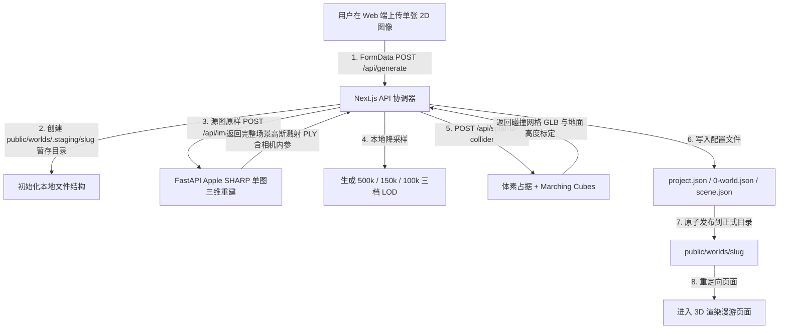

# Image2World 3D 场景生成管线开发报告与使用手册 (Development Report & User Manual)

本文件详细记录了 Image2World 在本次迭代中实现的端到端 3D 场景生成管线、前端拖拽上传与推理状态跟踪 UI、已修改的文件列表、底层代码架构，以及详细的用户使用与后续商业化规划。

---

## 1. 🏗️ 系统架构设计与数据流 (System Architecture & Data Flow)

本项目的核心目标是消除高昂的商业 API（如 Fal.ai、World Labs 等），通过**本地开源 GPU 算力**部署端到端生成管线，并将其完美集成至以 Next.js 15 为基础的 SaaS 前端平台中。

整个端到端生成管线的数据流与逻辑步骤如下：



> 家具等前景物体不再被单独抽取——它们作为真实几何被重建进场景本身。放弃前景道具路线的理由见 §3.7。

---

## 2. 📂 修改与新增的文件明细 (Modified & Added Files)

为了实现以上管线，我们对以下文件进行了修改或新增：

### A. 后端模型推理端 (`backend/`)
1. **`backend/server.py`** *(修改)*：
   * **掩码二进制序列化**：更新了 `/api/segment` 接口。此前后台虽然使用 SAM 2 生成了 PNG 掩码但未包含在 JSON 中返回。通过导入 `base64` 将生成的 PNG 二进制掩码序列化为 base64 字符串，随对象列表一同返回。
   * **新增 `/api/crop` 接口**：接收上传的原图和 SAM 2 掩码。计算掩码的极值边框，使用 Pillow 库以 `RGBA` 格式切出目标物体（背景透明），并裁剪为最小外接矩形以提升 TripoSR 几何计算的比例精度，最终以 PNG 流形式返回。
   * **CORS 中间件调整**：显式设定允许携带 credentials 并支持 Next.js 主机 (`http://localhost:3000`, `http://127.0.0.1:3000` 等) 跨域访问。

2. **`backend/test_pipeline.js`** *(新增)*：
   * 编写了一个纯 Node.js 的端到端测试工具。可从磁盘加载测试图片 `0-home.jpg`，提交给前端路由 `/api/generate`，模拟完整的生成任务以检测管线稳健性。

### B. 前端 Web 平台端 (`src/`)
1. **`src/app/api/generate/route.ts`** *(新增)*：
   * **核心 API 协调器**：负责与 Python 后端通信，实现前文所述的八大生成流程。
   * **刚体物理布局配置**：生成带有刚体物理碰撞属性 (`"physics": "rigidbody"`) 的 `scene.json`，在 `x` 轴上以 `1.5m` 间隔将前 5 个生成物体水平排列在摄像机前。
   * **超时时间延长**：配置 `export const maxDuration = 300`，使 Next.js API 路由能够容忍长达 5 分钟的同步推理执行。

2. **`src/components/WorldSidebar.tsx`** *(修改)*：
   * **上传界面集成**：在侧边栏顶部加入了极具设计感的“+ Create New World”卡片。
   * **添加玻璃微拟态模态框**：基于 Tailwind 编写了全覆式暗色微拟态模态框，包含文件拖拽区、自定义世界命名框、文件预览图。
   * **推理状态跟踪器**：当生成进行时，在模态框内锁定操作并渲染进度指示器与动态状态文本（如 *Segmenting foreground objects (SAM 2)...*, *Generating 3D object meshes (TripoSR)...* 等），提供流畅的生成等待反馈。
   * **引入相关 icon**：从 `@phosphor-icons/react` 引入了 `Plus`, `UploadSimple`, `X`, `Spinner` 图标。

3. **`src/app/globals.css`** *(修改)*：
   * 添加了 `@keyframes loading-progress` 与 `.animate-loading` 样式类，用于控制模态框内加载进度条以 8 秒的周期平滑循环动画。

4. **`src/utils/three-compat.ts`** *(修改)*：
   * 调整了实际 Three.js 模块的相对解析路径为 `../../node_modules/three/build/three.module.js`，避免 Webpack 构建打包边界限制，并消除了旧版 Three 导致的 alias 解析失败与警告。

---

## 3. 🚀 用户使用指南 (User Operations Guide)

### 3.1 环境准备
请确保您的计算机上已经安装了 CUDA (推荐 11.8 - 12.x)、Miniconda，以及 Node.js。

1. **激活 Conda 环境与依赖库**：
   确保使用了带有 PyTorch CUDA 的 Conda 环境：
   ```bash
   conda activate image2world
   ```
   * SAM 2 权重和 LaMa 权重在首次启动时会拉取或使用本地缓存；
   * TripoSR (约 1.6GB) 和 AudioLDM-S (约 196MB) 在接口首次被调用时会自动通过 Hugging Face Hub 下载并缓存。

### 3.2 启动项目
为测试并启动整个 Image2World 场景生成服务，请分别启动以下两个服务：

#### 第一步：启动 AI 推理后端 (FastAPI)
打开终端控制台，激活 Conda 后运行：
```bash
cd "D:\Tyndall Labs\image2world"
C:\Users\tingd\miniconda3\envs\image2world\python.exe backend/server.py
```
* **运行地址**：`http://localhost:8000`
* **Swagger 交互式文档**：默认关闭。用 `IMAGEWORLD_DOCS=true` 启动后可在 `http://localhost:8000/docs` 打开，进行 SAM 2, TripoSR, AudioLDM-S 及 LaMa 的单模块 live 测试。关掉是因为端点全部无鉴权，`/docs` 等于一份可调用清单。

#### 第二步：启动 Next.js 前端服务
打开另一个终端控制台，运行：
```bash
cd "D:\Tyndall Labs\image2world"
npm run dev
```
* **页面访问地址**：`http://localhost:3000`

---

### 3.3 在 Web 页面中使用生成管线
1. 打开浏览器访问 `http://localhost:3000`，页面将默认重定向至第一个场景 `/home-room`。
2. 在左侧的侧边栏顶部，点击 **Create New World** 按钮，会弹出生成模态框。
3. **输入参数**：
   * **World Name**：为您的世界取一个有意义的名字（如 *SciFi Laboratory*）。
   * **Source Image**：拖拽任意 JPEG/PNG 室内物体摆放图，或者点击上传框从文件浏览器选择。
4. 点击 **Generate World**。
5. 模态框将进入等待状态，页面会以动态文字实时更新后台模型的计算进度。
6. 生成完毕后（首次运行约需 1~3 分钟下载模型，后续生成只需 20~40 秒），模态框自动关闭，页面会自动跳转至类似 `http://localhost:3000/scifi-laboratory-xxxxxx` 的新路由，并将生成的刚体 3D 道具与环境完全渲染在画布中！

---

### 3.4 3D 画布交互与编辑
载入您自己生成的 3D 世界后，您可以：
* **FPS 漫游模式**：使用键盘 `W`/`A`/`S`/`D` 控制前后左右走动，`Space` 进行跳跃，鼠标控制旋转视角。
* **物理碰撞与音效**：系统会实时加载生成的 GLB 网格并绑定 Rapier 物理引擎刚体。当您在场景中走动碰倒、踢飞椅子、杯子或显示器时，会发出 AudioLDM 生成的专属真实物体碰撞撞击声效！
* **场景搭建与摆放编辑**：点击侧边栏右上角的 **Pencil (铅笔)** 编辑图标进入场景放置编辑器。您可以选中任意物体，通过平移/旋转轴进行空间重构，点击保存将最新的布局直接写入 `scene.json` 中。
* **重置场景**：在侧边栏中随时点击 **Reset** 图标将物理实体复位到初始位置。

---

## 3.5 🩺 稳定化与跑通验证日志 (2026-06-13)

本次迭代未新增功能，目标是「先稳一稳」：修复被掩盖的工具链缺陷并对现有管线做端到端冒烟验证。

### A. 工具链修复（构建/类型/Lint 全绿）

| 问题 | 根因 | 修复 |
| :--- | :--- | :--- |
| `eslint.config.mjs` 完全失效 | `eslint-config-next` 为旧版 eslintrc 风格，被当成 flat-config 数组直接展开（`nextVitals is not iterable`）；构建时仅静默警告，导致项目实际从未 lint | 改用官方 `FlatCompat` 桥接（Next 15 标准写法），并补 `backend/**` 忽略 |
| 8 个 TypeScript 错误 | `Buffer` 不满足 Web `Blob` 的 `BlobPart`（`SharedArrayBuffer` 不兼容）；`three-compat.ts` 直接 import 构建产物缺类型声明 | 6 处 `new Blob([buffer])` → `new Blob([new Uint8Array(buffer)])`；新增 `src/types/three-build.d.ts` 将该路径映射到官方 `three` 类型 |
| 9 个真实 Lint 错误（修复 config 后暴露） | `any`、`@ts-nocheck`/`@ts-ignore`、Node `require` 等 | 逐个修正：`any`→`unknown`/精确类型；`TransformControls` ref 改用最小事件接口；冗余 `@ts-ignore` 删除；R3F 视图层 `@ts-nocheck` 按既有 `ignoreBuildErrors` 立场在 lint 中放行 |
| 10 个 Lint 警告 | 未使用导入/变量、死代码、`` | 清理未使用项 + 移除 `ObjectHoverGuides` 重复死几何体；``（3 处动态/预览图）按设计保留 |

**结果**：`tsc --noEmit` 退出 0、`eslint .` 0 error、`next build` 成功产出。

### B. 端到端冒烟验证

- **后端**（`image2world` conda 环境）：服务启动正常，`device: cuda`，`GET /` 健康检查 200；`POST /api/segment` 对 `home-room` 原图实时跑通 SAM 2，检出 13 个物体（含 bbox/area/base64 掩码）。
- **前端**（`next dev`）：`/api/worlds` 正确返回 2 个世界（含历史 E2E 生成的 `test-e2e-world-kdgnxq`，5 物体 + 4 档 splat）；路由 `/`→307、`/home-room`→200、`/test-e2e-world-kdgnxq`→200、`/[slug]/edit`→200；`/api/scene-project` 返回合法 JSON；生成的 GLB 资产（3 MB）正常服务。
- **历史产物**：`test-e2e-world-kdgnxq` 包含真实 GLB 网格、SFX WAV、复制的 splat 环境，证明全管线曾完整跑通。

### C. 背景高斯溅射缺口已解决

生成管线已将 inpaint 产出的 clean plate（`0-world-plate.jpg`）发送到 Apple SHARP `/api/image-to-splat`，为每个世界生成独立的 `0-world-full_res.ply`。前端扫描器和 Spark renderer 可直接加载该 PLY；只有在 SHARP 未安装、权重不可用或推理失败时，才降级复制 `home-room` 静态环境，保证整条生成管线仍可完成。

### D. 交付加固（2026-07-31）

- **离线生产构建**：去除 `next/font/google` 的构建期网络依赖，改用本地系统字体栈；`next build` 可在无外网环境完成。
- **类型与质量门禁**：移除 `typescript.ignoreBuildErrors`，生产构建恢复 TypeScript 校验；图片统一使用 `next/image`，ESLint 零告警。
- **可靠发布**：生成任务写入 `public/worlds/.staging/<slug>`，全部完成后再原子移动到正式目录；失败任务自动清理，不再污染侧栏。
- **输入与依赖校验**：前后端都校验 PNG/JPG/WEBP 和 10 MB 上限；`GET /api/generate` 提供本地 AI 后端健康检查，地址可由 `IMAGEWORLD_BACKEND_URL` 配置。
- **创建体验**：弹窗提供后端就绪/离线状态、内联失败信息、Escape 关闭、可见焦点和小屏滚动；使用 portal 规避侧栏动画 transform 对固定定位的影响。

## 3.6 🧩 SAM 3 概念分割后端（可切换，2026-06-13）

在不破坏现有 SAM 2 路径的前提下，新增了 **SAM 3** 概念分割后端，用开关切换，便于 A/B 对比后再决定是否全切。

- **后端 `backend/server.py`**：将 `/api/segment` 重构为 `_segment_sam2` / `_segment_sam3` 双后端 + 调度。SAM 3 用 `build_sam3_image_model()` + `Sam3Processor`，对一份默认室内概念词表（`DEFAULT_INDOOR_CONCEPTS`，chair/monitor/lamp…）逐概念 `set_text_prompt`，按置信度过滤、从掩码反推 bbox（避免 box 格式歧义）、跨概念按 bbox IoU 去重，给每个物体附上**语义 `label`**。SAM 2 路径补 `label: null` 保持响应形状一致；响应新增 `segmenter_used`。
- **优雅降级**：请求 `sam3` 但未安装/无权重时，记录告警并回退 SAM 2，管线绝不硬失败（已实测：`segmenter=sam3` 未装 → `segmenter_used: sam2`，13 物体）。
- **前端 `src/app/api/generate/route.ts`**：`apiSegment` 透传 `IMAGEWORLD_SEGMENTER` 开关；返回的 `label` 贯通到**物体目录命名**（`chair-0`）、**object.json 显示名**与 **SFX 提示词**（"chair collision bump…" 而非 "object 0 …"）。
- **开关**：环境变量 `IMAGEWORLD_SEGMENTER=sam3`（默认 `sam2`）。安装与启用见 `backend/README.md` 的 Step 7 与「Segmentation Backend」节。
- **注意**：SAM 3 权重为 gated（`facebook/sam3`，需申请 + `huggingface-cli login`），且采用 Meta 自定义 SAM License（商用有限制），SaaS 化前需审阅条款。

#### ✅ 端到端验证（2026-06-13，实机跑通）

在 RTX 5060 Ti 16GB / torch 2.11.0+cu128 / numpy 2.2.6 上完成安装并验证：

- **分割实测**：`segmenter=sam3` 对 home 图返回 8 个**带语义标签**的物体——`bed`(0.93)、`backpack`(0.93)、`pillow`(0.91)、`chair`(0.87)、`desk`(0.87)、`cushion`(0.76)、`bag`×2。对比 SAM 2 的 13 个无名色块，更干净、可命名。
- **全管线实测**：`IMAGEWORLD_SEGMENTER=sam3` 下生成世界 `sam3-test-room-pk9iy1`，物体目录按标签命名（`bed-0`/`cushion-1`/`bag-2`/`backpack-3`/`pillow-4`），各含 GLB + SFX；SFX 提示词确认用了标签（`'bed collision bump impact sound effect, foley'`）；页面渲染 200，扫描器识别出 backpack/bag/bed/cushion/pillow。
- **安装踩坑记录**（已写入 README Step 7）：① `pip install -e . --no-deps` 保护 numpy 2.x/torch；② 补 `timm/ftfy/regex/iopath/pycocotools`；③ Windows 需 `triton-windows`（EDT kernel 硬依赖 triton）；④ 权重**直连 hf.co**下载，**勿用 hf-mirror 镜像**（不服务 gated 仓库，报 `LocalEntryNotFoundError`）。
- **代码侧已处理**：BPE 词表经 `sam3.__path__` 解析（规避 editable 安装 `__file__=None`）；推理包在 `torch.autocast(bfloat16)` + `inference_mode` 内（SAM 3 为 bf16，否则 dtype 不匹配）。

## 3.7 🎯 管线收敛为「纯场景重建」（2026-08-01）

### A. 为什么放弃前景物体实例

此前管线的核心假设是「背景 Splat + 可交互前景道具」：用 SAM 分割物体 → LaMa 把它们从图里擦掉 → TripoSR 逐个重建成可挪动的 GLB → AudioLDM 配碰撞音效。

实跑下来这条路不成立：

- **几何与原物差距过大。** TripoSR 从单张裁剪图猜测三维形状，产出的是 marching-cubes 网格 + 顶点色，没有 UV 贴图。与照片里的实物相比，识别度很低。
- **分割选中的往往不是道具。** SAM 2 自动分割取「面积最大的 5 个」，而画面里最大的区域是墙面、地板、门窗。实测 5 个「物体」中有一个高 2.48 m——房间层高才 2.6 m，那是一扇门。
- **代价高昂。** TripoSR 与 AudioLDM 占据了生成时间的绝大部分。

更关键的是**方向性的判断**：产品的价值在于「一个可漫游的三维情景」，而不是「情景里有几件能踢的家具」。

### B. 擦除前景其实在损害场景质量

一个反直觉但确凿的结论：既然目标是场景本身，那么 LaMa 擦除这一步是**净损失**——它把照片里真实的家具几何从场景中抹掉，再用 TripoSR 的猜测填回去。

现在源图**原样**送入 SHARP，家具作为真实重建的几何留在世界里，视觉质量显著高于此前的「空房间 + 猜测道具」。

### C. 结果

生成管线收敛为：`源图 → SHARP 重建 → LOD 分档 → 碰撞体提取 → scene.json`。

| | 改动前 | 改动后 |
| :--- | :--- | :--- |
| 端到端耗时（同一张图，RTX 5060 Ti） | 数分钟 | **43 秒** |
| 参与推理的模型 | SAM 2 / TripoSR / AudioLDM / LaMa / SHARP | **仅 SHARP** |
| 世界体积 | 119 MB | 105 MB |
| 家具几何 | 被擦除后由 TripoSR 猜测 | 真实重建 |

`scene.json` 的 `instances` 现在为空数组；摆放编辑器仍可手动从其他世界引入道具，这条路径未被破坏。

后端 `server.py` 中 `/api/segment`、`/api/crop`、`/api/image-to-3d`、`/api/generate-sfx`、`/api/inpaint`、`/api/place-objects` 等端点**予以保留**——它们均为延迟加载，不被调用就不占显存，日后若重拾物体方向可直接复用。前端不再有任何调用方，`/api/segment-point` 路由已删除。

### D. 过程中修正的既存缺陷

这三项在排查过程中被发现，均已修复并保留在后端：

- **TripoSR 输出 X-up 网格**，而 glTF/three.js 为 Y-up——此前所有道具在场景中其实是**躺倒**的，且 viewer 由包围盒推导落地面，躺倒的网格会连带陷进地板。判定方法：将网格沿各轴正交投影与裁剪图轮廓求 IoU，5 个物体一致指向 Y/X 平面（IoU 0.62–0.95，其余轴对仅 0.12–0.52）。已在导出前绕 Z 轴旋转 90° 修正。
- **LaMa 的 pad 从未裁回。** LaMa 将输入补齐到 8 的倍数后返回整块画布，683 px 高的源图产出 688 px 的结果，导致串行修补时掩码错位、以及与 SHARP `image_size` 的 5 px 偏差。已裁回输入尺寸。
- **串行修补改为单次并集修补。** 此前逐个物体调用 LaMa，每次都在上一次的生成结果上继续臆想。
---

## 3.8 🚶 出生点落在房间内（2026-08-01）

### 问题

角色的出生点长期硬编码为 `z = -0.5`。实测 `scene-only` 世界的碰撞体范围后发现：

```
房间几何 (viewer 空间)   X: -3.96 .. +2.76    Z: -12.82 .. -2.61
角色出生点                                     z = -0.50
```

**角色出生在房间外面 2.1 m 处**——背后是完全的虚空，一进场景就已经在边界之外。

这是单图重建的必然结果：SHARP 把相机放在拍照者的位置，而拍照的人通常站在被拍空间的**外面**（门口、房间一角之外）。原点因此天然位于几何之外。

### 修复

`/api/splat-to-collider` 增加返回 viewer 空间的 `bounds_viewer`；生成管线据此推算出生点——房间宽度居中，并从靠近相机的那条边**向内退 1.5 m**（浅房间则最多退到中点），写入 `scene.json` 的 `spawnPoint`。

前端 `CharacterController` / `FlyController` 接受该字段；旧世界没有此字段，回退到原有硬编码值，因此**向后兼容**。

### 验证

新生成的世界：`spawnPoint = [-0.60, -4.11]`，落在房间 X/Z 范围内 ✓。`/api/worlds` 确认新世界带该字段、两个旧世界为 `None` 并走回退路径。

> 📌 顺带澄清一处此前的误述：角色**不会掉出场景**。`GroundPlane` 提供 200×200 m 的固定碰撞体，另有 y=-10 的兜底网。真实现象是走出重建区域后进入「虚空」——脚下仍有无限地面，但四周没有任何几何。

---

## 3.9 🔬 两个负面结论（2026-08-02）

这一节记录**行不通的做法**，避免日后重复尝试。

### A. 过滤高斯无法消除条纹伪影

偏离原始拍摄视角后，桌面与地面会出现羽毛状条纹涂抹。原假设是「个别又大又细长的高斯」所致，遂删除同时满足「最长轴 > 5 cm 且各向异性 > 4」的高斯（占 3.66%）。

**结果：画面几乎无变化**，条纹丝毫未减，反而在删除处新增黑色噪点。

失败原因是假设本身就错了。实测各向异性中位数仅 2.88、p99 为 9.76，畸形高斯本就极少。真正的成因是：单视角重建为每个像素只分配**一个深度**，因此桌面上的键盘、纸张被重建成**贴合桌面、没有厚度的薄片**——从原始相机看它们是正确的（那本就是照片本身），从其他角度看便成了涂抹。它们的侧面与背面**从未被拍摄到**。

删除这些高斯只会留下空洞：数据本身没错，缺失的是被遮挡的那部分几何。**唯一解法是补全遮挡区域**（世界模型或多视角）。

### B. 场景边界围栏：有效，但不值得为过渡期保留

从出生点向 24 个方向扫描身体高度（0.25–1.7 m）的碰撞几何：

```
    0-105度   有墙，最近 0.3-1.5 m
  135-210度   *** 完全没有几何 ***     <- 相机背后
  240-300度   有墙，最近 1.2-1.5 m
```

**8/24 方向完全敞开**，且全部位于相机背后——单视角拍不到自己背后，故碰撞体不闭合（`is_watertight=False`）。这证实了「墙有碰撞就够了」在单视角重建下**不成立**。

据此实现了不可见围栏（`SceneBoundary`），几何验证通过（可走区域 7.2×10.7 m，跳不出、钻不过）。但随即**回滚**：世界模型生成 360° 场景后，背后的墙会被一并生成，碰撞体自然闭合，围栏即成冗余脚手架。不为一个下一步就会消失的缺口维护过渡机制。

> 提交记录：`98737e5`（实现）→ `d61bce3`（回滚）。出生点修复（`3a56f8b`）**未回滚**——无论几何如何产生，它都成立。

---

## 3.10 🌍 World Labs Marble 实测：世界模型解决了根本问题（2026-08-02）

### A. 一次生成的实测数据

通过 Marble API（`marble-1.1`）以纯文本提示生成一个「封闭办公套间」，与现有 SHARP 管线同口径对比：

| | SHARP（单视角重建） | **Marble（世界模型）** |
| :--- | :--- | :--- |
| 身体高度敞开方向 | **8/24**（全部位于相机背后） | **0/24 — 四周完全封闭** |
| 地面面积 | 68 m² | **211 m²**（约 3 倍） |
| 房间尺寸 | 6.7 × 2.6 × 10.2 m | 14.8 × 2.8 × 14.2 m |
| full_res 体积 | 63 MB（`.ply`，1.18M splats） | **27 MB**（`.spz`，约 2M splats） |
| 碰撞网格 | 60k 面（自行体素化提取） | **220k 面（官方直接提供）** |
| 全景图 | 无 | 提供（可作环境贴图） |
| 生成耗时 | 27–43 秒 | **477 秒**（约 8 分钟） |
| 单次成本 | 电费 | **1500 credits ≈ $1.20** |

封闭性用的是与 SHARP 完全相同的检测方法：把碰撞网格变换到 viewer 空间，从场景内部按 24 个方向扫描身体高度（0.25–1.7 m）的几何。**结果是 0 个敞开方向**——提示词里要求的「身后的走廊与玻璃门」确实被生成了出来。

这一次验证同时解决了此前记录的两个根本缺陷：走进虚空（§3.9-B）与遮挡处的条纹涂抹（§3.9-A）——两者本就是同一个根因「被遮挡区域没有数据」的两面。

### B. 输出格式与本项目原生兼容

Marble 返回的 JSON 结构与本项目 `output/world/0-world.json` 的 `WorldManifest` **完全一致**——`assets.mesh.collider_mesh_url`、`assets.imagery.pano_url`、`assets.splats.spz_urls`（`full_res`/`500k`/`150k`/`100k` 四档）、`semantics_metadata`。

这并非巧合：本项目的 viewer 移植自 `image-blaster`，而后者用的正是 Marble。

实测将资产按既有命名规则落盘后，**前端零改动**即完整识别（`/api/worlds` 返回四档 SPZ、碰撞体、全景图路径均正确）。Spark 渲染器原生支持 `.spz`。

### C. 两个必须注意的坐标参数

- **`metric_scale_factor = 2.0975`**（不是 1）。Marble 输出为归一化坐标，须乘以该系数才是米制。
- **`flip_y = true`**，与 SHARP 一致。判定依据：地面在 `y_local = +0.705`，代入 `y_world = gpo − msf · y_local` 得 `−0.017 ≈ 0`，吻合。

### D. 成本结构的意外结论

自部署未必更省。云 GPU 跑 Matrix-3D 约 $1–2/次（A800 上 720p 约一小时），**并不比 Marble 的 $1.20 便宜**，且质量未经验证。自部署的成本优势只存在于**本地 GPU** 这一种情形。

> ⚠️ API 无免费额度。网页版的 4 次免费与 API 是两套独立钱包。本次消耗后余额 3920 credits（尚可生成 2 次）。

---

## 3.11 🔑 双管线与用户自带 Key（BYOK，2026-08-02）

### A. 设计

生成弹窗新增一个**可选**的 Marble API Key 输入框，旁附 [platform.worldlabs.ai/api-keys](https://platform.worldlabs.ai/api-keys) 获取入口。管线据此自动选择：

| | 未填 Key | 填了 Key |
| :--- | :--- | :--- |
| 后端 | 本地 Apple SHARP | World Labs Marble |
| 成本 | 免费（本地 GPU） | 约 1500 credits ≈ $1.20，**计入用户自己的账户** |
| 耗时 | 16–43 秒 | 约 8 分钟 |
| 空间 | 只重建相机所见，**背后敞开** | **四周完全封闭** |
| 是否需要本地 GPU 后端 | 是 | **否**（纯云端） |

商业含义：**产品不承担 API 成本**。用户想要更好的效果就自带 key，否则用本地免费管线——无门槛先试用，满意再升级。

### B. Key 的安全处理

- 存于浏览器 `localStorage`，**服务端不落盘**
- 随每次生成请求传递，**仅置于 `WLT-Api-Key` 请求头**，绝不出现在 URL 中
- **不写入任何日志**（已通过代码审计核对）
- 输入框为 `type="password"`，`autoComplete="off"`

### C. 验证

- **无效 Key**：`{"code":"marble_error","message":"Marble rejected the API key. Check it on platform.worldlabs.ai.","retryable":false}` —— 401 被翻译为可读提示，且标记为不可重试（换 key 才有意义）。失败后暂存目录已清理，未产生费用。
- **未填 Key**：本地 SHARP 路径 16 秒完成，无回归。
- Marble 路径的产物落盘规则与既有扫描器一致，因此**前端零改动**即可渲染（详见 §3.10-B）。

> `maxDuration` 由 300 秒提升至 900 秒——Marble 单次生成常需 8 分钟以上。

### D. 端到端实测（图生世界，2026-08-02）

用真实 Key 通过 `/api/generate` 完整跑通**图生世界**——即产品的真实用例（用户上传照片，而非打字）：

| world | 敞开方向 | 地面 m² | 尺寸 (m) | splat 体积 | `msf` |
| :--- | :--- | :--- | :--- | :--- | :--- |
| SHARP（本地） | **8/24** | 69 | 6.7 × 2.6 × 10.2 | 63.0 MB | 1.00 |
| Marble 文本生成 | 0/24 | 211 | 14.8 × 2.8 × 14.2 | 27.0 MB | 2.10 |
| **Marble 图生世界** | **0/24** | 105 | 10.3 × 2.9 × 10.2 | 27.8 MB | **1.13** |

**图生世界同时满足了两个此前互斥的诉求**：既忠实还原原照片的房间（白色办公桌、带灯带的书架、圆桌与椅、窗外建筑、地毯纹理逐一对应），又四周完全封闭。且从房间内部观察时画面**锐利无条纹**——SHARP 一旦偏离原始视角就出现的羽毛状涂抹，在这里完全不存在，因为被遮挡区域的几何是真正被生成出来的，而非缺失。

面积 105 m² 介于 SHARP（69）与文本生成（211）之间：它需贴合原照片，不像文本生成可自由发挥。`msf = 1.13` 接近 1，说明输出尺度已近似真实米制。

耗时 **445 秒**，进度回调工作正常（中途上报 55%）。产物含源图留档、环境音、全景图，共 10 个文件。

> 💰 计费实测：生成前 3840 credits。除生成本身的 1500 外，**媒体上传另计 80 credits**——从 5420 到 3840 的差额即由此而来，估算成本时需计入。

---

## 3.12 🔒 后端并发保护（2026-08-02）

### A. 问题：同步推理阻塞了事件循环

`backend/server.py` 的所有端点都是 `async def`，但内部调用的 PyTorch 推理是**同步阻塞**的。后果被实测量化：

```
空闲时  GET /  ->  0.24 s
SHARP 推理期间  ->  9.04 s     ← 事件循环被占死
```

这不只是理论问题：前端的后端健康检查超时设为 **3 秒**（`src/app/api/generate/route.ts`），因此本地推理运行时打开创建弹窗，会显示「AI backend is unavailable」——一个用户可见的误报。

同时，模型均为单 GPU 上的惰性全局单例。当前之所以没有 OOM，只是因为阻塞带来的**意外串行**；一旦有人把某个端点改成同步 `def`（FastAPI 会将其放入线程池），立刻变成真并发争抢显存。

### B. 方案

```python
HEAVY_JOB_LOCK = asyncio.Semaphore(1)

async def run_heavy(fn, *args, **kwargs):
    """Run one blocking GPU/compute job off the event loop, serialised."""
    async with HEAVY_JOB_LOCK:
        return await asyncio.to_thread(fn, *args, **kwargs)
```

两件事一起做才有意义：`to_thread` 让事件循环保持响应，信号量保证重任务严格串行。只做前者会把意外串行变成真并发 OOM；只做后者仍然阻塞。

所有重端点（`segment`、`segment-point`、`inpaint`、`image-to-3d`、`generate-sfx`、`image-to-splat`、`place-objects`、`splat-to-collider`）均走 `run_heavy`；轻量的 `crop` 走不占锁的 `run_off_loop`。

`place-objects`（投影百万高斯）与 `splat-to-collider`（体素化 + Marching Cubes）虽不用 GPU，但同样会阻塞数十秒，因此一并纳入队列。

### C. 验证

| | 改动前 | 改动后 |
| :--- | :--- | :--- |
| 推理期间健康检查 | **9.04 s** | **0.21 s**（与空闲无异） |

三个并发 SHARP 请求：

```
req 1 finished at +11s
req 3 finished at +22s
req 2 finished at +33s      总耗时 33s = 3 × 11s
```

完美串行——各自 11 秒依次完成，全部成功产出 63 MB，服务器全程保持 0.24 s 响应。请求**排队而非争抢显存**。

---

## 3.13 🛡️ 本地开发工具的部署门禁（2026-08-02）

### A. 为什么这个问题现在才变要紧

`/api/open-world-folder` 与 `/api/open-claude-terminal` 会在**运行服务端的那台机器上启动进程**（文件管理器、终端）。笔记本上这是便利，一旦部署就是任何访问者都能触发的 RCE 面——其中 `target=root` 更是直接打开仓库根目录。

此前这只是理论风险，因为生成必须依赖本地 GPU，项目实际上部署不了。**BYOK 改变了这一点**：填了 Marble Key 就不需要本地 GPU，项目变得可部署，风险随之变成现实。

排查中还发现前端的 `canOpenLocalFolders` 被硬编码为 `false`——按钮从未显示过，但**API 路由一直开放**。这恰好印证了真正的暴露面在 API 层而非 UI。

### B. 方案

新增 `src/utils/localTools.ts`，前后端共用同一个表达式（`NEXT_PUBLIC_` 前缀使其在客户端与服务端都可读）：

```ts
export const LOCAL_TOOLS_ENABLED =
  process.env.NODE_ENV !== 'production' ||
  process.env.NEXT_PUBLIC_IMAGEWORLD_LOCAL_TOOLS === 'true'
```

开发环境默认启用；生产环境默认关闭，运营者可用 `NEXT_PUBLIC_IMAGEWORLD_LOCAL_TOOLS=true` 显式打开（用于在自己机器上跑生产构建）。禁用时返回 **404 而非 403**——关闭的端点不应暴露自己的存在。

顺带把 `canOpenLocalFolders` 接上该门禁，使这些按钮在开发环境下**真正可用**（此前恒为隐藏）。

### C. 验证

| 场景 | `/api/open-claude-terminal` |
| :--- | :--- |
| 生产构建，未设变量 | **404** |
| 生产构建，`NEXT_PUBLIC_IMAGEWORLD_LOCAL_TOOLS=true` | 501（"仅支持 macOS"，即门禁已放行） |
| 生产构建，`/api/worlds` | 200（正常路由不受影响） |

门禁表达式另经 5 组环境组合枚举验证，包含 `flag="1"` 这类**不应**放行的边界。

---

## 3.14 🧱 碰撞体表面分类：一个房间不该只有一套摩擦（2026-08-12）

### A. 问题

`build_collider.py` 已经在跑 `体素占据 → marching cubes → 连通分量过滤 → 简化`，
但产出是**一整块** mesh，前端挂成单个 `RigidBody colliders="trimesh"`。地板、墙面、
桌面共用 Rapier 的默认摩擦，直接后果是贴墙行走会被墙面摩擦拖住。

更可惜的是，分类需要的信息**早就算出来了又被丢掉**：

- `build_collider.py:154` 已经 `mesh.split()` 分出连通分量，过滤碎屑后立刻
  `concatenate` 合回去——分量身份就丢在这一行
- `detect_ground_offset` 已经在算面法线朝向 + 高度加权直方图，却只用来求了一个标量

### B. 方案

按"行走者会遇到什么"把面片分成 `floor` / `elevated` / `ramp` / `wall` / `ceiling`，
每类导出成独立 GLB 节点（trimesh 用 geometry key 作节点名，three 的 `GLTFLoader`
把它复制到 `Object3D.name`），前端为每类建独立 `RigidBody` 并给不同摩擦。

系数表在 `src/modules/collider/surfaces.ts`，判据与实测比例见 `backend/README.md`。

### C. 两个不显然的结论

**1. 分类阈值不能与地板检测共用。**

最初复用了 `detect_ground_offset` 的 `0.85`，结果 **36% 的面积落进 `ramp`**——这个类
等于没有判别力。原因是两者问的不是同一个问题：地板检测问"够不够平到能算地板"，
分类问"胶囊体能不能站住"，后者的答案是物理引擎通用的 ~45° 坡度极限。

拆成 `FLOOR_DETECT_NORMAL=0.85`（保持原行为不变）与 `WALKABLE_NORMAL=0.70` /
`VERTICAL_NORMAL=0.60` 后，三个世界上 `ramp` 一致降到 **8.6–10.5%**，且三者比例
高度接近，说明分类是稳定的而非噪声。

**2. `wall` 的 combine rule 比系数本身更重要。**

Rapier 默认把两个 collider 的摩擦**取平均**。0.02 的墙撞上角色胶囊（Rapier 默认
0.5）实际解算成 **0.26**，照样刮住玩家。必须用 `CoefficientCombineRule.Min` 才让低
系数真正生效——这一点已写进 `surfaces.test.ts` 的断言，防止日后被"优化"掉。

### D. 一个负面结论

试过用 `face_adjacency` 平滑法线后再分类，想抵消 marching cubes 的阶梯效应。
实测 `ramp` 从 35.9% **涨到** 36.5%——相邻阶梯面互相拉平，反而更糊。**不要重试。**

顺带修正了一个统计口径错误：最初按**面数**报告各类占比，得出"floor 只有 4%"。
按**面积**才是对的——quadric decimation 把平坦区域留成少量大三角形、把褶皱区域留成
大量小三角形，两种口径的结论正好相反。

### E. 验证

| 项目 | 结果 |
| :--- | :--- |
| 地板检测行为未变 | `ground_plane_offset = +1.299`，与重构前逐位一致 |
| 面数守恒 | 60,000 = 各类之和，无丢失、无重复归类 |
| GLB 节点名 | `floor` / `elevated` / `ramp` / `wall` / `ceiling` |
| 端到端契约 | three `GLTFLoader` 解析真实后端 GLB，5 类全部提取成功 |
| 后端测试 | `backend/test_collider.py` 8 项通过 |
| 前端测试 | 25 → **36** 项通过 |
| 体积代价 | GLB 1.00 → 1.44 MB（边界顶点复制） |

**尚未验证**：实际行走手感（贴墙是否真的不再卡顿）。in-app 浏览器面板隐藏时
`document.hidden = true`，R3F 不渲染、资产不加载，这一项需要人工在真实浏览器里走一遍。

**旧世界需要重跑 collider 才能用上分类**，否则前端检测到单个 `geometry_0` 节点后
退回原有的整体碰撞路径（行为与改动前完全一致）。

---

## 3.15 🪑 可推动道具：一个被实测否掉的前提（2026-08-12）

### A. 原设想与它的问题

设想是"一把椅子自成一个连通分量"，而 `build_collider.py:154` 已经 `mesh.split()`
分出了分量，只是又 `concatenate` 合了回去——看起来只要保留分量身份即可。

**三个世界的实测否掉了这个前提**：

| 世界 | 最大分量占比 | 尺寸 |
| :--- | ---: | :--- |
| sunlit-office | **97.1%** | 6.95×2.70×10.60 m（= 整个房间） |
| multiview-meetingroom | **90.3%** | 14.65×4.65×16.95 m |
| bounded | **98.3%** | 6.70×2.55×10.20 m |

站在地板上的东西在 0.05 m 体素分辨率下与地板**焊死**。剩下的小分量里尺寸像家具的
只有 2–3 个，其余是 Y 向厚度 0.05–0.15 m 的浮空碎片——做成 dynamic 刚体只会让场景
里飘着一堆会掉落的垃圾，比现状更糟。

### B. 改走的路

分割必须来自几何之外。两条选区路径，因为**任何一条单独都不够**：

- **SAM 2 点提示**：用户点一下，SAM 给出精确边界。自动，但会选错东西。
- **手动 box**：用户拖一个框。精确表达意图，也是 SAM 选错时的兜底。

两条都归结为"一组 gaussian 索引"，之后共用同一套 `体素 → marching cubes → 凸包`。
几何自始至终来自世界自己的重建，这是与 2026-08-01 砍掉的 TripoSR 路线的本质区别。

### C. 深度门控：两个都被测试钉住的坑

mask 覆盖的是**整条视线**，椅子背后的墙落在完全相同的像素里。

**1. 不能按峰高选择前景。** 墙在图像里总比物体大，gaussian 数常高一个量级。实测
500 点的物体对 9000 点的墙，按"最高峰的 20%"作阈值**直接跳过物体、选中了墙**。
改为切在"第一段空隙"——空隙的存在与两边体量无关。

**2. 空隙宽度必须用米，不能用 bin 数。** bin 宽随选区跨度变化：同样是"3 个空 bin"，
在跨米的场景里代表 15 cm，在单个表面上只有 6 mm——后者把一个高斯峰的尾巴切掉了。
现在要求空隙至少 0.1 m。

两个表面贴在一起时**不硬切**（保留整个选区），否则会把物体拦腰截断。

### D. 验证

| 项目 | 结果 |
| :--- | :--- |
| 后端测试 | `test_props.py` 15 项 + `test_collider.py` 8 项通过 |
| 真实数据 | sunlit-office 切出 3 个 prop：0.95×0.66×1.65 m / 68 kg、0.46×0.71×1.05 m / 21 kg、0.4×0.56×0.55 m / 12 kg |
| 扫描与配对 | GLB 节点名与 JSON id 完全配对，前端各建一个 dynamic 刚体 |
| 增量合并 | 追加与同 id 替换均正确 |
| 前端 | 36 项测试、lint、typecheck、生产构建全绿 |

### E. Web 端交互（2026-08-13 补完）

顶部一个 **Free an object** 开关，开启后点房间里任何东西即可切出来：

```
点击 → raycast(DROP_TARGET_LAYER) → worldToLocal → splat 空间
     → Next 路由（读 PLY + 源图 + 现有 props GLB）→ FastAPI → 写回 → 刷新
```

**坐标交接是最容易错也最难发现的一环。** collider 空间必须与 splat 空间严格一致，
靠的是 `WorldCollider` 与 `SplatRenderer` 施加同一组变换。两者一旦被改得不一致，
提取**仍会返回成功**，只是悄悄从错误的位置切下几何——没有任何报错。
`propExtractor.test.ts` 用 4 组变换（含翻转、缩放、非常规旋转）把这个不变量钉死。

Next 路由只搬字节不解析 GLB（合并在 Python 侧），并对 slug 做路径遍历防护。

端到端实测（后端 + dev server 全跑）：

| 场景 | 结果 |
| :--- | :--- |
| box 提取 | HTTP 200，2347 gaussians → 21.43 kg，与独立生成的 21.199 kg 一致（可复现） |
| 增量写回 | `prop-0/1/2` → 追加 `prop-3`，GLB 与 JSON 同步 |
| `slug=../../etc` | **404**，路径遍历被挡 |
| 同时给 point 和 box / 都不给 / 坐标非法 | 400 |

**尚未验证**：实际推动手感与点选命中率（同 §3.14，浏览器面板隐藏时
`document.hidden = true`，R3F 不渲染、资产不加载）。SAM 2 的 `point` 路径也只验证了
代码路径，未在真实点击下检验分割质量。

**未安装的依赖**：SAM 3（文本提示分割）、coacd / vhacdx（凸分解）。当前用 SAM 2
点提示 + 单凸包已足够；装上后可分别支持文本提示与凹形道具。

---

## 3.16 🎛️ Viewer UI 一轮（2026-08-13）

### A. 先核查，再动手——三项"缺口"其实不缺

动手前逐项核对了现状，原以为缺的东西大半已经存在：

| 原判断 | 实际情况 |
| :--- | :--- |
| 触控摇杆无可视化 | **已有**。`TouchControls.tsx` 会画出摇杆底盘与拨杆 |
| 首屏加载无进度 | **已有**。`ViewerLoadingOverlay` + `AssetStreamIndicator`，含进度条与文件名 |
| 画质切换只在快捷键 | **已在侧栏**（`WorldSidebar.tsx:522`），只是不在主 UI |

真正缺的只有两项，也就是这一轮做的两项。

### B. 上手提示（`ControlsHint`）

全仓库 grep 不到任何 `WASD` / hint / onboarding 字样——**第一次进入世界时，屏幕上
没有任何东西说明怎么走**。手机上尤其糟：摇杆是在你已经猜到"拖左半屏"之后才画出来的，
提示本身要靠猜。

现在世界就绪后显示一次，按 `(pointer: coarse)` 区分触屏与桌面给不同内容，9 秒后或
用户首次按键/点击即消失，`localStorage` 记住。存储被禁用时选择"照常显示、只是不记住"，
而不是抛错。

### C. 截图（`Screenshot.tsx`）

一个不显然的技术点：canvas 创建时**没有** `preserveDrawingBuffer`，所以在普通帧之后
读 `toDataURL` 只会得到**空白图**——绘制缓冲在呈现后即被清空。解法是在同一个同步块里
`gl.render()` 后立即读取，这样既拿得到像素，又不必为一个本就 GPU 吃紧的 splat 场景
在每一帧上支付那个标志的代价。

按钮放右上角而非塞进右下的源图面板：后者是 `hidden md:block` 的桌面专属，而截图恰恰
是手机最想要的。

### D. 验证状态

lint / typecheck / 45 项测试 / 生产构建全绿。

**但这一轮的 UI 一个都没有在真实浏览器里看过。** 它们全部挂在"世界就绪"之后，而
in-app 浏览器面板隐藏时 `document.hidden = true`、canvas 拿不到尺寸，页面连布局都
不发生，`viewerLoadState` 永远到不了 `ready`。实测确认 `kbd` 元素、截图按钮、
Free an object 按钮在该环境下均不出现——这是环境限制而非代码缺陷，但**外观、位置与
时机都需要人工过目**。

---

## 3.17 🗺️ 可行走区域：第一次把"走进虚空"量化（2026-08-13）

### A. 三道过滤，第三道才是重点

碰撞网格看起来是实心的地方，未必站得上去，更未必走得到。现在按三道过滤生成
`<n>-world-walkable.png`：能站（分类为 `floor`/`elevated`）、站得直（头顶 ≥ 1.6 m）、
**走得到**（从出生点洪水填充）。

第三道是这个功能存在的理由。单视角重建留下大量够得着却走不到的碎片，把它们画成可走
区域，等于**在最该警告"前面是虚空"的地方给出一张骗人的地图**。

| 世界 | 能站 | 走得到 | 不可达 |
| :--- | ---: | ---: | ---: |
| sunlit-office | 21.9 m² | 19.8 m² | 9.6% |
| **multiview-meetingroom** | 75.3 m² | 25.5 m² | **66.2%** |
| bounded | 21.3 m² | 20.1 m² | 5.7% |

多视图那个 66.2% 不是 bug——覆盖更广的同时也更碎。§3.9/§3.12 反复提到的"走进虚空"，
到这里第一次有了可量化的数字。

### B. 两个踩过的坑

**1. 不能用 `triangles_center` 网格化。** 一个三角形只落一个格子，而 quadric
decimation 恰恰把最平坦的区域留成少量大三角形——§3.14 的诊断数据早就写着"最平的 4%
面片承载 38% 面积"。地板是最平的，于是地板几乎整个被漏掉，端到端实测直接得出
**0 m²**。改为按面积采样（每格约 4 个采样点）。

这个坑值得记：**面片统计的口径问题在这个项目里已经出现两次**，§3.14 是按面数报告
占比、这里是按面片中心网格化，两次都被"平坦=大三角形"咬到。

**2. 可达面积不可能大于可站面积。** despeckle 用的 `binary_closing` 会填洞并向外
扩张，实测报出 **−13.8% 不可达**这种自相矛盾的数字。closing 仍需保留（让洪水填充跨过
噪声孔洞），但最终结果必须与原始网格取交集——洞不是能站的地方。

### C. 前端

`Minimap.tsx` 把灰度掩码重新着色：不可达处**透明**而非暗色，否则读起来像"暗一点的
地板"而不是"没有地板"，与整个功能的意图相反。玩家位姿走 ref +
`requestAnimationFrame`，而不是每帧 setState 重渲染整个 overlay。

### D. 验证

34 项后端测试 + 45 项前端测试 + lint + typecheck + 生产构建全绿；扫描器已能正确读出
`walkable` 资产。**minimap 的实际观感未经人工确认**（原因同 §3.14/§3.16）。

---

## 3.18 👁️ 终于看见了：Playwright 打通视觉验证（2026-08-13）

### A. 前两条路都不通，第三条通了

§3.14–3.17 反复写着"未经人工确认"，因为：

1. **in-app 浏览器面板**隐藏时 `document.hidden = true`，canvas 拿不到尺寸，R3F 不渲染、
   `.ply` 不请求，页面连布局都不发生
2. **用户的真实 Chrome** 完全访问不了 `localhost:3000`（`localhost` 与 `127.0.0.1` 均
   返回 error page，而同一个 server 在 in-app 面板里正常）——很可能是加速器/VPN 的代理
   把本地流量也拦了，而浏览器只能以 read tier 授权，改不了它的设置

**Playwright 自带 Chromium 绕开了两者**：软件 WebGL2（SwiftShader）能真渲染，
`document.hidden = false`，canvas 1440×900。代价是渲染 118 万 splat 太慢导致截图超时，
切到 Low 画质（100k LOD）即可。这条路以后应作为本项目视觉验证的默认手段。

### B. 抓到两个真 bug

**1. minimap 被源图缩略图完全遮住。** 我在代码注释里写着"放在源图面板左边"，实际却用了
`right-3`——两者同在右下角，而源图面板是 384×384 且在 DOM 中更靠后，把 99×144 的
minimap 整个盖住。实测 `overlapsSource: true`，裁图里只看得到那张办公室照片。
已移到左下角，不再依赖源图面板的尺寸。

**2. 玩家标记飞出屏幕。** 实测 `top: 120.625%`、`y=903`（视口只有 900）。原因是玩家在
可行走区域之外——而这恰恰是**单视角世界的开场常态**：相机被放在拍照位置，也就是房间
外面。现在 clamp 到边缘并降到 45% 不透明度，读作"你在图外，往这个方向"。

### C. 一个看起来像 bug、其实不是的

点击"Free an object"后点屏幕正中央，**不发任何请求**。逐层排查后场景图完全正常
（5 个 dropTarget clone 都在 `mask=4`），`hitsAllLayers` 也是 0——与图层无关。

真相是几何：相机在 `[0, 1.6, -0.5]` 朝 `[0, 0, -1]`，**屏幕正中心那条射线是严格水平的**，
与水平地板永不相交，而那个高度的正前方恰好没有碰撞面。扫一遍屏幕纵向就很清楚：

| 屏幕位置（NDC y） | 命中数 | 首个 |
| :--- | ---: | :--- |
| +0.5（上看） | 1 | ceiling |
| **0（正中心）** | **0** | — |
| −0.3 | 4 | wall |
| −0.6 | 2 | ramp |

我最初的测试点恰好选中了唯一打不中的位置。点屏幕下方立刻发出了
`POST /api/extract-prop`，整条链路是通的。

但这暴露了真实的 UX 问题：**正前方水平方向经常没有碰撞几何**（§3.9 记过"8/24 方向
没有身体高度的几何"），所以点空是常态而非异常。已补上明确反馈，不再静默失败。

### D. 顺带确认为真的

- 上手提示按时出现又按时消失（9 秒）。之前查不到它，是因为我等了 25 秒——逻辑没错，
  是检查时机错了
- props 真的渲染成 dynamic 刚体：场景图里 `prop-0/1/2` 齐备
- minimap 掩码正确着色，26.4% 像素不透明，与 19.8 m² 可走 / 74 m² 房间投影吻合
- 五类碰撞面各自成为独立 mesh，与 §3.14 的设计一致

---

## 3.19 🔒 信任边界：守卫必须放在真正占 GPU 的那一端（2026-08-14）

### A. 问题：`/api/*` 从来没有任何来源校验

Next 自带的跨站保护只覆盖 `/_next` 与 `/__nextjs`，**`/api/*` 不在其中**。而
`multipart/form-data` 与 `text/plain` 都是 CORS **简单请求**——浏览器不预检直接发出，
`Request.json()` 也不校验 Content-Type。攻击者读不到响应，但**副作用已经发生**：

| 一个第三方页面能做的 | 后果 |
| :--- | :--- |
| `POST /api/scene-project` 发 `{"version":1,"instances":[]}` | 清空摆好的场景与标定过的 spawnPoint |
| `POST /api/generate` / `extract-prop` | 占住 16 GB 单卡 |
| `` | 在宿主机上起终端（`` 就够，不需要 JS） |

### B. 方案：自定义头 + 后端 Origin 中间件

前端每个写请求带 `x-imageworld-app: 1`。**真正起作用的是「自定义头」这件事本身**——
跨源 fetch 一旦带自定义头就不再是简单请求，必须先过预检，而这些路由不返回任何
`Access-Control-Allow-*`，预检失败，真实请求根本发不出去。`Sec-Fetch-Site` 只是快路径：
它在旧浏览器、非浏览器客户端、以及 `http://192.168.x.x` 这类非安全上下文下**根本不发**，
所以只能用来拒绝、不能用来放行——判据是「两个都要成立」而非「任一」。

> ⚠️ 给任何一条路由加 CORS 响应头，或在 `next.config.ts` 加全局 `headers()`，这道锁当场失效。

### C. 一个只做前端会漏掉的洞

**审查发现原方案挡不住真正要挡的东西**：视频重建流程里浏览器是**直连
`localhost:8000`** 的（`CreateWorldModal.tsx`），所以 Next 层的守卫对 FastAPI 那一侧
毫无作用——而 GPU 恰恰在那一侧。CORS 白名单只决定能不能**读**响应，不阻止请求抵达。

后端补 `reject_cross_origin_writes` 中间件：非 GET 请求若带 `Origin` 且不在白名单内，
直接 403；**`Origin` 缺失则放行**——那是 curl、Next 服务端 fetch、pytest，而能在本机起进程
的人本来就能直接读写 `public/worlds/`。

### D. 一并收紧的四项

* `uvicorn` 由 `0.0.0.0` 改为 `IMAGEWORLD_BIND_HOST`（默认 `127.0.0.1`）
* `/docs` 与 `/openapi.json` 默认关闭（`IMAGEWORLD_DOCS=true` 打开）——端点全部无鉴权，
  `/docs` 等于一份可调用清单
* 上传按请求计额度（默认 1 GiB）。**注意这个上限只约束常驻内存**：Starlette 在 handler
  被调用**之前**就已把 multipart 落盘，所以 413 是写完之后才返回的
* 服务端门禁改读**不带前缀**的 `IMAGEWORLD_LOCAL_TOOLS`。Next 在构建期把 `NEXT_PUBLIC_*`
  内联进**服务端** bundle，旧写法在构建机上一旦设了该变量就被烤成常量 `true`，运行时再也
  关不掉。前缀版本降级为只控制按钮显隐（`LOCAL_TOOLS_VISIBLE`）

### E. 验证

| 场景 | 结果 |
| :--- | :--- |
| 跨站 `POST /api/scene-project`（text/plain） | **403** |
| 跨站 `GET /api/open-world-folder?target=root` | **404**，不弹窗 |
| 跨站 `POST :8000/api/reconstruction-jobs` | **403** |
| 白名单来源 / 无 Origin 的服务端调用 | 正常通过 |
| 伪造头 + `sec-fetch-site: cross-site` | **403** |
| 超额上传 | **413** |

`sameOrigin.test.ts` 6 项钉住守卫语义（含「同源但无头」「有头但 cross-site」两个方向）。

### F. 顺手清掉的

`.env.local` 里的 `WORLDLABS_API_KEY` **全仓库零引用**——BYOK 的 key 走浏览器
localStorage + multipart 字段，服务端从不读环境变量。一个没有任何功能依赖的实时计费凭据
留在工作区，只靠一行 gitignore 挡着。已删除并需吊销。同时删掉导出但零调用的
`fetchMarbleCredits`（一处会拿 key 发外网请求的入口）。

---

## 3.20 📏 单位：一次差点推过头的修正（2026-08-14）

### A. 问题

`metric_scale_factor` 把重建单位换算成米。**8 个世界里有 5 个不等于 1**
（demo-office 1.131、marble-office 2.098、family-splatfacto **3.659**）。而
`build_walkable.py` 的 `CELL_SIZE = 0.15` 与 `CHARACTER_HEIGHT = 1.6`、
`build_props.py` 的 `density = 250 kg/m³`，全部作用在**未缩放**的几何上。

在 3.659 的世界上：净空门限实际要求 **5.9 m**（几乎整张图判为不可走）、
网格 cell 实际 **0.55 m**、上报面积差 **13.4 倍**、道具质量差 **49 倍**（体积是三次方）。

**目前磁盘上还没错过**——唯一有 walkable 图的世界恰好是 scale=1。这是个潜伏问题，
但 `demo-office` 自己就是 1.131，随手跑一次就会发作。

### B. 一个被真实数据否掉的方案

第一版把**点云**整体缩放，让文件里每个常量都名副其实。在 3.659 的真实世界上实测：

```
distance cull: 317,840 / 621,380 points     ← 15 m 在 24 m 跨度的场景上砍掉一半
surfaces: floor 1%                          ← 分类明显不对
ground_plane_offset: +7.653（磁盘上是 +2.256）
```

原因：缩放点云会**连带改变 `--voxel-size` 与 `--max-distance` 的含义**，也就改变了
碰撞网格本身。`ground_plane_offset` 在磁盘上的既定约定是**世界单位**
（`finalize/route.ts` 拿到后自己乘 scale），推翻它会波及视频重建整条链路。

**改法收窄**：碰撞体构建、地板检测、表面分类、GLB 导出**全部保持世界单位不变**；
只有「以米为单位上报」的量才换算——walkable 网格和道具质量。

### C. 落地

* `build_collider.py` 新增 `read_metric_scale()`：scene.json 优先于 manifest，与 viewer 同序
* 只给 `build_walkable_map` 传一份 `mesh.copy().apply_scale(scale)`；`spawnPoint` 本来就是
  viewer 空间坐标，至此与网格同空间（此前是拿米制 spawn 去查未缩放的网格）
* `<n>-world-walkable.json` 新增 `metric_scale_factor`。`Minimap` 按
  `x * builtScale / liveScale` 定位——缺字段的旧文件按 1 回退，与原先的「除以 scale」逐位等价
* `prop_descriptor(metric_scale=)` 只换算质量；`centre` / `bounds` 仍是世界单位（它们与 GLB
  一起被 viewer 缩放，换算会导致重复缩放）
* `room size` 的打印不再谎称 "m"

`test_metric_scale.py` 14 项：scale 来源优先级、非法值（0 / 负 / 字符串 / NaN）不落进除法、
质量的三次方关系、`centre`/`bounds` 不动、掩码记录 scale、净空按米判定。

### D. 顺带：坐标变换的单一真源

`WorldCollider` 与 `SplatRenderer` 此前各自手写同一组变换，`propExtractor.test.ts` 里还有
**第三份拷贝**——那个自称"把两侧钉在一起"的测试，实际在测它自己（把 SplatRenderer 的
`groundPlaneOffset` 改成负号，9 个用例照样全绿）。

现在两者 **spread 同一个 `worldTransform()` 的返回值**，两个组件不可能再算出不同的数。
测试改为 import 真实模块，删掉 4 个「对任何可逆变换恒真」的往返用例，换成钉住真正的契约：
**`groundPlaneOffset` 不参与缩放**（`finalize/route.ts:240` 依赖这一点）。

Playwright + SwiftShader 实拍确认 demo-office 位置、朝向、比例均正确，零控制台错误。

---

## 3.21 🔌 接线：功能存在 ≠ 用户能用到（2026-08-14）

### A. minimap 此前只有跑过命令行的世界才有

`build_walkable_map` 的**唯一调用点**在 `build_collider.py` 的 `main()` 里。
`/api/splat-to-collider` 从不产出它——也就是说**浏览器里生成的每一个世界都没有 minimap**，
只有手动跑过 CLI 的那一个有。而 `generate/route.ts` 的进度文案早就写着
"Deriving walkable surfaces from the point cloud"，roadmap 也已经标成 `[x]`。

### B. 为什么不能塞进碰撞体那一趟

视频重建世界的 `metricScaleFactor` 是**从碰撞体的地板高度反推出来的**
（`finalize/route.ts`：`calibratedScale = requestedCameraHeight / (cameraY + rawGroundPlaneOffset)`）。
而网格的门限是米制。**在碰撞体这一趟里，网格该用的 scale 还不存在。**

所以新增独立端点 `/api/walkable`，吃的是**已建好的碰撞体 GLB** 而不是点云：

* 小一百倍，且**表面分类已经在文件里**（`build_collider` 就是按类写节点的），不必重新体素化
* 可以在碰撞体之后调用——这是视频重建唯一可行的顺序

`collider_groups()` 从 GLB 的具名节点重建 (mesh, 面分组)。**用真实世界验证过往返**：
sunlit-office 的 GLB 反推后 cols/rows/cell_size 与磁盘上的**完全一致**，面积差 2%
（`sample_surface` 是无固定种子的随机采样，本身就有这个抖动）。

### C. 降级是设计的一部分

老世界的碰撞体是单个 `geometry_0`，没有分类，无从知道哪些面是地板——端点返回 **422**，
调用方记一条 warning 继续。实测 demo-office / bounded / multiview-meetingroom 三个老世界
都走这条路。它们要 minimap 需重跑一次 collider（与 §3.14 的表面分类是同一个前提）。

### D. 点选抠图会打中那块 200 m 的隐形板

`GroundPlane` 有一块 200×200、`colorWrite=false` 的 plane 在 `DROP_TARGET_LAYER` 上
（给摆放编辑器的"落到地面"用，那边有 `isSelectedObject` 过滤，`PropExtractor` 没有）。后果两条：

1. 地板附近点击时两者都在 y≈0，谁更近取决于亚厘米差异；命中 plane 时局部坐标第三分量恒为 0，
   后端 `depth > 1e-6` 判否 → 400 → 前端显示成一句看不懂的 502
2. 这块板 200 m 见方，**任何朝下的落空点击都会命中它**，§3.18 刚补的"点空反馈"在水平线以下
   几乎永远不触发

改法是给身份而不是给层级：`dropTargets.ts` 出 `markColliderDropTarget` /
`isColliderDropTarget`，`WorldCollider` 构造 drop-target 副本时打标，`PropExtractor` 取
**最近的房间命中**而不是最近的任意命中。

### E. 没有做的一件事，以及为什么

**抠出来的 prop 仍然留在静态碰撞体和 splat 云里**，所以 dynamic 凸包与包含同一把椅子表面的
fixed trimesh 用逐字段相同的 transform 精确重叠——生成瞬间被穿透恢复冲量弹飞，推的时候顶着
自己的表面走，视觉上还多一块灰壳。

**这个不能靠互斥 collisionGroups 止血**：房间碰撞体里含 `floor`/`elevated` 节点，互斥之后
道具不再与地板碰撞，只剩 `GroundPlane` 那块 y≈0 平板兜着，会穿墙穿台面——比现状更糟。

正确解是后端把选区索引一并交出来，`build_collider` 支持 `exclude` 并在抠完重跑一次碰撞体，
splat 端把这些 gaussian 的 opacity 置零。这是数天的工作量，且抠一次就要重跑一次体素化，
需要自己的进度反馈。**按审计结论，这条应回退到分支做，不以当前状态进 main。**

### F. 验证

79 项后端测试 + 50 项前端测试 + lint + typecheck 全绿；Playwright 实拍 demo-office 与改动前
逐像素一致、零控制台错误。

---

## 3.22 📦 交付体积：本地世界一直在发未压缩的点云（2026-08-19）

### A. 问题

Marble 的世界是 `.spz`，本地生成的世界是 `.ply`——同一个 viewer，两种体积。

`public/worlds/room1-cbti0t/output/world/0-world-100k.ply` 是 5,600,753 字节，
除以 100k splat 正好 **56 B/splat**，即 14 个 float32（xyz + f_dc×3 + opacity +
scale×3 + rot×4），一个都没量化。Marble 同档位的 `.spz` 是 1.12 MB。

High 画质走 `full_res`，于是首屏要下 47–203 MB。磁盘上 902 MB 的世界里，
784 MB 是可压缩的 PLY。

### B. 方案

Spark 自己就带编码器：`@sparkjsdev/spark` 导出 `transcodeSpz`，`SplatMesh`
两种格式都能读。所以这不是换格式，只是换字节数——viewer 侧一行没改。

新增 `src/utils/spz.ts`，接在两条管线生成 LOD 的同一处
（`api/generate/route.ts`、`api/video-reconstruction/finalize/route.ts`），
另有 `npm run assets:spz` 回填已有世界。

**`full_res.ply` 保留，LOD 的 PLY 删掉。** 前者是无损原件，`/api/extract-prop`
在运行时从它身上抠道具，`npm run assets:lod` 也从它重建 LOD；后者在 `.spz`
写出之后就没有任何读者了——碰撞体是在同一趟管线里、更早的时候读 `500k.ply` 的。

`worldsScanner` 原本用「目录列举里最后一个」决定同一档位取 `.ply` 还是 `.spz`，
两者并存时结果不确定。改成显式优先 `.spz`。这顺带给了一条退路：删掉某个世界的
`.spz`，扫描器自动退回它的 `.ply`。

### C. 实测

回填 20 个文件，**784 MB PLY → 138 MB SPZ**：

| 世界 | full_res PLY | full_res SPZ | 比例 |
|---|---|---|---|
| singleview-meetingroom | 47.4 MB | 11.6 MB | 4.1x |
| multiview-meetingroom | 56.8 MB | 15.4 MB | 3.7x |
| room1-cbti0t | 66.1 MB | 16.0 MB | 4.1x |
| family-splatfacto-integration | 203.5 MB | 18.8 MB | **10.8x** |

Splatfacto 那个是 10.8x，因为它的 PLY 每个 splat 存了 45 个 float32 的球谐系数
和 3 个从来没人读的法线。**球谐没有被丢掉**——回读确认 `shDegree=3` 完整保留。

### D. 一次测错，以及测对之后的结论

只看头 5 个 splat 什么也证明不了，所以做了全量比对：把两边都过一遍 Spark 自己的
`setPackedSplat`——也就是真正送进 GPU 的那 4 个 uint32——逐字比较。

**第一次做错了。** 我把词 3 当成 rgba，据此得出「Splatfacto 世界 4.7% 的 splat
颜色偏差最大 25/255」。词 3 根本不是颜色：把其余字段全部固定、只动 rgb，词 3 纹丝不动
（恒为 `ff000000`）。**rgba 在词 0**——`cc998066` 正好对应 opacity 0.8 / b 0.6 /
g 0.5 / r 0.4。

排查过程里还顺手证伪了一个假设：怀疑是球谐导致的，于是用 `maxSh: 0` 重编一遍完全丢掉
SH——偏差数字一模一样（4.662%，max 25/255）。这本该是「读错字段」的信号，当时没读出来。

读对词 0 之后，两条管线的结论一致：

| | rgb 每通道 | alpha | 位置 |
|---|---|---|---|
| room1（SHARP，1,179,648 splat） | 最大 1/255，>1 的占 0.000% | 最大 1/255 | 最大 1.22e-4 |
| family（Splatfacto，820,363 splat） | 最大 1/255，>1 的占 0.000% | 最大 0/255 | 最大 1.22e-4 |

**两条管线都是等价的**，位置误差 0.12 mm。

几何字有 74% 的 splat 不逐位相同，但那是量化本身，不是精度问题——逐字节比多字节字段
本来就没意义（16 位定点数低位 +1，低字节就从 255 翻到 0）。几何该看字段级：位置
1.22e-4；log-scale 在 room1 最大 1.23e-2，在 family 有 25 个 splat（0.003%）超过 0.05。

教训写在这里而不是删掉：**逐字比较打包缓冲区之前，先确认哪个字装的是什么**——
拿一个 splat，固定其余字段只动一个，看哪个字变。十行代码，省掉一个错误结论。

### E. 验证

| 项目 | 结果 |
| :--- | :--- |
| 地板检测行为未变 | `ground_plane_offset = +1.299`，与重构前逐位一致 |
| 面数守恒 | 60,000 = 各类之和，无丢失、无重复归类 |
| GLB 节点名 | `floor` / `elevated` / `ramp` / `wall` / `ceiling` |
| 端到端契约 | three `GLTFLoader` 解析真实后端 GLB，5 类全部提取成功 |
| 后端测试 | `backend/test_collider.py` 8 项通过 |
| 前端测试 | 25 → **36** 项通过 |
| 体积代价 | GLB 1.00 → 1.44 MB（边界顶点复制） |

**尚未验证**：实际行走手感（贴墙是否真的不再卡顿）。in-app 浏览器面板隐藏时
`document.hidden = true`，R3F 不渲染、资产不加载，这一项需要人工在真实浏览器里走一遍。

**旧世界需要重跑 collider 才能用上分类**，否则前端检测到单个 `geometry_0` 节点后
退回原有的整体碰撞路径（行为与改动前完全一致）。

---

## 3.15 🪑 可推动道具：一个被实测否掉的前提（2026-08-12）

### A. 原设想与它的问题

设想是"一把椅子自成一个连通分量"，而 `build_collider.py:154` 已经 `mesh.split()`
分出了分量，只是又 `concatenate` 合了回去——看起来只要保留分量身份即可。

**三个世界的实测否掉了这个前提**：

| 世界 | 最大分量占比 | 尺寸 |
| :--- | ---: | :--- |
| sunlit-office | **97.1%** | 6.95×2.70×10.60 m（= 整个房间） |
| multiview-meetingroom | **90.3%** | 14.65×4.65×16.95 m |
| bounded | **98.3%** | 6.70×2.55×10.20 m |

站在地板上的东西在 0.05 m 体素分辨率下与地板**焊死**。剩下的小分量里尺寸像家具的
只有 2–3 个，其余是 Y 向厚度 0.05–0.15 m 的浮空碎片——做成 dynamic 刚体只会让场景
里飘着一堆会掉落的垃圾，比现状更糟。

### B. 改走的路

分割必须来自几何之外。两条选区路径，因为**任何一条单独都不够**：

- **SAM 2 点提示**：用户点一下，SAM 给出精确边界。自动，但会选错东西。
- **手动 box**：用户拖一个框。精确表达意图，也是 SAM 选错时的兜底。

两条都归结为"一组 gaussian 索引"，之后共用同一套 `体素 → marching cubes → 凸包`。
几何自始至终来自世界自己的重建，这是与 2026-08-01 砍掉的 TripoSR 路线的本质区别。

### C. 深度门控：两个都被测试钉住的坑

mask 覆盖的是**整条视线**，椅子背后的墙落在完全相同的像素里。

**1. 不能按峰高选择前景。** 墙在图像里总比物体大，gaussian 数常高一个量级。实测
500 点的物体对 9000 点的墙，按"最高峰的 20%"作阈值**直接跳过物体、选中了墙**。
改为切在"第一段空隙"——空隙的存在与两边体量无关。

**2. 空隙宽度必须用米，不能用 bin 数。** bin 宽随选区跨度变化：同样是"3 个空 bin"，
在跨米的场景里代表 15 cm，在单个表面上只有 6 mm——后者把一个高斯峰的尾巴切掉了。
现在要求空隙至少 0.1 m。

两个表面贴在一起时**不硬切**（保留整个选区），否则会把物体拦腰截断。

### D. 验证

| 项目 | 结果 |
| :--- | :--- |
| 后端测试 | `test_props.py` 15 项 + `test_collider.py` 8 项通过 |
| 真实数据 | sunlit-office 切出 3 个 prop：0.95×0.66×1.65 m / 68 kg、0.46×0.71×1.05 m / 21 kg、0.4×0.56×0.55 m / 12 kg |
| 扫描与配对 | GLB 节点名与 JSON id 完全配对，前端各建一个 dynamic 刚体 |
| 增量合并 | 追加与同 id 替换均正确 |
| 前端 | 36 项测试、lint、typecheck、生产构建全绿 |

### E. Web 端交互（2026-08-13 补完）

顶部一个 **Free an object** 开关，开启后点房间里任何东西即可切出来：

```
点击 → raycast(DROP_TARGET_LAYER) → worldToLocal → splat 空间
     → Next 路由（读 PLY + 源图 + 现有 props GLB）→ FastAPI → 写回 → 刷新
```

**坐标交接是最容易错也最难发现的一环。** collider 空间必须与 splat 空间严格一致，
靠的是 `WorldCollider` 与 `SplatRenderer` 施加同一组变换。两者一旦被改得不一致，
提取**仍会返回成功**，只是悄悄从错误的位置切下几何——没有任何报错。
`propExtractor.test.ts` 用 4 组变换（含翻转、缩放、非常规旋转）把这个不变量钉死。

Next 路由只搬字节不解析 GLB（合并在 Python 侧），并对 slug 做路径遍历防护。

端到端实测（后端 + dev server 全跑）：

| 场景 | 结果 |
| :--- | :--- |
| box 提取 | HTTP 200，2347 gaussians → 21.43 kg，与独立生成的 21.199 kg 一致（可复现） |
| 增量写回 | `prop-0/1/2` → 追加 `prop-3`，GLB 与 JSON 同步 |
| `slug=../../etc` | **404**，路径遍历被挡 |
| 同时给 point 和 box / 都不给 / 坐标非法 | 400 |

**尚未验证**：实际推动手感与点选命中率（同 §3.14，浏览器面板隐藏时
`document.hidden = true`，R3F 不渲染、资产不加载）。SAM 2 的 `point` 路径也只验证了
代码路径，未在真实点击下检验分割质量。

**未安装的依赖**：SAM 3（文本提示分割）、coacd / vhacdx（凸分解）。当前用 SAM 2
点提示 + 单凸包已足够；装上后可分别支持文本提示与凹形道具。

---

## 3.16 🎛️ Viewer UI 一轮（2026-08-13）

### A. 先核查，再动手——三项"缺口"其实不缺

动手前逐项核对了现状，原以为缺的东西大半已经存在：

| 原判断 | 实际情况 |
| :--- | :--- |
| 触控摇杆无可视化 | **已有**。`TouchControls.tsx` 会画出摇杆底盘与拨杆 |
| 首屏加载无进度 | **已有**。`ViewerLoadingOverlay` + `AssetStreamIndicator`，含进度条与文件名 |
| 画质切换只在快捷键 | **已在侧栏**（`WorldSidebar.tsx:522`），只是不在主 UI |

真正缺的只有两项，也就是这一轮做的两项。

### B. 上手提示（`ControlsHint`）

全仓库 grep 不到任何 `WASD` / hint / onboarding 字样——**第一次进入世界时，屏幕上
没有任何东西说明怎么走**。手机上尤其糟：摇杆是在你已经猜到"拖左半屏"之后才画出来的，
提示本身要靠猜。

现在世界就绪后显示一次，按 `(pointer: coarse)` 区分触屏与桌面给不同内容，9 秒后或
用户首次按键/点击即消失，`localStorage` 记住。存储被禁用时选择"照常显示、只是不记住"，
而不是抛错。

### C. 截图（`Screenshot.tsx`）

一个不显然的技术点：canvas 创建时**没有** `preserveDrawingBuffer`，所以在普通帧之后
读 `toDataURL` 只会得到**空白图**——绘制缓冲在呈现后即被清空。解法是在同一个同步块里
`gl.render()` 后立即读取，这样既拿得到像素，又不必为一个本就 GPU 吃紧的 splat 场景
在每一帧上支付那个标志的代价。

按钮放右上角而非塞进右下的源图面板：后者是 `hidden md:block` 的桌面专属，而截图恰恰
是手机最想要的。

### D. 验证状态

lint / typecheck / 45 项测试 / 生产构建全绿。

**但这一轮的 UI 一个都没有在真实浏览器里看过。** 它们全部挂在"世界就绪"之后，而
in-app 浏览器面板隐藏时 `document.hidden = true`、canvas 拿不到尺寸，页面连布局都
不发生，`viewerLoadState` 永远到不了 `ready`。实测确认 `kbd` 元素、截图按钮、
Free an object 按钮在该环境下均不出现——这是环境限制而非代码缺陷，但**外观、位置与
时机都需要人工过目**。

---

## 3.17 🗺️ 可行走区域：第一次把"走进虚空"量化（2026-08-13）

### A. 三道过滤，第三道才是重点

碰撞网格看起来是实心的地方，未必站得上去，更未必走得到。现在按三道过滤生成
`<n>-world-walkable.png`：能站（分类为 `floor`/`elevated`）、站得直（头顶 ≥ 1.6 m）、
**走得到**（从出生点洪水填充）。

第三道是这个功能存在的理由。单视角重建留下大量够得着却走不到的碎片，把它们画成可走
区域，等于**在最该警告"前面是虚空"的地方给出一张骗人的地图**。

| 世界 | 能站 | 走得到 | 不可达 |
| :--- | ---: | ---: | ---: |
| sunlit-office | 21.9 m² | 19.8 m² | 9.6% |
| **multiview-meetingroom** | 75.3 m² | 25.5 m² | **66.2%** |
| bounded | 21.3 m² | 20.1 m² | 5.7% |

多视图那个 66.2% 不是 bug——覆盖更广的同时也更碎。§3.9/§3.12 反复提到的"走进虚空"，
到这里第一次有了可量化的数字。

### B. 两个踩过的坑

**1. 不能用 `triangles_center` 网格化。** 一个三角形只落一个格子，而 quadric
decimation 恰恰把最平坦的区域留成少量大三角形——§3.14 的诊断数据早就写着"最平的 4%
面片承载 38% 面积"。地板是最平的，于是地板几乎整个被漏掉，端到端实测直接得出
**0 m²**。改为按面积采样（每格约 4 个采样点）。

这个坑值得记：**面片统计的口径问题在这个项目里已经出现两次**，§3.14 是按面数报告
占比、这里是按面片中心网格化，两次都被"平坦=大三角形"咬到。

**2. 可达面积不可能大于可站面积。** despeckle 用的 `binary_closing` 会填洞并向外
扩张，实测报出 **−13.8% 不可达**这种自相矛盾的数字。closing 仍需保留（让洪水填充跨过
噪声孔洞），但最终结果必须与原始网格取交集——洞不是能站的地方。

### C. 前端

`Minimap.tsx` 把灰度掩码重新着色：不可达处**透明**而非暗色，否则读起来像"暗一点的
地板"而不是"没有地板"，与整个功能的意图相反。玩家位姿走 ref +
`requestAnimationFrame`，而不是每帧 setState 重渲染整个 overlay。

### D. 验证

34 项后端测试 + 45 项前端测试 + lint + typecheck + 生产构建全绿；扫描器已能正确读出
`walkable` 资产。**minimap 的实际观感未经人工确认**（原因同 §3.14/§3.16）。

---

## 3.18 👁️ 终于看见了：Playwright 打通视觉验证（2026-08-13）

### A. 前两条路都不通，第三条通了

§3.14–3.17 反复写着"未经人工确认"，因为：

1. **in-app 浏览器面板**隐藏时 `document.hidden = true`，canvas 拿不到尺寸，R3F 不渲染、
   `.ply` 不请求，页面连布局都不发生
2. **用户的真实 Chrome** 完全访问不了 `localhost:3000`（`localhost` 与 `127.0.0.1` 均
   返回 error page，而同一个 server 在 in-app 面板里正常）——很可能是加速器/VPN 的代理
   把本地流量也拦了，而浏览器只能以 read tier 授权，改不了它的设置

**Playwright 自带 Chromium 绕开了两者**：软件 WebGL2（SwiftShader）能真渲染，
`document.hidden = false`，canvas 1440×900。代价是渲染 118 万 splat 太慢导致截图超时，
切到 Low 画质（100k LOD）即可。这条路以后应作为本项目视觉验证的默认手段。

### B. 抓到两个真 bug

**1. minimap 被源图缩略图完全遮住。** 我在代码注释里写着"放在源图面板左边"，实际却用了
`right-3`——两者同在右下角，而源图面板是 384×384 且在 DOM 中更靠后，把 99×144 的
minimap 整个盖住。实测 `overlapsSource: true`，裁图里只看得到那张办公室照片。
已移到左下角，不再依赖源图面板的尺寸。

**2. 玩家标记飞出屏幕。** 实测 `top: 120.625%`、`y=903`（视口只有 900）。原因是玩家在
可行走区域之外——而这恰恰是**单视角世界的开场常态**：相机被放在拍照位置，也就是房间
外面。现在 clamp 到边缘并降到 45% 不透明度，读作"你在图外，往这个方向"。

### C. 一个看起来像 bug、其实不是的

点击"Free an object"后点屏幕正中央，**不发任何请求**。逐层排查后场景图完全正常
（5 个 dropTarget clone 都在 `mask=4`），`hitsAllLayers` 也是 0——与图层无关。

真相是几何：相机在 `[0, 1.6, -0.5]` 朝 `[0, 0, -1]`，**屏幕正中心那条射线是严格水平的**，
与水平地板永不相交，而那个高度的正前方恰好没有碰撞面。扫一遍屏幕纵向就很清楚：

| 屏幕位置（NDC y） | 命中数 | 首个 |
| :--- | ---: | :--- |
| +0.5（上看） | 1 | ceiling |
| **0（正中心）** | **0** | — |
| −0.3 | 4 | wall |
| −0.6 | 2 | ramp |

我最初的测试点恰好选中了唯一打不中的位置。点屏幕下方立刻发出了
`POST /api/extract-prop`，整条链路是通的。

但这暴露了真实的 UX 问题：**正前方水平方向经常没有碰撞几何**（§3.9 记过"8/24 方向
没有身体高度的几何"），所以点空是常态而非异常。已补上明确反馈，不再静默失败。

### D. 顺带确认为真的

- 上手提示按时出现又按时消失（9 秒）。之前查不到它，是因为我等了 25 秒——逻辑没错，
  是检查时机错了
- props 真的渲染成 dynamic 刚体：场景图里 `prop-0/1/2` 齐备
- minimap 掩码正确着色，26.4% 像素不透明，与 19.8 m² 可走 / 74 m² 房间投影吻合
- 五类碰撞面各自成为独立 mesh，与 §3.14 的设计一致

---

## 3.19 🔒 信任边界：守卫必须放在真正占 GPU 的那一端（2026-08-14）

### A. 问题：`/api/*` 从来没有任何来源校验

Next 自带的跨站保护只覆盖 `/_next` 与 `/__nextjs`，**`/api/*` 不在其中**。而
`multipart/form-data` 与 `text/plain` 都是 CORS **简单请求**——浏览器不预检直接发出，
`Request.json()` 也不校验 Content-Type。攻击者读不到响应，但**副作用已经发生**：

| 一个第三方页面能做的 | 后果 |
| :--- | :--- |
| `POST /api/scene-project` 发 `{"version":1,"instances":[]}` | 清空摆好的场景与标定过的 spawnPoint |
| `POST /api/generate` / `extract-prop` | 占住 16 GB 单卡 |
| `` | 在宿主机上起终端（`` 就够，不需要 JS） |

### B. 方案：自定义头 + 后端 Origin 中间件

前端每个写请求带 `x-imageworld-app: 1`。**真正起作用的是「自定义头」这件事本身**——
跨源 fetch 一旦带自定义头就不再是简单请求，必须先过预检，而这些路由不返回任何
`Access-Control-Allow-*`，预检失败，真实请求根本发不出去。`Sec-Fetch-Site` 只是快路径：
它在旧浏览器、非浏览器客户端、以及 `http://192.168.x.x` 这类非安全上下文下**根本不发**，
所以只能用来拒绝、不能用来放行——判据是「两个都要成立」而非「任一」。

> ⚠️ 给任何一条路由加 CORS 响应头，或在 `next.config.ts` 加全局 `headers()`，这道锁当场失效。

### C. 一个只做前端会漏掉的洞

**审查发现原方案挡不住真正要挡的东西**：视频重建流程里浏览器是**直连
`localhost:8000`** 的（`CreateWorldModal.tsx`），所以 Next 层的守卫对 FastAPI 那一侧
毫无作用——而 GPU 恰恰在那一侧。CORS 白名单只决定能不能**读**响应，不阻止请求抵达。

后端补 `reject_cross_origin_writes` 中间件：非 GET 请求若带 `Origin` 且不在白名单内，
直接 403；**`Origin` 缺失则放行**——那是 curl、Next 服务端 fetch、pytest，而能在本机起进程
的人本来就能直接读写 `public/worlds/`。

### D. 一并收紧的四项

* `uvicorn` 由 `0.0.0.0` 改为 `IMAGEWORLD_BIND_HOST`（默认 `127.0.0.1`）
* `/docs` 与 `/openapi.json` 默认关闭（`IMAGEWORLD_DOCS=true` 打开）——端点全部无鉴权，
  `/docs` 等于一份可调用清单
* 上传按请求计额度（默认 1 GiB）。**注意这个上限只约束常驻内存**：Starlette 在 handler
  被调用**之前**就已把 multipart 落盘，所以 413 是写完之后才返回的
* 服务端门禁改读**不带前缀**的 `IMAGEWORLD_LOCAL_TOOLS`。Next 在构建期把 `NEXT_PUBLIC_*`
  内联进**服务端** bundle，旧写法在构建机上一旦设了该变量就被烤成常量 `true`，运行时再也
  关不掉。前缀版本降级为只控制按钮显隐（`LOCAL_TOOLS_VISIBLE`）

### E. 验证

| 场景 | 结果 |
| :--- | :--- |
| 跨站 `POST /api/scene-project`（text/plain） | **403** |
| 跨站 `GET /api/open-world-folder?target=root` | **404**，不弹窗 |
| 跨站 `POST :8000/api/reconstruction-jobs` | **403** |
| 白名单来源 / 无 Origin 的服务端调用 | 正常通过 |
| 伪造头 + `sec-fetch-site: cross-site` | **403** |
| 超额上传 | **413** |

`sameOrigin.test.ts` 6 项钉住守卫语义（含「同源但无头」「有头但 cross-site」两个方向）。

### F. 顺手清掉的

`.env.local` 里的 `WORLDLABS_API_KEY` **全仓库零引用**——BYOK 的 key 走浏览器
localStorage + multipart 字段，服务端从不读环境变量。一个没有任何功能依赖的实时计费凭据
留在工作区，只靠一行 gitignore 挡着。已删除并需吊销。同时删掉导出但零调用的
`fetchMarbleCredits`（一处会拿 key 发外网请求的入口）。

---

## 3.20 📏 单位：一次差点推过头的修正（2026-08-14）

### A. 问题

`metric_scale_factor` 把重建单位换算成米。**8 个世界里有 5 个不等于 1**
（demo-office 1.131、marble-office 2.098、family-splatfacto **3.659**）。而
`build_walkable.py` 的 `CELL_SIZE = 0.15` 与 `CHARACTER_HEIGHT = 1.6`、
`build_props.py` 的 `density = 250 kg/m³`，全部作用在**未缩放**的几何上。

在 3.659 的世界上：净空门限实际要求 **5.9 m**（几乎整张图判为不可走）、
网格 cell 实际 **0.55 m**、上报面积差 **13.4 倍**、道具质量差 **49 倍**（体积是三次方）。

**目前磁盘上还没错过**——唯一有 walkable 图的世界恰好是 scale=1。这是个潜伏问题，
但 `demo-office` 自己就是 1.131，随手跑一次就会发作。

### B. 一个被真实数据否掉的方案

第一版把**点云**整体缩放，让文件里每个常量都名副其实。在 3.659 的真实世界上实测：

```
distance cull: 317,840 / 621,380 points     ← 15 m 在 24 m 跨度的场景上砍掉一半
surfaces: floor 1%                          ← 分类明显不对
ground_plane_offset: +7.653（磁盘上是 +2.256）
```

原因：缩放点云会**连带改变 `--voxel-size` 与 `--max-distance` 的含义**，也就改变了
碰撞网格本身。`ground_plane_offset` 在磁盘上的既定约定是**世界单位**
（`finalize/route.ts` 拿到后自己乘 scale），推翻它会波及视频重建整条链路。

**改法收窄**：碰撞体构建、地板检测、表面分类、GLB 导出**全部保持世界单位不变**；
只有「以米为单位上报」的量才换算——walkable 网格和道具质量。

### C. 落地

* `build_collider.py` 新增 `read_metric_scale()`：scene.json 优先于 manifest，与 viewer 同序
* 只给 `build_walkable_map` 传一份 `mesh.copy().apply_scale(scale)`；`spawnPoint` 本来就是
  viewer 空间坐标，至此与网格同空间（此前是拿米制 spawn 去查未缩放的网格）
* `<n>-world-walkable.json` 新增 `metric_scale_factor`。`Minimap` 按
  `x * builtScale / liveScale` 定位——缺字段的旧文件按 1 回退，与原先的「除以 scale」逐位等价
* `prop_descriptor(metric_scale=)` 只换算质量；`centre` / `bounds` 仍是世界单位（它们与 GLB
  一起被 viewer 缩放，换算会导致重复缩放）
* `room size` 的打印不再谎称 "m"

`test_metric_scale.py` 14 项：scale 来源优先级、非法值（0 / 负 / 字符串 / NaN）不落进除法、
质量的三次方关系、`centre`/`bounds` 不动、掩码记录 scale、净空按米判定。

### D. 顺带：坐标变换的单一真源

`WorldCollider` 与 `SplatRenderer` 此前各自手写同一组变换，`propExtractor.test.ts` 里还有
**第三份拷贝**——那个自称"把两侧钉在一起"的测试，实际在测它自己（把 SplatRenderer 的
`groundPlaneOffset` 改成负号，9 个用例照样全绿）。

现在两者 **spread 同一个 `worldTransform()` 的返回值**，两个组件不可能再算出不同的数。
测试改为 import 真实模块，删掉 4 个「对任何可逆变换恒真」的往返用例，换成钉住真正的契约：
**`groundPlaneOffset` 不参与缩放**（`finalize/route.ts:240` 依赖这一点）。

Playwright + SwiftShader 实拍确认 demo-office 位置、朝向、比例均正确，零控制台错误。

---

## 3.21 🔌 接线：功能存在 ≠ 用户能用到（2026-08-14）

### A. minimap 此前只有跑过命令行的世界才有

`build_walkable_map` 的**唯一调用点**在 `build_collider.py` 的 `main()` 里。
`/api/splat-to-collider` 从不产出它——也就是说**浏览器里生成的每一个世界都没有 minimap**，
只有手动跑过 CLI 的那一个有。而 `generate/route.ts` 的进度文案早就写着
"Deriving walkable surfaces from the point cloud"，roadmap 也已经标成 `[x]`。

### B. 为什么不能塞进碰撞体那一趟

视频重建世界的 `metricScaleFactor` 是**从碰撞体的地板高度反推出来的**
（`finalize/route.ts`：`calibratedScale = requestedCameraHeight / (cameraY + rawGroundPlaneOffset)`）。
而网格的门限是米制。**在碰撞体这一趟里，网格该用的 scale 还不存在。**

所以新增独立端点 `/api/walkable`，吃的是**已建好的碰撞体 GLB** 而不是点云：

* 小一百倍，且**表面分类已经在文件里**（`build_collider` 就是按类写节点的），不必重新体素化
* 可以在碰撞体之后调用——这是视频重建唯一可行的顺序

`collider_groups()` 从 GLB 的具名节点重建 (mesh, 面分组)。**用真实世界验证过往返**：
sunlit-office 的 GLB 反推后 cols/rows/cell_size 与磁盘上的**完全一致**，面积差 2%
（`sample_surface` 是无固定种子的随机采样，本身就有这个抖动）。

### C. 降级是设计的一部分

老世界的碰撞体是单个 `geometry_0`，没有分类，无从知道哪些面是地板——端点返回 **422**，
调用方记一条 warning 继续。实测 demo-office / bounded / multiview-meetingroom 三个老世界
都走这条路。它们要 minimap 需重跑一次 collider（与 §3.14 的表面分类是同一个前提）。

### D. 点选抠图会打中那块 200 m 的隐形板

`GroundPlane` 有一块 200×200、`colorWrite=false` 的 plane 在 `DROP_TARGET_LAYER` 上
（给摆放编辑器的"落到地面"用，那边有 `isSelectedObject` 过滤，`PropExtractor` 没有）。后果两条：

1. 地板附近点击时两者都在 y≈0，谁更近取决于亚厘米差异；命中 plane 时局部坐标第三分量恒为 0，
   后端 `depth > 1e-6` 判否 → 400 → 前端显示成一句看不懂的 502
2. 这块板 200 m 见方，**任何朝下的落空点击都会命中它**，§3.18 刚补的"点空反馈"在水平线以下
   几乎永远不触发

改法是给身份而不是给层级：`dropTargets.ts` 出 `markColliderDropTarget` /
`isColliderDropTarget`，`WorldCollider` 构造 drop-target 副本时打标，`PropExtractor` 取
**最近的房间命中**而不是最近的任意命中。

### E. 没有做的一件事，以及为什么

**抠出来的 prop 仍然留在静态碰撞体和 splat 云里**，所以 dynamic 凸包与包含同一把椅子表面的
fixed trimesh 用逐字段相同的 transform 精确重叠——生成瞬间被穿透恢复冲量弹飞，推的时候顶着
自己的表面走，视觉上还多一块灰壳。

**这个不能靠互斥 collisionGroups 止血**：房间碰撞体里含 `floor`/`elevated` 节点，互斥之后
道具不再与地板碰撞，只剩 `GroundPlane` 那块 y≈0 平板兜着，会穿墙穿台面——比现状更糟。

正确解是后端把选区索引一并交出来，`build_collider` 支持 `exclude` 并在抠完重跑一次碰撞体，
splat 端把这些 gaussian 的 opacity 置零。这是数天的工作量，且抠一次就要重跑一次体素化，
需要自己的进度反馈。**按审计结论，这条应回退到分支做，不以当前状态进 main。**

### F. 验证

79 项后端测试 + 50 项前端测试 + lint + typecheck 全绿；Playwright 实拍 demo-office 与改动前
逐像素一致、零控制台错误。

---

## 3.22 📦 交付体积：本地世界一直在发未压缩的点云（2026-08-19）

### A. 问题

Marble 的世界是 `.spz`，本地生成的世界是 `.ply`——同一个 viewer，两种体积。

`public/worlds/room1-cbti0t/output/world/0-world-100k.ply` 是 5,600,753 字节，
除以 100k splat 正好 **56 B/splat**，即 14 个 float32（xyz + f_dc×3 + opacity +
scale×3 + rot×4），一个都没量化。Marble 同档位的 `.spz` 是 1.12 MB。

High 画质走 `full_res`，于是首屏要下 47–203 MB。磁盘上 902 MB 的世界里，
784 MB 是可压缩的 PLY。

### B. 方案

Spark 自己就带编码器：`@sparkjsdev/spark` 导出 `transcodeSpz`，`SplatMesh`
两种格式都能读。所以这不是换格式，只是换字节数——viewer 侧一行没改。

新增 `src/utils/spz.ts`，接在两条管线生成 LOD 的同一处
（`api/generate/route.ts`、`api/video-reconstruction/finalize/route.ts`），
另有 `npm run assets:spz` 回填已有世界。

**`full_res.ply` 保留，LOD 的 PLY 删掉。** 前者是无损原件，`/api/extract-prop`
在运行时从它身上抠道具，`npm run assets:lod` 也从它重建 LOD；后者在 `.spz`
写出之后就没有任何读者了——碰撞体是在同一趟管线里、更早的时候读 `500k.ply` 的。

`worldsScanner` 原本用「目录列举里最后一个」决定同一档位取 `.ply` 还是 `.spz`，
两者并存时结果不确定。改成显式优先 `.spz`。这顺带给了一条退路：删掉某个世界的
`.spz`，扫描器自动退回它的 `.ply`。

### C. 实测

回填 20 个文件，**784 MB PLY → 138 MB SPZ**：

| 世界 | full_res PLY | full_res SPZ | 比例 |
|---|---|---|---|
| singleview-meetingroom | 47.4 MB | 11.6 MB | 4.1x |
| multiview-meetingroom | 56.8 MB | 15.4 MB | 3.7x |
| room1-cbti0t | 66.1 MB | 16.0 MB | 4.1x |
| family-splatfacto-integration | 203.5 MB | 18.8 MB | **10.8x** |

Splatfacto 那个是 10.8x，因为它的 PLY 每个 splat 存了 45 个 float32 的球谐系数
和 3 个从来没人读的法线。**球谐没有被丢掉**——回读确认 `shDegree=3` 完整保留。

### D. 一个只有全量比对才会发现的差别

只看头 5 个 splat，两种格式完全一致。全量比对（把两边都过一遍 Spark 自己的
`setPackedSplat` 量化器，也就是真正送进 GPU 的那 4 个 uint32）才看出分野：

* **SHARP 世界（room1，1,179,648 splat）：每个通道最大差 1/255，无一超出 SPZ
  的表示范围。等价于逐位相同。**
* **Splatfacto 世界（820,363 splat）：alpha 最大差 1/255；rgb 有 4.7% 的 splat
  差超过 4/255，最大 25/255。** 分布是双峰的（p50=0、p99=24），说明是系统性偏移
  而不是量化噪声。源数据 rgb 范围是 [-0.08, 4.73]，超出 SPZ 的 [-0.44, 1.44]，
  但那些超范围的点只占大误差的 0.1%——所以**根因还没查清**。

结论按实际强度写：SHARP 路径可以说「已验证一致」，Splatfacto 路径不能。两者的
`full_res.ply` 都还在盘上，B 节那条退路对它同样有效。

### E. 验证

`encodeSpz` / `writeSpzLevels` 的单元测试用合成 PLY 跑，不依赖任何素材；
钉住的是本项目自己那部分——哪些文件该活下来。`/api/worlds` 实测 8 个世界
全部解析到 `.spz`，`npm run build` 通过。

---

## 3.23 🧹 显存：README 写着的那个功能其实不存在（2026-08-19）

### A. 问题

`backend/README.md` 写着「每次推理完成后，临时卸载模型权重并调用
`torch.cuda.empty_cache()` 立即释放显存」。前半句是假的。

`clear_vram()` 只调 `gc.collect()` + `empty_cache()` + `ipc_collect()`。这三个
归还的是 PyTorch 分配器**缓存**的块，**碰不到仍被全局变量引用的权重**。而
`sam_generator`、`sam2_image_predictor`、`sam3_model`、`sam3_processor`、
`tsr_model`、`sfx_pipeline`、`lama_model`、`sharp_predictor` 这 8 个全都是
lazy-load 的模块全局，加载后永不置空。

进程内无害——`run_heavy` 已经把它们串行化了。跨进程就要命：`ns-train`
（视频重建）跑在自己的子进程里，看不到也用不了 FastAPI 进程占着的那几 GB。
所以「先用图片生成一个世界，再跑视频重建」在 16 GB 卡上必 OOM。

### B. 方案

`MODEL_GLOBALS` 登记这 8 个名字，`unload_models()` 全部置空再清缓存，
`POST /api/unload` 走 `run_heavy` 排在正在跑的推理后面。

`reconstruction_jobs.py` 里加一个 `release_gpu_models` 钩子，由 `server.py`
在导入时接上（反向 import 会成环）。调用点在 `subprocess.Popen` 之前、
`GPU_JOB_LOCK` **之内**——那是唯一确定没有推理在跑的时刻。锁是不可重入的
`threading.Lock`，所以这里直接调 `unload_models()`，不能走 `run_heavy`。

### C. 实测（RTX 5060 Ti 16 GB）

```
before load: free 15.91 / 17.10 GB
after SHARP: free 13.09 GB, loaded=['sharp_predictor']
after unload: free 15.91 GB, released=['sharp_predictor']
reclaimed 2816 MB
```

2816 MB 一分不差地还给了驱动。

### D. 真正的风险不是卸载会坏，是有人忘了登记

`unload_models()` 只能释放 `MODEL_GLOBALS` 列出来的东西。所以测试不测卸载本身，
测的是**覆盖率**：用 `ast` 解析 `server.py`，找出所有「函数里 `global X` 且赋值 X」
的名字——也就是 lazy-load 的形状——断言它们都在 `MODEL_GLOBALS` 里。
反向也测：登记表里不能有 `server.py` 已经不再定义的名字。

用 `ast` 而不是 import，所以这个测试不需要 torch、CUDA 或任何权重，能进 CI。

另有一个行为测试：monkeypatch 掉 `subprocess.Popen`，断言 `release_gpu_models`
在它**之前**被调用——顺序反了就等于没做。

---

## 3.24 ⚙️ CI：检查一直都在，只是没人跑（2026-08-19）

`npm run check` 和 9 个 pytest 文件早就存在，但没有 `.github/`，全靠手动。

新增 `.github/workflows/ci.yml`，两个 job：

* **web**：`npm ci` → lint → typecheck → test → build。build 放最后，因为它最慢，
  而前三项定位失败远比打包报错清楚。
* **backend**：不装 `backend/requirements.txt`——那会拉 torch、diffusers 和整套
  SAM/TripoSR，好几 GB 的 wheel 换来 runner 根本跑不了的模型。只装
  `pytest numpy scipy scikit-image trimesh fastapi`，跑 6 个纯 CPU 套件（89 项）。

**没跑的三个在 workflow 里写明了原因**，不做无声截断：
`test_backend.py` 是环境冒烟脚本不是测试且 import torch；`test_client.py` 要连
localhost:8000 的活服务；`test_multiview.py` 经 `multiview_splat` 间接 import torch。

同时补了 5 个此前零测试的几何模块——`worldTransform`、`walkableMap`、`spawn`、
`placements`、`dropTargets`。选它们是因为坐标约定是这个项目历史上反复出微妙错误的
地方（§3.8、§3.17、§3.20 都是这类），而这类错误不会崩，只会让碰撞体和 splat 悄悄错位。

测试钉的是约定本身，不是算术：SHARP 的 `flipY` 转 π、Nerfstudio 显式传 -π/2 且
必须压过 `flipY`（包括显式传 0 的情况）、`groundPlaneOffset` 在缩放**之后**加所以
不能被 metric scale 乘一遍、spawn point 是 `[x, z]` 而非 `[x, y]`、`walkableMap`
的超时必须与调用方 signal **合并**而非被替换（§3.21 修过一次的回归）。

前端测试从 62 项增至 111 项。

---

## 3.25 ⏳ 生成不再属于那条 HTTP 连接（2026-08-19）

### A. 问题

`POST /api/generate` 一直是「请求拥有工作」：进度顺着这条连接流回来，
而 `request.signal` 一旦 abort，管线就被拆掉、暂存世界被删。

于是刷新一下、合上笔记本、隧道抖一下，一次跑了八分钟的 Marble 生成就没了——
**而且钱已经花掉了**。

### B. 方案

`src/utils/generationJobs.ts`：POST 建一个任务、把管线**脱离自己**启动、
立刻返回 id；进度写进文件，浏览器轮询。这正是视频那条路一直以来的形状
（`backend/reconstruction_jobs.py`），只是这次在 Node 侧——因为图片管线在这边，
它握着 Marble key，那个 key 不落盘也不进后端。

Marble key 只活在启动闭包里；任务文件只记 `backend: 'marble' | 'sharp'`。
有一条测试直接对 job.json 的原文断言不含 "key"。

### C. 一个设计被实测打回：内存里的所有权不成立

第一版用一个模块级 `Map<jobId, AbortController>` 判断「这个进程还在跑它吗」，
不在就判 `interrupted`。单元测试全绿，实测立刻露馅：

任务明明还活着（桩后端还挂着、暂存目录还在），从 `/api/generate/jobs` 读却是
`interrupted`。**Next 给每个 route handler 单独打包，模块级状态不共享**——
`/api/generate` 的 `Map` 不是 `/api/generate/jobs/[id]` 的 `Map`。

同一个原因还有第二个后果，而且更糟：`DELETE` 那个 bundle 里根本找不到
controller，取消只会把文件改成 canceled，**管线照跑不误**。

改成两件事都走文件：

* **心跳**：`trackJob` 每 2 秒写一次 `heartbeatAt`。读取方看到 `running`
  但心跳超过 60 秒没动，才判 `interrupted`。
* **取消**：同一个 tick 顺便回读自己的状态，发现不再是 `running` 就 abort
  自己的 controller。所以取消跨 bundle 也能真正到达管线。

60 秒相对 2 秒很宽松，是刻意的：事件循环忙一下不该被当成死亡。

### D. 并发

`activeJob()` 非空就返回 409，并把**正在跑的那个任务的 id** 一起给前端——
前端据此接管它，而不是报「冲突」。这也是刷新后重新接上的同一条路径：
modal 打开时读 `GET /api/generate/jobs` 的 `active`。

一次只跑一个不是限制：GPU 本来就在后端串行，而「只有一个」正是重连能省掉
「记住 id 跨刷新」的原因。

### E. 验证（起了一个只挂不答的桩后端，让任务停住）

| 检查 | 结果 |
|---|---|
| POST 立即返回 | 202 + running 任务 |
| curl 退出后任务是否继续 | 继续跑 >12 s |
| 从另一个 bundle 轮询 | 连续 4 次都是 running（心跳生效） |
| 运行中再次 POST | 409 + 运行中任务的 id |
| 从 DELETE bundle 取消 | 6 秒内 canceled，暂存世界被删 |
| 重复取消 | 200，幂等 |
| 取消后重新开始 | 202 |
| 已发布的世界 | 8 个，未受影响 |

**第一轮实测我自己也读错了一次**：判据写成 `ls .staging`，而空的父目录同样返回
成功，于是「清理干净」被读成「有残留」。改成比对具体的 slug 目录名才是对的。

---

## 3.26 🔐 身份：同源校验从来就不是认证（2026-08-20）

### A. 问题

`isAppRequest` 装在 8 个路由上，注释写得很清楚它在防什么——**CSRF**。它拦的是
「别的网站在你浏览器里驱动这个 API」。

它拦不住的是：**有人直接 curl 这台机器**。加一个 `x-imageworld-app: 1` 头就过了。

所以在这次改动之前，这个 app 的访问控制总量是零：任何能连到那个端口的人都能占用
GPU、花掉 Marble key、往 `public/worlds` 里写东西。

### B. 只守 API 等于没守

一开始我只给 `/api/*` 加了身份校验。这是安全剧场：

* 页面是 server component，自己就从磁盘读世界数据渲染出来；
* splat 本身在 `public/worlds/`，Next 当**静态文件**发——知道 slug 就能直接下，
  一个受守卫的路由都不碰。

所以真正的位置是 `middleware.ts`，一处同时管住页面和静态资源。API 反而要**排除**
在外：它们答的是 JSON，重定向到 HTML 登录页会把 401 变成解析错误。

### C. 一个把实现方式定死的约束

middleware 默认跑 Edge runtime，那里**没有 `node:crypto`，也没有 `Buffer`**。

所以 `auth.ts` 整个写在 **Web Crypto** 上（`crypto.subtle`），Node 18+ 和 Edge 都有，
一套实现两处用，代价是 `verifySession` 变成异步——`guardRoute` 也跟着异步。
这个代价是划算的：两套实现迟早会漂移，而漂移的方向是「middleware 放行了路由会拒绝的东西」。

`serverSession.ts` 单独存在也是同一个原因：它用 `next/headers`，那个在 Edge 里
不能用，所以只给 server component 用，验证逻辑仍然共享。

### D. 默认关闭，且必须两个变量一起给

不配置 = 完全是以前的行为，本地开发不受影响。

**只给一个不算配置**，这是刻意的：只有 secret 没有密码，操作者会把自己锁在门外；
只有密码没有 secret，签出来的 cookie 没人能验。两种半配置状态都不值得支持。

变量名不带 `NEXT_PUBLIC_` 前缀，理由和 `localTools.ts` 一样——`NEXT_PUBLIC_*` 在构建期
被内联，一个读它的门禁会被构建机器的环境**烤成常开**。

### E. 归属

`project.json` 记 `owner`，生成时写入，`readWorlds(viewer)` 按它过滤。

**没有 owner 的世界是共享而非隐藏**——它们是开启鉴权之前生成的，藏起来等于操作者
一开门就发现自己的世界全没了。这是决定，不是疏忽，所以有测试钉住。

未开启鉴权时 `currentUserId` 返回 `operator`，和密码签出来的身份是同一个，
于是「开门前生成的世界」在开门后不会变成孤儿。

### F. 验证

关闭状态（默认）：

| 检查 | 结果 |
|---|---|
| `/`、`/room1-cbti0t` | 200 |
| 世界资源 `.spz` | 200 |
| `/api/worlds` | 200，8 个世界 |
| 跨源 `/api/worlds` | 403（原有守卫仍在） |

开启后、未登录：

| 检查 | 结果 |
|---|---|
| `/` | 307 → `/sign-in` |
| `/room1-cbti0t` | 307 → `/sign-in?next=%2Froom1-cbti0t` |
| 世界资源 `.spz` | **401**（不是重定向——WebGL loader 拿到 HTML 只会报解码错误） |
| `/api/worlds`、`POST /api/generate` | 401 `unauthenticated` |
| 错误密码 | 401；第 9 次起 429 |

登录后：页面 200、`.spz` 完整下回 1,480,143 字节、`/api/worlds` 8 个世界。
**带着有效 cookie 但不带 app 头访问 API 仍是 403**——两道检查确实互相独立。
登出后 `/` 立刻回到 307。

### G. 一个不属于本项目的发现

`AGENTS.md` 要求「写代码前先读 `node_modules/next/dist/docs/` 里的对应指南」。
**这个目录在当前安装里不存在**（Next 15.5.19）。所以 middleware 的行为我是靠实测
确认的，不是靠文档。这条值得单独说，因为下一个人会按 AGENTS.md 去找那个目录。

---

## 3.27 🗺️ Isaac Sim：生成的世界能不能当导航地图（2026-08-22）

### A. 问题

`0-world-walkable.json` 一直在算「人能站在哪」，但那是给查看器用的。真正要回答的是
另一个问题：**这些世界能不能直接喂给机器人仿真器当导航地图**。

结论：能，而且**不需要改导出器**。

### B. 两个资产，两个消费者

最容易犯的错是把一个世界当成一个资产。它是两个：

| | 是什么 | 谁消费 |
|---|---|---|
| 高斯泼溅 | `.spz` / `.ply`，50 万–200 万个 splat | 相机——RGB 传感器、感知 |
| 碰撞网格 | `<n>-world.glb`，6 万面、五类 | PhysX——碰撞、射线、地图 |

**导航图完全来自碰撞网格，splat 一点不参与**，所以建图时 `--no-splat` 导出即可，
文件从 33 MB 降到 1.7 MB。这也解释了一件反直觉的事：在视口里把碰撞网格隐藏掉，
场景依然是可碰撞的——隐藏 prim 不关闭它的碰撞体。

### C. 地图是射线打出来的，不是 omap 给的

Isaac Sim 自带 `isaacsim.asset.gen.omap` 就是干这个的。**它在 standalone 脚本里
自相矛盾**：`get_buffer()` 报告全部可通行，而 `get_occupied_positions()` 返回每一个
格子——包括房间外面根本没有几何的地方。换了两种 experience、五个扫描高度、绝对和
相对两种边界都试过，结果一样。

同一个进程里直接射线查询却是对的（探针放在地板上方 1.371 m，打到地板 1.367 m）。
所以地图改成 `raycast_closest` 逐格自己打——**这不是降级方案，它就是那条物理查询，
一次一格**。两条路的结果都打印出来，让分歧留在明面上，而不是悄悄选一个好看的。

### D. 两个必须排除的东西

**`/World/GroundPlane`。** 导出里有一块 z=0 的无限碰撞平面，好让原点生成的刚体
脚下有东西。把它当地板，包围盒里每一格都成了可通行，**包括楼外的地面**——实测
155.8 m² 「可通行」、无地板格子 0 个，而同一次运行里光线栅格给出的是 87.3 / 69.0。

**splat 的范围。** Isaac Sim 6.0 认识 splat prim，于是把它算进包围盒，尺寸从
12.38 × 13.84 涨到 15.95 × 16.04 m，越出房间。5.1 跳过这个未知 prim，两者曾经
「碰巧一致」。地图讲的是机器人能站在哪，所以边界取碰撞体。

### E. 从「哪里有地板」到「机器人能到哪里」

原始栅格之后过两道，**顺序不是随便的：先膨胀，后泛洪**。膨胀会关掉门口，而唯一
入口比机器人还窄的区域本来就不可达；先泛洪就会把它留下。泛洪用 4 连通——两个障碍
角之间的对角针孔不是缝。被丢弃的格子涂灰不涂白：地图对它们**不作声明**，而不是把
规划器骗进一块永远到不了的地板。

| 世界 | 原始可通行 | 区域数 | 丢弃 | 可达 | 膨胀 0.25 m |
|---|---|---|---|---|---|
| marble-office | 87.4 m² | 34 | 3.5 m² | 83.8 m² | 59.9 m² |
| marble-from-photo-7y19ti | 20.4 m² | 17 | 0.1 m² | 20.3 m² | 11.7 m² |

**这里有个反直觉的结果，而且是对重建质量的肯定**：可达性过滤在 Marble 上收益很小，
34 个区域里的 33 个加起来只有 3.5 m²。Marble 几乎不留无法到达的碎片。别指望这道
过滤在别处也这么闲——SHARP 那种单视角重建是开壳，它会重要得多。

膨胀 0.25 m 代价 24.6 m²，同时把区域数从 33 压到 10：膨胀直接把碎片整块吞掉，
泛洪根本没轮到看它们。`--robot-radius` 默认 0，因为 nav2 自己的 costmap 层会膨胀，
开着会做两遍。

### F. 一个被掉落测试逮到的导出器 bug

导出器给 `/World/GroundPlane` 加了和背景一样的 `groundPlaneOffset` 平移，于是那块
不可见的碰撞平面**浮在地板上方 1.46 m**。

查看器里看不出来——`GroundPlane.tsx` 根本不接收位置，只有 `SplatRenderer.tsx` 和
`WorldCollider.tsx` 用那个偏移。但在 Isaac Sim 里，扔下去的 7 个刚体**全部**停在
1.4617 + 半径处，原点生成的机器人也会站在半空。修掉之后落到 0.101–0.154。

它的测试当时叫 `test_ground_plane_follows_offset`，而**里面对位置一个断言都没有**。
现在叫 `sits_at_the_origin`，并且真的断言了。

顺带一提：平面移到原点之后，导航图立刻回归 155.8 m² 的错误答案——因为射线开始打到
它了。D 里那条排除规则是这次才变得必要的。

### G. 让机器人真的走起来：频率是策略自己声明的

先做的是 Nova Carter（轮式）。它能加载、遵守重力、精确跟随轮速指令、会移动，
**但横穿房间时会翘起或单轮悬空绕圈**，未解决。

然后换成足式：Isaac Sim 自带四个带运动策略的机器人（ANYmal / Spot / Go2 / H1）。
`torch` 是硬门槛（`PolicyController.load_policy` 调 `torch.jit.load`），装 CPU 版
2.13.0 即可——这些策略是很小的 MLP，同时避开 Blackwell 显卡的 CUDA 版本问题。

**真因是物理频率抄错了。** Spot 的策略在自己的 env config 里写明 `dt=0.002`、
`decimation=10`，也就是 500 Hz 物理、50 Hz 控制。我从 standalone 示例抄了硬编码的
1/200：

| 配置 | 结果 |
|---|---|
| 物理 1/200，零命令 | 塌，z=0.196 |
| 物理 1/200，1.0 m/s 前进 | 走 1.2 m 后摔 |
| 策略自己的 dt，零命令 | **站住，z=0.462** |
| 策略自己的 dt，1.0 m/s | 平地 4.39 m，全程直立 |

在 1/200 下策略勉强能蹒跚前行，所以「自动前进」看起来是成立的，直到松开手才暴露。
线索一直摆在那儿：standalone 示例硬编码 1/200，交互示例用 1/500——**同一个机器人
两个数**。现在直接读 `load_policy` 解析出来的 `_dt`，不再抄任何示例。

### H. 验证

| 检查 | 结果 |
|---|---|
| 导出打开 | 0 个未知 prim 类型 |
| 尺度 | 探针上方 1.371 m，打到地板 1.367 m（差 4 mm） |
| 墙 | 距房间中心 1.26 / 5.35 / 4.25 / 6.92 m |
| 封闭性 | 身高高度 72 个水平方向只有 2–5 个通向外面（SHARP 是 24 之 8） |
| 图原点 | −5.235，与 `0-world-walkable.json` **完全一致** |
| 与自有工具 | 73.03 m² 对本图 83.8 m²，差在净空（1.6 vs 0.6 m）、格子（15 vs 5 cm）、去噪 |
| 版本一致性 | 5.1 与 6.0 产出的栅格**逐位相同** |
| 回归 | `--no-reachability` 还原 34949 格，正是同一次运行打印的 `raw free was 34949`，一格不差 |
| 泛洪选对了房间 | 世界原点（`scene.json` 的 `spawnPoint`）在保留区内，两个世界都是 |
| 播种无关性 | 最大区域默认、`--spawn 0,0`、越界 `--spawn 100,100` 回退，**都保留同样的 33530 格** |
| 足式行走 | Spot 零命令站住 0.462 m；平地 10 s 走 4.39 m 直立 |

### I. 未解决

* **Nova Carter 无法直行横穿房间。** 同一脚本在 NVIDIA 平地上 6 s 直行 2.41 m。
  我此前把它归因为「小型差速机器人与 marching-cubes 网格地面的接触问题」——
  **现在这个解释站不住了**：足式机器人在同一块地板上、靠足底接触，走得很好。
  真因未知，重新开放。
* **导出器从不声明 `MeshCollisionAPI` 近似方式。** 射线打的永远是真实三角形，
  所以导航图不受影响；接触解算是另一条代码路径，没有验证过。我早先做过三种碰撞
  变体的 A/B 说「完全一致」——那次比的是射线命中，**根本看不到接触**。
* 地图没有去噪；单一高度阈值，缓坡整条都算地板。
* `--robot anymal|go2|h1` 没实测过。

### J. 方法：这轮什么有效，什么没效

Isaac Sim 一轮要 3 分钟，所以「改一处再跑一次」的代价很高，而我为此付了不少。

**没效的**：假设-重跑。轮式那次连续烧掉四个假设（物理未烘焙 / 隐藏碰撞体关掉碰撞 /
轮轴镜像 / 地板太粗糙），全错。足式这次又烧掉三个（headless、碰撞体可见性、旧命名
空间导入），也全错。1/200 下系统处在**临界状态**，而临界系统会源源不断制造像模像样
的假线索——每一个都曾经「复现」或「消失」过一次。

**有效的，每次都一次命中**：

* **对照组**——同代码同机器人换 NVIDIA 平地，一次运行就把责任从我的代码移出去。
* **直接测量**——1600 点高度扫描，一次把「地板太粗糙」钉死在 0.000 m。
* **二分**——把我的脚本和官方示例逐段互换。最后是把他们循环里的一行赋值挪到循环外，
  **在他们自己的脚本里复现了故障，小数点后三位一致**。
* **读配置而不是读示例**——两个示例本身就不一致，答案在策略的 env config 里。
* **纯逻辑先离线单测**——泛洪和膨胀在合成栅格上验（门开/门关、对角针孔、半径
  1/2/3 对应圆盘 5/13/29 格、边界不回绕），把 3 分钟的反馈环压成 1 秒。

还有一条工程性的：**carb 会吞掉物理回调里的异常**。「策略在跑但站不住」和「回调早就
死了」在画面上完全一样，都是躺在 0.196。回调现在自己计步、自己报异常——不加这个，
所有下游结论都是在两种可能之间瞎猜。

### L. 一个被这趟顺带挖出来的潜伏 bug：守门的测试自己先漂了

`test_export.py` 里有两个契约测试，职责是**盯住 TS 和 Python 导出器之间的漂移**——
导出器重新实现了一遍查看器的变换语义，没有任何机制把两边绑在一起，这两个测试就是
那根绳子。

它们的做法是在 `.tsx` 源码里 grep 内联的算式。后来 TS 重构，把摆放逻辑收进了
`worldTransform.ts` 这个单一真源，两个 grep 同时失配——**绳子断了，而且是无声的**，
测试从"守门"变成"常红"。

然后它们要防的事就真的发生了：TS 长出了 `rotationX` 覆盖（Nerfstudio 是 Z-up，
以 `flip_y: false` + `rotation_x: -π/2` 到达），而导出器只读 `flip_y`：

```python
background.AddRotateXOp().Set(180.0 if world.flip_y else 0.0)
```

`flip_y` 是 false，于是给 0°，而正确答案是 −90°。**一个视频重建的世界导出成 USD 会
整个躺倒**，它的"地板"其实是面墙——而导航图会老老实实地把那面墙栅格化。

现在没有世界踩到：8 个世界的 semantics 里都没有 `rotation_x`，所以这是潜伏的，
下一个视频重建世界导出时才会炸。

修法两条。导出器加一个 `background_rotation_degrees(flip_y, rotation_x)`，明确镜像
TS 那一行；注意 `??` 只在 null/undefined 时回退，所以显式的 `rotation_x = 0` 必须
压过 `flip_y`——用 `is not None` 而不是真值判断，TS 那边有专门的测试钉这个case。
契约测试改成守 `worldTransform.ts` 这个真源，另加一条断言：两个组件都必须调用
`worldTransform(`，不许自己再算一遍。

**教训是关于测试的形状，不是关于这个 bug。** 一个靠 grep 别人源码文本的测试，在被
守护的代码重构时会**静默失效**而不是报警——它的失败模式和"通过"长得很像，都是不吭声。
守单一真源、并且断言"调用点还在"，比守算式文本抗重构。

### K. 一个不属于本项目的发现

Isaac Sim 5.1 在这台机器上**启动即崩**（`rtx.scenedb.plugin.dll` 访问违例，
发生在任何 stage 加载之前——空的 `SimulationApp` 一样崩，所以别怪资产）。
`--/app/vulkan=false` 强制 D3D12 后端可以修好，实测带旗 3/3 通过、不带旗 2/2 崩溃。
其它全试过都没用：`renderer/asyncInit`、`mdlMaterialWarmup`、锁定 GPU、关 aftermath、
关 DLSS、清 shader 缓存。**6.0 里这个问题完全消失**，所以那是 Kit 107 的 bug。

另外 `omni.gsplat.viewport` 是死路：它不是 NVIDIA 的（注册表指向
`github.com/j3soon/omni-3dgs-extension`），本身不渲染任何东西，只是一个连
`ipc://` 的 ZeroMQ 客户端，而 Windows 上实测 `zmq.has('ipc') = False`。
6.0 原生就渲染我们写的 `ParticleField3DGaussianSplat`，不需要它。

---

## 3.28 🧭 导航地图第二轮：把边界、阈值和"从不运行的测试"逐个量掉（2026-09-01）

§3.27 把「Marble 世界能不能当 Isaac Sim 导航地图」这条链打通了。这一轮不加新
能力，只做一件事：**把上一轮记下来的五个「已知但没查」逐个查掉**，而且每一个都
先量后改。结果里有两个和我预期相反，这恰恰是量的价值。

### A. 每次 nav2 运行刷 400 条 ERROR —— 不是规划失败

上一轮记着「planner 每次都刷 `worldToMap failed`，路径照样对，没追」。日志长这样：

```
worldToMap failed: mx,my: 187,284, size_x,size_y: 247,276
worldToMap failed: mx,my: 188,284, size_x,size_y: 247,276
```

**光看数字就能定位代码路径**：`my` 固定、`mx` 递增，说明有人在扫一个矩形。NavFn 的
`tolerance: 0.5 m`（10 格）会在目标周围扫一圈找可达替代点，扫出地图的每一格都按
ERROR 级别报一次。目标恰好落在离顶边 10 格以内，于是搜索方框有五分之一在地图外。

不用读一行 nav2 源码。

### B. 顺带发现的真 bug：网格截断

```python
nx = int((wmax[0] - x0) / cell_size)   # 12.375/0.05 = 247.5 -> 247
```

`int` 把不满一格的最后一条**丢掉**：房间 12.375 m 宽只出 247 格，最后 2.5 cm 不在
图里。丢的那条恰恰是房间边缘，也就是墙所在的地方。改 `math.ceil` 后 x、y 各补回
一格（248 × 277）。

### C. `--border`：一个诚实的边界

自由格一路顶到第 0 行。两处因此静默出错：

* 膨胀用数组平移实现，边缘补零＝「不是障碍」。边界上的自由格**从来没有**被外面
  的未知区域膨胀过——而外面正是我们最不了解的地方。
* NavFn 的容差搜索出界就报 ERROR。

`--border 0.5`（默认开）在四周补一圈未知格，说的是真话：重建之外没有地板，我们也
不猜。两个问题一起消失，`worldToMap failed` **从 ~400 条降到 0**。

而且不只是消音：搜索不再被截断后，返回路径的终点从 `(3.29, 8.97)` 变成
`(3.29, 9.02)`，也就是目标本身。

代价也要说清楚：`--robot-radius 0.25` 的可达面积从 61.6 m² 降到 **59.9 m²**。这
1.7 m² 不是精度损失——现在「图外」按未知参与膨胀，机器人中心必须离已测区边缘留出
一个半径，这本来就是应该的。

### D. 阈值比它看起来松得多

`floor_top` 取的是**地板网格的最高顶点**——一个离群点定了基准——再加
`--floor-tolerance` 才是可走带。marble-office 的地板中位数是 4 mm，最高顶点 0.371，
于是可走带一直到 **0.491 m**。

于是给 `build_navmap.py` 加了一件事：记录每个被判为自由的格子**脚下地面的实际高度**，
把常数变成可测量。

| | p50 | p95 | p99 | 最大 | 带顶 |
|---|---|---|---|---|---|
| marble-office | 0.004 | 0.109 | 0.159 | **0.489** | 0.491 |
| marble-from-photo-7y19ti | 0.007 | 0.007 | 0.077 | **0.268** | 0.287 |

尾巴**顶到了阈值**。而泛洪是纯 2D 的，会把半米高的台面和旁边的地板连起来，等于
告诉规划器可以平地走上去。

### E. 这次预期错了，而量把我拉回来

我本以为这是个不小的修正，写了 `--max-step`（泛洪不跨过超过该高度的相邻落差），
并让每次运行都报出各阈值的代价：

| 步高上限 | marble-office | marble-from-photo-7y19ti |
|---|---|---|
| 不限（默认） | 33530 | 8107 |
| 0.20 m | 33452（−78） | 8104（−3） |
| 0.10 m | 33409（−121） | 8096（−11） |
| 0.05 m | 33239（−291） | 8061（−46） |
| 0.03 m | 31515（**−2015**） | 7960（−147） |

那个半米高的台面只值 **0.2 m²**。如果直接去改阈值，我会为 0.2 m² 动全部已发布的
数字。0.03 m 处的悬崖是另一个发现：**重建自身的地板噪声**在相邻格之间就超过 3 cm，
这是这份数据能表达的下限，不是机器人的属性。

默认保持 0（2D），理由和 `--robot-radius` 一样：合适的步高属于某个具体机器人，
脚本不知道是哪个。但代价每次都印出来。

### F. 去噪：量完之后决定不做

孤立障碍格：marble-office 3 个（1–2 格），marble-from-photo 11 个。
`build_walkable.py` 会去掉它们，这里不去——**在 5 cm 分辨率下，一个孤立障碍格和一条
椅子腿是同一个东西**。栅格里没有任何信息能区分，而两种错误不对称：留下一个噪点，
地图紧一点；删掉一条真腿，机器人撞上去。

改成每次报障碍连通块的直方图，好让「噪点不再是零星几个」的那天能被看见。

### G. `check_navmap.py` 的退出码原来在说谎

它自己的注释写着「洞太大是重建问题，不是规划问题」，然后对两者一律返回非零。
后果是 `--robot-radius` 在真实重建数据上**永远绿不了**，而真正的回归看起来会和
一直都在的那些洞一模一样。

改成只有「单独膨胀障碍」这一档能判失败，另一档打印为提示。nav2 支持这个划分：它
膨胀致命障碍，但不膨胀 `NO_INFORMATION`。

`--ros` 也不再依赖 `nav2_check.sh` 先配好 DDS——它自己找一块带 MULTICAST 的网卡
并写 FastDDS profile（跳过 /32 隧道地址）。实测故意设 `ROS_LOCALHOST_ONLY=1` 也能
纠正过来，往返比对一致。

### H. 碰撞近似一直是"靠默认值"

`UsdPhysics.CollisionAPI` 单独用，approximation 属性是不写的，走 schema 默认的
三角网格。那正是静态房间需要的——门口、家具下的空隙、重建留下的洞全是凹面，凸包
会把它们统统吞掉。但**依赖默认值和主动要求不是一回事**。

现在显式写上 `MeshCollisionAPI` + `approximation = none`，五个碰撞网格全覆盖，
并加了测试锁住（顺带断言背景不能是 rigid body——三角网格只能静态，PhysX 会悄悄
换成凸包）。

对照：重新导出重建地图后 `raw free` 从 34922 变成 34949，**只多了 ceil 补回那一行
的 27 格**。cooking 没有任何变化，说明之前拿到的确实就是三角网格。

### I. 七个测试从"只在我这台笔记本上跑"变成每次 CI 都跑

`test_export.py` 里开导出 stage 的那七个测试，跳过条件是「有生成的世界 **且** 有
OpenUSD」。生成的世界是本地数据不入库，所以 CI 每次都跳过——而它们守的恰恰是这个
项目真正犯过的错：地板漂离 0、ground plane 沾上了不该沾的 offset、房高没转到 Z。

三处都修了：

1. **跳过条件读导出器自己的依赖表。** 它原先只查 `pxr`。一台只装了 OpenUSD 没装
   trimesh 的机器上，七个「跳过」变成六个 **error**——我就是这么撞上的。
2. **`usd_convert_gsplat` 改成按需。** 它本来就是懒加载（只在写 splat 时 import），
   启动检查却无条件要求它、连带把 Python 卡在 3.11–3.12。整条碰撞体 + 物理路径被
   一个它根本不用的依赖挡着。现在 `--no-splat` 不需要它。
3. **测试套件自己造世界。** 没有真实世界时，用 trimesh 生成一个 3 m 高的盒子房间，
   细分到顶点数够，`ground_plane_offset` **从磁盘上的网格量出来**而不是假设——这样
   测试仍然在检查它一直在检查的东西（offset 的符号、作用的 prim、和翻转的先后），
   而不依赖 trimesh 在往返中保持 glTF 的坐标轴。导出器新增 `IMAGEWORLD_WORLDS_DIR`
   环境变量，好让子进程也指到那里。

CI 加装 `usd-core`（有 cp310 的 manylinux wheel）。本地从 `101 passed, 6 skipped`
变成 **108 passed, 0 skipped**。

### J. 对照实验（全部重跑）

| 检查 | 结果 |
|---|---|
| `--no-reachability` | 还原 34949 格，正是同一次运行打印的 `raw free was 34949`，一格不差 |
| 播种无关性 | 最大区域默认、`--spawn 0,0`、越界 `--spawn 100,100` 回退，都保留 **33530 格** |
| 计数交叉校验 | PNG 逐格等于 `build_navmap` 写的 JSON，两个世界都是 |
| nav2 正控制 | office 404 poses / 10.27 m；photo 213 poses / 5.36 m，**0 条 worldToMap 错误** |
| nav2 负控制 | 目标放进无地板区，仍然空路径 + `failed to generate a valid path` |
| DDS 往返 | 通过 rclpy 发布再订回，栅格逐格相同 |
| 碰撞近似 | 显式声明后 cooking 无变化（`raw free` 只差新采样那一行） |

### K. 方法上的一条

这一轮五个遗留项里，**两个的结论和我动手前的预期相反**：孤立障碍格该留不该删，
半米高的台面只值 0.2 m²。两次都是因为先写了测量再动代码。

反过来说，A 那一条只花了几分钟——因为我读了错误信息里的**数字**，而不是错误信息的
**措辞**。`my` 不动、`mx` 在扫，就已经把代码路径指出来了。

---

## 3.29 🤖 闭环：让机器人真的在这张图上走到目的地（2026-09-01）

§3.27 把 Marble 世界变成了 Isaac Sim 的导航地图，§3.28 把地图本身的边界、阈值和
测试逐个量掉。但两边一直是**开环**的：路线在 WSL 里用 nav2 规划，机器人在 Isaac
Sim 里被键盘开着走，中间没有连起来。「这张图能用」始终是个论证，不是演示。

这一轮把它连上，然后**机器人立刻找出了两个所有检查都发现不了的错误**。

### A. 连接件

```
地图 -> A* -> 拉直的折线 -> 纯追踪 -> [vx, vy, yaw] -> 运动策略
```

规划走的是 `check_navmap.py` 用的同一个 `navmap` 模块——所以「机器人开的路线」
和「被检查过的路线」是同一条，而不是两份实现碰巧一致。机器人是
`walk_robot.py` 那个策略驱动的关节体。中间只有控制器是新的，而且**故意写得很笨**：
一个前视点、比例航向、加一个「先转再走」的门限。再聪明一点就分不清是地图的问题
还是控制器的问题，而分清这两者正是跑它的全部意义。

### B. 追航点不是纯追踪

拉直之后 marble-office 的路线只剩 4 个航点，于是转向目标点在 6 m 外——半米的横向
偏差在那个距离上只有 4 度航向误差，控制器几乎不回应。Spot 一路缓慢右偏，穿过整个
房间，最后在偏离中线 0.75 m 处撞墙摔倒。

改成追**线上**固定距离的前视点（同一条路线、同一组增益）：

| | 均值偏差 | 最大偏差 |
|---|---|---|
| 追航点 | 0.225 m | 0.746 m |
| 纯追踪 | **0.068 m** | **0.313 m** |

### C. 按 nav2 的规矩规划，会让机器人贴着洞走

nav2 膨胀致命障碍，但不管 `NO_INFORMATION`——对真实房间里的真实机器人这是对的：
地板就在那儿，只是地图没看见。**但在这里房间就是重建本身**，地图上没地板的格子，
碰撞网格里也没有，机器人的脚会踩空。

| 规划设置 | 最紧净空 | 中位数 |
|---|---|---|
| 洞可走 + 最短路（nav2 的规矩） | 0.07 m | 1.13 m |
| 洞可走 + 净空代价 | 0.25 m | 1.30 m |
| 洞算障碍 + 最短路 | 0.35 m | 1.45 m |
| 洞算障碍 + 净空代价 | **0.90 m** | 1.49 m |

顺带修了两个 A* 的老毛病：最短路在膨胀图里天然贴着膨胀边界跑（给 A* 加了净空
代价，就是 nav2 的 inflation layer 写成一行），以及默认目标取「最远可通行格」
可能落在到不了的口袋里（改成「最远**可达**且周围有余量的格」）。

### D. 然后机器人找出了地图里的一个真错误

路线修好、循线精度 3 cm 之后，Spot 还是**停死**——两次，位置不同，都在 y≈6.1
附近，而地图说那里是自由的、有 0.90 m 净空。

排查过程里我错了两次，两次都是量出来纠正的：

* **「是不是仿真停了？」** 两次都停在 17.3 s、`policy steps run` 都是 8658，看着
  像确定性的仿真中断。其实 8658 × 0.002 = 17.316——失速检测每 200 帧查一次，第 4
  次检查正好落在那里。时间相同是检测节奏决定的，步数相同是时间相同的算术推论。
  我为此加的诊断（区分「机器人卡住」和「仿真停了」）留下了，因为这两件事从外面看
  完全一样。
* **「是不是有台阶？」** 我写了个竖直列探针去查地面剖面，得到「全程平坦」的结论。
  **探针本身有盲点**：竖直面在 2D 投影里退化成线段，点在三角形内的测试永远打不中
  它——我一直看不见墙。换成按三角形包围盒查，失速点 0.8 m 内有 63 个「墙状」
  三角形，而走得顺畅的位置是 0。

真正的原因：碰撞网格里有一段 **z 从 0.109 升到 0.266 的 16 cm 台阶**，
`build_navmap.py` 把它写成了地板。

### E. 根因：净空射线的起点错了

第二遍向上打的射线用来判断「有地板但头顶没空间」，它的起点是 `floor_top + 0.05`。
而 `floor_top` 是**整个地板网格的最高顶点**——marble-office 上是 0.371 m，而机器人
实际走的地面在 0.109 m。**中间 0.26 m 对两遍射线都是不可见的**：太低，向上的射线
够不着；又不是向下射线遇到的第一个面。

那个 16 cm 台阶就坐在这条带子里。

改成从**本格自己测到的地面**起算，marble-office 的障碍面积从 14.1 m² 变成
27.1 m²——对一个有家具的办公室，后者才是可信的那个。

偏移量用 `--floor-tolerance`（它本来的含义就是「离地多高仍算地板」，所以带内的
东西按定义不构成阻挡）。它不能更小：碰撞网格是有厚度的壳，这块地板的两层相距
10 cm，用 5 cm 会让每一个从上层缝隙看下去的格子撞上自己的背面——实测，障碍格
从 7091 涨到 38503，半个房间没了。

**任何「拿地图检查地图」的手段都发现不了这个。** `check_navmap.py` 和 nav2 都
同意这张图——因为它们读的是同一张错的图。只有让机器人在上面走，才会撞上。

### F. 还给地图加了第三维的一点信息

一张 2D 栅格没有高度，台阶就读成平地。`--max-step` 把相邻格之间超过该高度的落差
**两侧都标成障碍**——放进地图里，而不是留在脚本里，这样 nav2 和任何读这张 PNG 的
消费者都看得见。斜坡天然不受影响：它的高度是渐变的，没有哪一对相邻格超限，这正是
单一高度阈值做不到的区分。0.10 m 在 marble-office 上花 1034 格（2.6 m²）。

### G. 相信机器人，还是相信地图

没有完整的重建，也没有到处都对的阈值。只信地图的栈走不完全程：在没变的地图上
重规划会返回同一条路线，机器人撞上同一个东西——实测，一次运行里连续六次。

失速时改成：把身前一小块地图划掉、**不转身**地倒出来（朝着挡住你的东西转身，是
卡住的机器人继续卡住的方式）、在剩下的图上重新规划。这是 nav2 的 local costmap
加恢复行为，做到刚好够用的程度。

**而且它是被验证过的，这一点费了点事。** 每一次成功的运行恢复次数都是 0，所以最
关键的那条代码路径根本没有被执行过——它是个愿望，不是行为。于是加了
`--obstacle X,Y[,SIZE]`：往场景里放一个实心箱子，而**不告诉地图**。这正是它存在
的那个场景的诚实版本：勘测之后有人把椅子搬到了走廊里。

在一条旁边有 1.40 m 余量的路线上放一个 0.70 m 的箱子：

```
 10.0s  at (0.22, 3.21)  剩 5.00 m  偏离 0.02 m
 13.3s  地图上没有的东西，在 (0.27, 3.55) —— 后退并绕行：6 航点 5.22 m
 15.0s  at (0.24, 2.91)   ← 正在倒车
 20.0s  at (-0.35, 3.41)  ← 从西侧绕过
 27.8s  到达 (0.77, 7.65)，距目标 0.35 m
```

到达，1 次恢复，划掉 253 格，实走 11.19 m 对规划 8.10 m——那个 x1.38 **就是**绕
的那段路——结束时仍站在 0.523 m。

### H. 结果

Spot，`--robot-radius 0.35`，洞算障碍，偏好净空，地图用 `--max-step 0.10` 建。

| 目标 | 规划 | 实走 | 均值偏差 | 最大 | 用时 |
|---|---|---|---|---|---|
| office (0.89, 7.97) | 8.10 m | 8.29 m (x1.02) | 0.080 m | 0.298 m | 13.2 s |
| office (3.49, −3.93) | 5.28 m | 5.02 m (x0.95) | 0.066 m | 0.180 m | 8.0 s |
| office (−2.01, −3.93) | 4.43 m | 4.50 m (x1.02) | 0.118 m | 0.303 m | 8.4 s |
| office (−0.81, 4.12) | 4.18 m | 4.44 m (x1.06) | 0.099 m | 0.289 m | 8.0 s |
| photo (−1.07, 2.82) | 3.50 m | 3.32 m (x0.95) | 0.056 m | 0.120 m | 7.6 s |

**五个目标、两个世界，五次全部到达**，一次恢复都没用上，五次都以 Spot 自己的站立
高度（0.49–0.53 m）结束——没有一次是靠摔过去的。实走距离与规划相差都在 6% 以内：
机器人在**跟线**，不是自己摸过去的。

### I. 重做的对照

地图变了，所有数字都重测了。

| 检查 | 结果 |
|---|---|
| 计数交叉校验 | PNG 逐格等于 JSON，两个世界都是 |
| `--no-reachability` | 29771 格 = `raw free 30805` 减去台阶变成障碍的 1034，同一次运行都打印出来 |
| 播种 | 最大区域默认与 `--spawn 0,0` 都是 27168 格；越界 spawn **不再一致** |
| nav2 | office 407 poses / 10.88 m，photo 203 poses / 5.36 m，**0 条 worldToMap 错误** |
| nav2 负控制 | 目标放进无地板区，仍然空路径 |
| DDS 往返 | 通过 rclpy 发布再订回，逐格相同 |

越界 `--spawn 100,100` 那条值得单独说：修正后的地图有 150 个区域（原来 34 个），
「回退到最近的自由格」于是落进角落里一个 11 格的口袋，泛洪只留下那一块。没有人
需要去发现它——运行本身打印了 `world origin reachable: False`。那个检查存在的
理由就是这个。

### J. 方法上的

这一轮四次判断错误，四次都是被测量纠正的：追航点当成了纯追踪、把检测节奏当成
仿真中断、拿一个看不见竖直面的探针得出「全程平坦」、以及把 5 cm 当成安全的射线
偏移。

但真正的那条是：**§3.27 和 §3.28 的所有检查都无法发现 E 里那个 bug**，因为它们
都在拿地图检查地图。把机器人放上去走，第一次就撞上了。

---

## 3.30 📦 探针：一个格子是一根柱子，不是一条中心线（2026-09-01）

§3.29 里机器人找出了地图的一个真错误——净空射线从全局 `floor_top` 起算，把一个
16 cm 台阶写成了平地。修的是**起点**。但它修完之后**仍然是一条射线**：一根无粗细
的线，穿过 5 cm 格子的正中间。

而格子代表的是整根 5×5 cm 的柱子，机器人是有体积的。站在格子里但不在中轴上的东西
——台阶的角、两个格心之间的椅子腿、路缘的边——射线全看不见。这是同一个形状的错误
往下一层，而且正是撞死 Spot 的那个：射线从它该发现的那道坎**旁边**的空气里穿过去了。

### A. 换成体积查询

PhysX 有 `overlap_box_any`，测整根柱子。两种探针每次都跑，差值写进 JSON，
所以「盒子更严」是这个房间的一次测量，不是一句断言：

| 世界 | 射线拦下 | 盒子拦下 | 射线走过去了 | 盒子漏掉 |
|---|---|---|---|---|
| `marble-office` | 5050 | 7054 | **2004**（5.0 m²） | 0 |
| `marble-from-photo-7y19ti` | 1020 | 1775 | **755**（1.9 m²） | 0 |

最后一列是自检：盒子几何上严格包含射线那条线，只可能找到更多。哪天它非零，那是
查询本身出了问题，不是房间的性质。

两个可核对的点，不用相信我：

- 算术闭合。`free_before_filters` 从 30805 → 28801、7685 → 6930，差正好是 2004
  和 755，两个 `box_only` 计数，别无其他。
- `--probe ray` 逐格复现旧图：27168 自由 / 10830 障碍 / 41598 未知，和改动前
  JSON 里的数字一样。**动的只有探针。**

代价是 `marble-office` 3.4% 的可走面积（67.9 → 65.6 m²）。买回来的东西在驾驶上
看不见：同样五个目标全部到达，横向偏差和之前差在毫米级（长距离那条 0.079 对
0.080 m）。变化的是地图现在说得出家具在哪。

### B. 报告在错误的时刻测量

`walkable_ground_z` 在可达性过滤**之前**算，然后当作发布图的描述写进 JSON。
README 里那条限制说明——「可走地面高达 0.473 m」——描述的是一张**没人发布**的栅格：
那块 47 cm 的台面早就因为没有路可达而被丢掉了。

| 世界 | 过滤前 p100 | 发布图 p100 | 发布图 p99 |
|---|---|---|---|
| `marble-office` | 0.473 m | **0.159 m** | 0.045 m |
| `marble-from-photo-7y19ti` | 0.286 m | **0.126 m** | 0.028 m |

阈值确实偏松（带顶在地面上方 0.49 m），这个限制是真的；但它是 16 cm 的尾巴，
不是半米。两个数字现在都在 JSON 里，发布的在 `walkable_ground_z`，原始的在
`walkable_ground_z.before_filters`——因为它们回答的是两个不同的问题。

### C. 两个头条验证数字早就和树里的图脱节了

这一轮最难受的发现。README 里两个被反复引用的数字：

- 「洞算障碍 + 净空代价 → 最紧净空 **0.90 m**」
- 「nav2 规划成功：**407 poses, 10.88 m**」

都描述的是净空射线修复**之前**的图。证据是硬的：0.90 m 那条路线的目标
(1.24, 8.32) 在当前图上根本不可通行；nav2 那个目标 (3.79, 9.02) 在当前图上是
unknown 格。

最初我以为是自己把 nav2 弄坏了。判决实验：用 `--probe ray` 建出逐格复现旧图的那张
图，跑同一个目标——**同样失败**。所以不是盒子探针的锅，是那两个数字在更早的某次
修复里就失效了，而没有任何东西会告警。我的改动只是把它们撞了出来。

重做之后（office，nav2 自己的规矩：`robot_radius 0.25`、只膨胀致命障碍）：

| | 目标 | 结果 |
|---|---|---|
| 旧记录 | (3.79, 9.02) | 407 poses, 10.88 m —— 现在两张图上都失败 |
| 重测 | (2.04, 8.72) | **384 poses, 9.75 m**（绕行 ×1.09），0 个 `worldToMap failed`，0 个 ERROR |

规划器对比表也用 24 个目标重做——单条路线量的是它碰巧走的那条走廊，说明不了问题。
同一批目标、每种设置都能到、`--robot-radius 0.35`：

| 规划设置 | 最差路线 | 中位 | 低于机器人自身 0.35 m 半径 |
|---|---|---|---|
| 洞可走 + 最短路（nav2 的规矩） | 0.30 m | 1.07 m | 24 条里 2 条 |
| 洞可走 + 净空代价 | 0.45 m | 1.07 m | **0 条** |
| 洞算障碍 + 最短路 | 0.35 m | 1.07 m | 24 条里 2 条 |
| 洞算障碍 + 净空代价 | 0.45 m | 1.07 m | **0 条** |

结论和旧表说的不是一回事：**起作用的是净空代价**，它值那两行——差别是
24 条里有 2 条挤得比机器人还窄，和一条都没有。而旧表归功给「洞算障碍」的那部分，
在净空代价开着的时候几乎不改变任何数字。

### D. 三个「文档里写的命令跑不起来」

同一轮里撞出来三个，形状一样：文档描述的东西和能运行的东西分了叉。

1. **`--max-step` 默认 0**，可两张发布的图都是 `0.10` 建的——照文档第 2 步那条命令
   重建，得到的是一张把 16 cm 台阶叫平地的图。理由原本是「步高属于具体机器人，
   默认关掉地图才是房间的测量」，但 `--robot-height` 和 `--floor-tolerance` 同样是
   机器人形状的参数、同样有非零默认值。那不是中立，是三个里挑一个不给。改成 0.10。
2. **`--goal -2.01,-3.93` 是 argparse 语法错误**。值以短横线开头又不是纯数字，被
   当成未知选项，运行直接死在 usage 里。房间左半边的坐标全是这样——**拿这个工具
   指向自己地图的左半边是个语法错误**。改成识别坐标形状后自动重接。
3. **`nav2_check.sh` 在 Windows 检出后是 CRLF**，WSL 里报
   `syntax error near unexpected token $'do\\r'`，看起来像脚本有 bug。`core.autocrlf=true`
   是 Windows 检出的常态，加 `.gitattributes` 的 `*.sh text eol=lf` 钉死。
   nav2 这一步正是证明地图能进真实 ROS 栈的那一步。

顺带一提，第 3 条我第一次检查时用 `grep -q $'\\r'` 得到的答案是「LF」，是错的；
数字节才看清 121 行全是 CRLF。**这已经是这个项目里第三次，一个检查自信地给出
错误答案。**

### E. 方法论：数字也会失效，而且不会告警

§3.28 的结论是「所有读地图来验证地图的检查都会同意地图」。这一轮补上另一半：

> **写进文档的测量结果也会和它描述的东西脱节，而且没有任何机制会告诉你。**

0.473、0.90、407 poses——三个数字都不是编的，它们在被测量的那一刻都是对的，
然后被测的东西变了。CI 不会失败，检查不会红，因为没有任何东西在比对「文档说的」
和「现在的」。

能防住这个的只有一件事：**让每个数字都能被重新生成**。`--probe ray` 存在的价值
不只是退路——它让「这次改动只动了探针」变成一个可以跑出来的事实，而不是一句
我的保证。同理，`clearance_probe` 里那个恒为 0 的 `ray_only` 不是装饰，是每次
构建都在重跑的一致性检查。

---

## 3.31 🔗 打通：让整条链子变成一个能跑的东西（2026-09-02）

§3.27 到 §3.30 把每一段都做对了：导出、建图、校验、nav2、驱动机器人。但它们一直
是**五条要人按顺序敲的命令**，而不是一个东西。没有任何程序跑过这个列表。

这一轮把它变成 `scripts/isaac-sim/pipeline.py`：

```
    export  ->  map  ->  check  ->  vln  ->  nav2  ->  drive
```

它**外挂进程而不是导入模块**，因为这五段真的不共用一个解释器——导出器是 Node，
`build_navmap.py` 和 `navigate.py` 要 Isaac Sim 自带的 Python，`check_navmap.py`
在哪都能跑，nav2 活在 WSL 里。假装这些边界不存在，正是 CRLF 那个 bug 能活下来的
原因。

### A. 它一跑就找出五个 bug

**1. `PYTHONHOME` 泄漏。** 第一次全量运行，八个世界的 `map` 和 `drive` **全部**
失败在同一处：

```
AssertionError: SRE module mismatch
  C:/Users/.../uv/python/cpython-3.11-.../re/_compiler.py
```

Isaac Sim 的 Python 3.12 加载到了 uv 那个 Python 3.11 的标准库。原因是子进程继承了
`PYTHONHOME`。而**手敲同一条命令是好的**——shell 里没有这个变量。这种 bug 只在"有
程序来调度"的时候才出现，也就是说，在有 runner 之前它不可能被发现，而在有 runner
的那一秒它必然出现。

**2. 退出码 0 不等于产出可用。** `build_navmap.py` 对任何 PhysX 能加载的 stage 都
会成功退出。八个世界里有一个 splatfacto 重建，回来的地图是 74.8 × 70.3 × 20.3 m、
地板在 19.5 m 高处、可走面积 **0.02 m²**——而阶段报告是绿的。只读退出码的 runner
会把这个叫做"pipeline 正常"。

现在 `map` 阶段读构建自己算出的两个信号来判定：`world_origin_reachable`（洪泛填充
有没有保住世界原点所在的那块——那是 viewer 放角色的地方，也就是"房间"）和剩余地板
面积。两个都不是我为这件事新发明的阈值。

**3. `floor_top` 回退到天花板。** 上面那个 0.02 m² 的根因：碰撞体没有被分类成
floor / wall / ceiling 部件时，`build_navmap.py` 回退到**整个碰撞体的包围盒**，
而它的 `GetMax()[2]` 是天花板。八个世界里三个导出的是单一未分类的 `geometry_0`
碰撞体，对这三个，`floor_top` 落在房间高度的 **0.94 至 0.97** 处：

| 碰撞体 | 世界 | floor_top / 房间高度 |
|---|---|---|
| 分类过 | marble-office / marble-from-photo / demo-office | 0.06 – 0.13 |
| 只有 `geometry_0` | family-splatfacto / multiview / singleview | **0.94 – 0.97** |

于是每一条向下的射线都从地板上方 20 m 处出发、只走 2.6 m，什么都打不到。

我的第一版修复是改用碰撞体**底部**。测了一下，更差：

| 回退方式 | multiview 可走面积 | splatfacto 可走面积 |
|---|---|---|
| 包围盒顶部（原有） | 3.16 m² | 0.02 m²（那是天花板） |
| 包围盒底部（我的第一版） | **0.00 m²** | **0.00 m²**（比真地板还低） |

碰撞体底下有杂散几何，所以底部也不是地板。两个"显而易见"的猜测都试过、都测过、
都不对——**我只是把一个错答案换成了另一个错答案**。

再猜第三次就是在拿两个世界调参了。最终落地的是：**拒绝猜**。没有分类过的 floor
部件时直接退出，说清楚这个导出里有哪些部件、`backend/tools/build_collider.py`
就是产生分类碰撞体的工具，以及 `--floor-z` 可以直接告诉它地板在哪。

第一版猜测发出去的是一张看起来合理、实际是垃圾的栅格。没有图，比那个好。

**4. 一个不会让进程失败的拒绝，不是拒绝。** 上面那个"拒绝"写完之后我跑了一次，
信息一字不差地打印出来了——而进程**退出码是 0**：

```
this collider has no classified `floor` part, ...
  Its parts are: geometry_0
EXIT=0
```

`raise SystemExit(msg)` 在 `SimulationApp` 起来之后不设置退出码：Kit 把它接住、
记成一条 `[py stderr]`、正常关闭、返回 0。于是 runner 把这次拒绝记成成功，然后去
读磁盘上**上一轮留下的** `-navmap.json`，对着它报了一通。信息完整地说出来了，却
什么也没改变——两头落空里最坏的一种。

改成显式 `os._exit(1)`。第一版还是 0，因为我把它放在了 `simulation_app.close()`
**之后**——这里的配置带 `--/app/fastShutdown=True`，那种模式下 Kit 的 close() 会
自己终止进程、状态 0，后面的代码根本不执行。放到 close() 之前才拿到 `EXIT=1`。

**5. Runner 不能相信一个自己没看着被写出来的文件。** 上一条会被这一条掩盖，反之
亦然：即使拒绝正确失败了，只要磁盘上还有旧图，下游三个阶段照样会去验它。所以
`map` 阶段现在记录 yaml 的 mtime，退出 0 但文件没被重写一样算失败；而 `map` 一旦
失败，check / nav2 / drive 全部跳过而不是去读旧文件。

实测这条不是假想：加保护之前 `singleview-meetingroom` 报的是 `map:XX check:ok`
——那个 ok 验的是一小时前、另一份代码建出来的图。

**而且项目里其他地方早就是这么做的。** §3.21 记着：老世界的碰撞体是单个
`geometry_0`、没有分类，walkable 端点对它直接返回 **422**，调用方记一条 warning
继续——那时点名的三个老世界里就有 `multiview-meetingroom`。也就是说，"未分类的
碰撞体无从知道哪些面是地板"这件事，这个仓库两个月前就写下来了，而
`build_navmap.py` 是唯一一个遇到它还去猜的消费者。它现在和其余部分一致了。

### B. 八个世界，一条命令

把 runner 指向树里**每一个**世界，而不是那两个一直在用的：

| 世界 | export | map | check | nav2 | drive |
|---|---|---|---|---|---|
| `demo-office` | ok | ok | ok | ok | ok |
| `family-splatfacto-integration-jpjwgt` | ok | **XX** | -- | -- | -- |
| `marble-from-photo-7y19ti` | ok | ok | ok | ok | ok |
| `marble-office` | ok | ok | ok | ok | ok |
| `multiview-meetingroom` | ok | **XX** | -- | -- | -- |
| `room1-cbti0t` | ok | **XX** | -- | -- | -- |
| `singleview-meetingroom` | ok | **XX** | -- | -- | -- |
| `sunlit-office-k7hil8` | ok | **XX** | -- | -- | -- |

**3 个世界五个阶段全绿**：`demo-office`、`marble-from-photo-7y19ti`、`marble-office`——从 Marble 构建一路到机器人自己走到目的地，一条命令。

其余的失败原因，全部由地图自己报出来：

| 世界 | 阶段 | runner 的判定 |
|---|---|---|
| `family-splatfacto-integration-jpjwgt` | map | refused - the collider has no classified `floor` part |
| `multiview-meetingroom` | map | refused - the collider has no classified `floor` part |
| `room1-cbti0t` | map | unusable map: nothing walkable at the world origin (2.49 m2 free) |
| `singleview-meetingroom` | map | refused - the collider has no classified `floor` part |
| `sunlit-office-k7hil8` | map | unusable map: nothing walkable at the world origin (4.11 m2 free) |

这不是 pipeline 坏了，是那些**重建**不构成一个有地板的房间——而现在这件事会被说出来，而不是变成一张看起来合理的废图。

### C. 测试不能自己跟自己核对

给 runner 写测试的时候我先犯了一次它存在要防的那个错：测试里自己写一份正则，然后
验证自己写的那份。`pipeline.py` 里的正则改掉，测试照样全绿。

改成把正则提成 `pipeline.SAYS` 具名常量，测试用**那些对象**。这样"把 `\w+` 换成更
窄的东西"会在测试里红，而不是让报告悄悄变空——`result: did not arrive` 曾被
`\w+` 截成 `result=did`，正是这种退化。

`test_pipeline.py` 覆盖四样不需要任何工具链的东西：Windows → WSL 路径翻译、
环境变量清洗、地图可用性判定、以及那批正则。CI 里跑。

**它当场抓到了我自己的一次改动。** 后来给 `SAYS` 加 `refused` 这个模式时，那条
断言集合相等的测试立刻红了——不是因为我改错了，而是因为改动没有被声明。这正是
想要的行为：模式集合是这个报告能说出什么的全部边界，改它必须是件显眼的事。

另外仓库现在带了一张**真实的地图**：`demo-office` 是刻意跟踪的样例世界，
`pipeline.py` 把它的 navmap 三件套（几 KB）留在树里，于是一个全新 clone 不用 GPU、
不用 Isaac Sim、不用 API key 就能跑 `check_navmap.py` 和 nav2 校验。`.usdz`（1.7 MB）
和驾驶覆盖图排除在外——前者从已跟踪的 GLB 一秒重建，后者要 Isaac Sim 才有意义。
`test_navmap.py` 现在也对着这张真图验一遍 PNG 与 JSON 是否仍然描述同一个栅格，
这是合成的 ASCII 图查不出来的一类漂移。

### D. 这一轮的方法论

§3.28：所有读地图来验证地图的检查，都会同意地图。
§3.30：写进文档的测量结果会和它描述的东西脱节，而且不会告警。
§3.31 补上第三条：

> **一条只以文档形式存在的流水线，它的每一段都可以是坏的，而整体看起来是好的。**

CRLF 让 nav2 那一步在任何 Windows 检出上都跑不了，`PYTHONHOME` 让建图和驱动在任何
自动调度下都跑不了，天花板当地板让三个世界静默产出废图。三个都不是"写错了代码"，
三个都是"没人真的从头跑过一遍"。而它们全部在 runner 存在后的头两次运行里暴露。

---

## 3.32 🎓 更高的那道杠：地图能被规划器走通 ≠ 能拿来训 VLN（2026-09-03）

§3.27 到 §3.31 一路把一件事做扎实了：**导航栈能读这张图，机器人能在上面走到目的地**。
18 个从地图采样的目标全部到达，4 种策略里 3 种走得动。这道杠是达标的。

但"可供导航使用"和"可供**训练** VLN 导航"是两道杠，中间差得很远。而链子里**没有任何一
步在量后面这道**——所以也就没有任何一步说得出差多少。

### 为什么占据栅格不是 VLN 环境

R2R / RxR 意义下的 VLN 不在栅格上动作。智能体站在一个**视点（viewpoint）**上，看一张全
景，然后选一个相邻视点迈过去——**环境本身就是一张图**。所以地图有没有用，取决于能不能在
上面铺出一张像样的图。

`vlngraph.py` 负责铺：视点撒在可通行格子里，两点之间直线无遮挡（按给定机器人半径膨胀后
判断）就连一条边。`vln_check.py` 负责判，五条判据都出自 R2R 的实际形态——90 栋建筑、每
个场景约 120 个视点、路径平均 10 m / 4–6 跳：

| 判据 | 门槛 | 理由 |
| --- | --- | --- |
| `nodes` | ≥ 20 | 再少就分不出彼此不同的 train / val 路线 |
| `largest_fraction` | ≥ 0.90 | 目标落在另一个连通分量里的 episode，智能体永远走不到 |
| `coverage` | ≥ 0.90 | 图要代表整个空间，而不只是宽敞的中间那块 |
| `detour_p90` | ≥ 1.20 | 路线都是直线的话，"朝目标走"就解了，指令是装饰 |
| `episodes` | ≥ 50 | 3–20 m、≥ 4 跳，对齐 R2R 的路径统计 |

每条判据还要声明**自己什么时候读不得**。不到 100 个视点对的 p90 是噪声；不到 20 个视点
无论地图什么样都凑不出 50 条 episode；没有可通行格子时 coverage 的 0.0 只是缺分母。这些
返回 `--`（未评估）而不是"不合格"，而且有 `--` 的世界同样不算通过——"看不出来"不是通过。
没有这一层时，门禁曾对一张完全没有地板的地图断言"你的问题是只有一个大开间，去多拍几个房
间"。

### 八个世界的成绩（由门禁跑出来，不是手打）

| 世界 | 可通行 m² | 视点 | 覆盖 | detour p90 | 需绕行的点对 | episodes | 判定 |
| --- | --- | --- | --- | --- | --- | --- | --- |
| `demo-office` | 9.7 | 21 | 1.00 | 1.27 | 10.5% | **4** | largest_fraction, episodes |
| `family-splatfacto-integration-jpjwgt` | 4.6 | **17** | 1.00 | _1.00_ | 0.0% | _0_ | nodes, largest_fraction |
| `marble-from-photo-7y19ti` | 9.6 | 21 | 1.00 | 1.32 | 11.7% | **19** | episodes |
| `marble-office` | 49.0 | 99 | 1.00 | **1.12** | 3.7% | 100 | detour_p90 |
| `multiview-meetingroom` | 12.5 | 32 | 1.00 | _3.25_ | 74.2% | **18** | largest_fraction, episodes |
| `room1-cbti0t` | 0.8 | **4** | 1.00 | _1.00_ | 0.0% | _0_ | nodes, largest_fraction |
| `singleview-meetingroom` | 4.8 | **10** | 1.00 | _1.57_ | 27.8% | _2_ | nodes |
| `sunlit-office-k7hil8` | 2.8 | **7** | 1.00 | _2.35_ | 26.7% | _0_ | nodes, largest_fraction |

粗体是判定不合格，斜体是门禁**拒绝下结论**的项。

**采集出来的世界一个都不合格，而且没有任何单独一条判据能解释这件事。** 五条里有三条是某个世界的**唯一**
阻塞项——`marble-office` 只卡 detour，`marble-from-photo-7y19ti` 只卡 episode 产量，
`singleview-meetingroom` 只卡视点数——所以并不存在「修一个地方就好了」。

* `marble-office` 是唯一规模够的——99 个视点、870 条边、100 条 episode、满覆盖——它**只**
  栽在 detour，1.12 对 1.20。4186 个视点对里只有 3.7% 需要绕过任何东西，平均节点度 17.6：
  一个没有内墙的 L 形通厅，几乎每个视点都看得见几乎所有其他视点。
* `marble-from-photo-7y19ti` **只**栽在 episode 产量，19 条对 50 条。它有拐角
  （p90 1.32）、覆盖满分；9.6 m² 就是装不下多少条"3 m 长、4 跳"的路线。
* `demo-office` 同样有真实结构，但 21 个视点里有 3 个卡在没有直线可达的死胡同支岔里，
  连通占比 86% 对门槛 90%。
* `multiview-meetingroom` 的**结构强度远超其他所有世界**——p90 3.25，74% 的视点对需要绕
  行——但它碎得厉害：32 个视点分在 **15 个连通分量**里，13 个是孤点，最大的一块只有 12 个。
  它的 p90 只基于 66 个点对，门禁拒绝读取，这是对的——在唯一一块连通碎片内部量出来的
  detour，不是一句关于这栋建筑的话。这是「相机视锥」问题：`build_collider.py` 自己的文档
  就警告过，单视角重建覆盖的是一台相机看见的区域，平面轮廓是那块可见区，不是房间。

**表里有三行在这一轮之前根本不存在。** `multiview-meetingroom`、`singleview-meetingroom`
和 `family-splatfacto-integration-jpjwgt` 都因为 collider 未分类而被 `build_navmap.py` 拒
绝，完全产不出地图。对每一个跑 `python backend/tools/build_collider.py <slug>` 把 collider
分类之后，拒绝就停止了——**八个世界现在全部能产出地图和视点图**。任何被 `map` 阶段拒绝的
世界，这都是第一件该试的事。

这并不等于修好了它们——`family-splatfacto` 仍然是 106 m² 可站立表面里 collider 只够到
0.5 m²，地图是 17 个视点碎成 6 块——但**一个能给出测量值的世界是可以拿来讨论的，一个直接
拒绝的世界不行**。

### 门禁也能说"通过"

上面每一行都是拒绝。而**一个只会拒绝的门禁，和一个永远不会失败的检查是同一种东西**——正
是这个目录一直在拆的那类问题。此前没有任何东西能区分「这些采集只是单房间」和「这套判据根
本达不到」；`test_vlngraph.py` 里的合成栅格也不行，因为那是测试自己造的 numpy 数组，从没
经过导出器、PhysX 或 `build_navmap.py`。

所以现在有了一个真正走过全链路的夹具：

```bash
python scripts/isaac-sim/make_reference_world.py
python scripts/isaac-sim/pipeline.py reference-rooms --skip nav2,drive
```

`make_reference_world.py` 生成一个 16 × 12 m 的 GLB：五个房间开向一条走廊，192 m² 地板，
门洞 1.0 m 宽，几张要绕过去的桌子。**它不是重建，也不是训练数据**，它的唯一用途是让成功路
径能被跑一次。它走的是**未修改**的链路、**未修改**的判据：

```
  ok export     1.4s
  ok map       14.5s   free=156.99 m2  occupied=16.26
  ok check      0.3s
  ok vln        0.6s   viewpoints=212  links=1302  ready=yes  met=5  total=5
```

| | `reference-rooms` | `marble-office`（最好的采集） |
| --- | --- | --- |
| 视点 | 212 | 99 |
| 连通分量 | 1 | 2 |
| 平均节点度 | 12.3 | 17.6 |
| detour p90 | **2.36** | 1.12 |
| 需绕行的点对 | **61.9%**（共 22366） | 3.7%（共 4186） |
| episodes | 100 条，中位 12.5 m / 8 跳 | 100 条，中位 7.8 m / 4 跳 |

中位 episode 是 12.5 m / 8 跳，正是 R2R 自己的形态。注意它的平均节点度**反而更低**：
`marble-office` 的 17.6 是因为几乎每个视点都看得见几乎所有其他视点——那是症状，不是优点。

**所以 pipeline 能达到 VLN 质量，是这八个采集达不到。** 这是整页数字背后一直悬着的问题，
现在有了答案，而且答案指明了力气该往哪儿花：花在采集上，不是花在建图器上。
`test_a_real_isaac_build_can_pass_every_criterion` 把这个结论钉住。

造这个夹具的路上顺手挖出两个真问题：

* **`--no-splat` 名不副实。** `resolve_world` 无论这个旗标怎么设都会以"no background
  splat"失败，于是一个只有碰撞几何、没有外观的世界**根本无法导出**——尽管
  `build_navmap.py` 从不看 splat，而且那个旗标自己的注释就写着这些运行"从不碰它"。已修，
  并保留了真正需要 splat 时的拒绝。
* **地板正好落在 z = 0 是一次掷硬币。** `/World/GroundPlane` 是那里的无限碰撞体，而建图器
  刻意忽略打在它上面的射线——于是共面的地板会在 PhysX 选中平面的地方留下未测格。这个夹具
  第一次构建出来地板是**斑块状**的，而且把建筑往旁边平移一下，斑块的位置就变了——那正是
  数值上打平的样子。现在夹具整体抬高 0.1 m。任何手工搭的世界都要注意这一点；重建出来的世
  界碰不到，因为它们的地板落在 `ground_plane_offset` 决定的高度上。

### 这道门禁自己先错了三次

三次都是被测量抓住的，三次都已经用测试钉死。

**一、它读了中位数。** 第一版的判据是 `detour_p50 < 1.10` 判不合格。在一个 10 × 10 m 的
合成盒子里挂一堵挡住 80% 的墙——怎么看都是两个房间——中位数 detour 是 1.01，和空盒子一模
一样，因为大多数视点对落在墙的同一侧、彼此可见。

| 合成场景 | detour p50 | p90 | p100 |
| --- | --- | --- | --- |
| 空的 10 × 10 m 盒子 | 1.00 | 1.01 | 1.03 |
| 墙挡住 60% | 1.01 | 1.53 | 10.82 |
| 墙挡住 80% | 1.01 | 2.32 | 16.09 |

按中位数判，一次**真实的两房间采集**会被判不合格，然后账算到重建头上。这张表同时也是这里
任何结论能成立的前提：一个因为 bug 而恒等于 1.0 的指标，报出来的东西和这些世界报出来的一
模一样——`test_a_wall_makes_routes_go_round` 存在的意义，就是让低分保持是一句关于世界的话。

**二、它对没测过的数字下诊断**——就是上面那个 `--` 机制。

**三、它把机器人半径算了两遍，而这一条改写了整页的每一个数字。** `min_clearance` 默认等
于机器人半径，却被作用在一个由 `~passable` 算出的 clearance 场上——而 `passable` **已经**
扣掉过那个半径了。结果是：0.25 m 的机器人，视点必须站在离墙 0.5 m 的地方。用一条 0.8 m
宽的合成走廊量（0.25 m 的机器人在里面走中线绰绰有余）：**修复前 0 个视点，修复后 12 个**。

这个 bug 的破坏不是均匀的，所以才拖了这么久才看出来。它砍掉的是**最靠墙的那批视点**，而
那恰恰是路线需要绕行的那批——于是它同时压低了 `coverage` 和 `detour`，让每个世界看起来又
小又平淡：

| | 修复前 | 修复后 |
| --- | --- | --- |
| `demo-office` 视点 / 覆盖 | 9 / 0.85 | 21 / 1.00 |
| `marble-office` 视点 / detour p90 | 74 / 1.03 | 99 / 1.12 |
| `marble-from-photo` detour p90 | 1.16 | 1.32 |
| `multiview-meetingroom` detour p90 | 1.00 | 3.25 |

这一节的第一稿写的结论是"所有世界都是一个大开间"。那是在读 bug。

### 换过一次仪器，但它没能帮上忙

图上的比值有可能是我自己连边策略的产物：视点间隔 0.75 m、边长上限 2.5 m，图几乎是全连通
的，而**全连通图的测地距离按定义就等于欧氏距离**。所以我改用 8 邻接 A* 在自由格子上又量
了一遍——那个方法根本没有"边"。

那次复核跑在**修复之前**。它给 `marble-office` 的 p90 是 1.082，而图法是 1.03；1.082 恰
好是 8 邻接路径相对直线的比值上限，于是这个分歧被我解释成"栅格法在测自己的对角量化误
差"。修复之后两者吻合了：栅格 1.108，图法 1.12。

量化上限确实是真的，那段推理在给定输入下也没错。**问题出在输入**：两个仪器拿到的是同一批
被污染的视点，所以它们一致与否，跟这批视点对不对毫无关系。**第二意见只有在比故障点更上游
的地方独立，才算第二意见。**

### 两个做了又撤掉的功能

`multiview-meetingroom` 的地板碎成 **298 个区域**，flood 保留 17.6 m²、丢弃 **21.1 m²**
——丢的比留的还多。而 `docs/ISAAC_SIM.md` 里早就写着一条已知局限：这里没有 despeckle。两
件事对上了，我于是给 `build_navmap.py` 加了 `--bridge-specks`：让 reachability 的 flood
能跨过孤立的小障碍物 blob（它们在地图里仍是障碍物，只影响连通性），沿用
`build_walkable.py` 已有的"闭运算只用于连通、再与原图求交"结构。

**测下来：什么也没发生。** 阈值 0 / 2 / 4 三档，kept 都是 7059 格。直接去量"到底是什么在
隔开这些区域"，答案很干脆：被孤立区域的边界有 **77% 是 unknown 而非障碍物**，297 块里 108
块**只**被 unknown 包围（四周根本没地板的孤岛），159 块只有一个格子。它们被丢弃是**对的**。

但这里我还**测错了对象**。`build_walkable.py` 的闭运算作用在**可走区**上，它填的是
**地板上的缺口**，不是障碍物 blob。换成填地板缺口再测——恢复了 **5.93 m²**，+34%。

**然而它同样不能发布，原因更要命。** 它只放宽了"flood 能跨过什么"，并没有改变地图：于是
地图保留下来的地板，**规划器根本走不过去**。打开它之后 `check_navmap.py` 在
`marble-office` 上直接报 `NO PATH … the free space is not connected at this radius`。
这正是 reachability 过滤器存在的理由——"把不可达的碎片标成可走"——只不过是从另一个方向撞
上来的。

要让它自洽，就必须把缺口格子**写进地图**当作 free。而每一个能恢复那 5.9 m² 的变体，都要
为此凭空造出 6.7–7.4 m²：0.30 m 的闭运算填 7.40 m²，"只填两侧都有实测地板的格子"需要放宽
到 0.40 m、填 6.71 m²。**大约每恢复一平米就要捏造一平米**——而这个世界的四周本来就没有地板。

所以隔开那些区域的**不是针孔，是 0.3–0.4 m 宽、重建从没看见过的地板**。那 21.1 m² 被丢弃
是对的。两个功能都**已撤销**，留下的是量到的东西：这条局限现在不只是"确认不疼"，还附带了
一个价码——想让它不疼，得用一比一的捏造去换。

而真正挡在这个世界和一张可用地图之间的，是重建覆盖了一台相机的楔形而不是一个房间。

顺带一个操作教训：扫描阈值时我在后台任务还在跑的过程中改了那个脚本，最后一档跑的已经是新
代码，不可比。结论未受影响（前三档一致），但那一行数据是废的。

### 结论

`vln` 已作为一个 stage 接进 `pipeline.py`（`check` 与 `nav2` 之间），且**刻意不阻断**后面
的步骤：一张对数据集来说太小的图，仍然是一张 nav2 走得动的图，把两者混为一谈会让一直亮着
绿灯的驾驶结果不再被报告。另外，`map` 阶段判红时的跳过规则现在分两种情况——**地图没写出来**
才跳过 `vln`（否则会去读上一轮留在盘上的旧图），**写出来了只是质量差**则照量不误，因为说清
"差在哪"正是这个 stage 的全部职责。

全部逻辑只依赖已提交的 `-navmap.yaml` 加 numpy / Pillow——不需要 Isaac Sim、不需要 GPU、
不需要 ROS——所以 CI 全覆盖。

**还缺什么。** 这一节量出了"地图够不够格"，但一个 VLN 数据集还需要视点上的全景观测、物体
语义、以及指令。渲染那条路是通的（`backend/ml-sharp/src/sharp/cli/render.py` 能按相机从
PLY 渲染，`backend/sam3/` 有分割），但都还没接。而更靠前的瓶颈是采集：现在最有结构的世界
（`multiview-meetingroom`，74% 的点对需要绕行）恰恰是碎得最厉害的那个，因为重建覆盖的是
一台相机的可见楔形而不是一个房间。**把那块楔形补成房间，比这一节里的任何后处理都更能把地
图推过这道杠。**

## 3.33 📷 视点上看到什么：全景与 R2R 格式导出（2026-09-24）

§3.32 末尾说缺全景，这一节把它接上了，分两段：

- `scripts/isaac-sim/vlnviews.py`（numpy + trimesh，CI 覆盖）：读 `-vlngraph.json`，把每个
  视点从地图坐标（Z-up，Isaac Sim 看到的）换到 viewer 坐标（Y-up，splat 和碰撞体所在），
  用碰撞体逐个探测，然后写出 Matterport3D 模拟器格式的 `<slug>_connectivity.json`、
  `instructions` 为空的 R2R 式 `<slug>_episodes.json`，以及一份渲染任务。
- `backend/tools/render_viewpoints.py`（WSL 的 Splatfacto venv，gsplat）：在每个视点渲染 6 面
  天空盒（MP3D 的 `<id>_skybox<k>_sami.jpg` 命名）和深度，并统计每个面有多少像素被 splat
  覆盖。

输出在 `public/worlds/<slug>/export/vln/`。

**坐标换算要先证明能失败。** 地图 = viewer 绕 X 轴转 +90°，即 `(x, y, z)_map = (x, -z, y)_viewer`，
背景变换（平移、旋转、缩放）在这层旋转里面。每个视点做三项检查：向下的射线必须落在地图的地面
高度带里，眼睛位置要有头顶空间，四周净空要不小于建图时给的机器人半径。第一版在 8 个真实世界上
**全部**报 `not_floor`，原因是我读错了字段：`floor_top_z` 是 floor 部件包围盒的**顶部**
（marble-office 是 0.371 m，而地面在 0.004 m），真正的行走高度在 `walkable_ground_z`。另外，
地面附近朝下的面片会被按法线标成 `ceiling`（99 个视点里有 94 个脚下就是这种面）。所以现在
地面按建图用的高度带判断，标签只记录不裁决。

检查只有能失败才有意义。`reference-rooms` 的背景变换是恒等的，测不到变换本身，所以反向对照
放在 marble-office 上做（`flip_y`、缩放 2.1、偏移 1.46）：

| 故意改错 | marble-office 通过 | multiview-meetingroom 通过 |
| --- | ---: | ---: |
| 正确 | 99/99 | 32/32 |
| 漏掉缩放 | 0/99 | 32/32（它的缩放本来就是 1） |
| 漏掉地面偏移 | 0/99 | 0/32 |
| 镜像地图 y | 61/99 | 0/32 |
| 平移 0.3 m | 93/99 | 23/32 |

还有一项独立的校验：splat 渲出的深度和碰撞体射线求得的深度，在 marble-office 的 5 个视点上
中位相对误差是 **3.1%**（p90 约 7%）。

**结果。** 缓存好 gsplat 编译后（首次在 WSL 串行编译约 14 分钟），marble-office 99 个视点 × 6 面
× 512 px 用 **16.8 s**。

| 世界 | 可用视点 | 水平面覆盖率 p0 / p50 | 画面 |
| --- | ---: | --- | --- |
| marble-office | 99/99 | 0.999 / 1.000 | 干净 |
| marble-from-photo-7y19ti | 21/21 | 0.996 / 1.000 | 干净 |
| multiview-meetingroom | 32/32 | 0.872 / 0.926 | **大面积拖影** |
| family-splatfacto-integration-jpjwgt | 3/17 | 0.906 / 0.911 | 14 个视点头顶空间不足 |

**覆盖率会高估画质。** multiview-meetingroom 的覆盖率超过 87%，但一离开输入相机，画面就被
SHARP 的拉伸拖影占满（与"拉伸伪影无法靠过滤高斯修掉"那条结论是同一个现象）。像素确实被
覆盖了，覆盖它们的是拖影。所以 `render_report.json` 里的覆盖率只能抓**空洞**，抓不到
**拖影**；判断能不能用来训练，仍然需要人眼看，或者需要一个衡量新视角质量的指标，这个目前
还没有。Marble 的两个世界是完整封闭的场景，画面没有这个问题。

**还缺什么。** 指令（`instructions` 为空）。物体级语义：目前只有碰撞体的五类几何部件，
`--labels` 能按面光栅化；`backend/sam3/` 仍未接入。瓶颈仍是 §3.32 说的采集：能渲出干净画面、
又通过全部五项 VLN 标准的世界，目前一个也没有。

## 4. 📅 未来商业化改造技术指南 (SaaS Commercialization Roadmap)

若您想在后续将此项目打包部署为 SaaS 云服务，建议遵循以下技术升级路径：

### 4.1 引入 Celery/Redis 推理队列 (性能优化 - 强烈推荐)
> **注**：§3.25 已把 `/api/generate` 改成任务制，单机场景下的「刷新即丢」和 504 都不再存在。下面这套仍然成立的部分是**多机**：任务状态现在写在本地磁盘，跨实例共享需要 Redis 或数据库。

原先前端 Next.js 调用 `/api/generate` 采用同步长连接机制。在高并发或 GPU 负载较满时，很容易导致网关超时（Gateway Timeout 504）。
* **改造方法**：
  1. 在 Next.js 或独立的 Python 后端部署 Celery 异步框架，使用 Redis 缓存队列。
  2. 用户上传图片后，生成任务立即入队，Next.js `/api/generate` 立即返回 `{"task_id": "xxx", "status": "queued"}`。
  3. 前端切换为轮询 `/api/task-status?id=xxx`，或者建立 SSE (Server-Sent Events) 长连接。
  4. 后端 GPU 推理进程作为 Worker 顺序处理任务，处理完毕后将资产上传至 CDN，并通知前端。

### 4.2 接入 Clerk 鉴权与 Stripe 计费包 (商业变现)
> **注**：§3.26 已经把鉴权**边界**做好了——middleware 守页面与静态资源、`guardRoute`
> 守全部 API、世界记 `owner`。现在缺的只是「一个操作者密码」换成「多用户身份源」：
> 换掉 `auth.ts` 与 `SignInForm.tsx` 两个文件，其余调用点一处不动。

* **用户认证**：在 Next.js 中集成 Clerk 或 NextAuth.js，为页面添加鉴权守卫。
* **点数消费 (Credits)**：
  1. 在数据库（PostgreSQL）中为用户关联 `credits` 字段；
  2. 每次生成新世界消耗 `10` 个 credits；
  3. 集成 Stripe 支付 SDK，支持用户通过信用卡/支付宝购买 Credits 点数加油包或按月订阅套餐。

### 4.3 静态资源存储托管 (CDN 分发)
* 默认情况下，生成的 3D GLB 物体和高斯溅射 `.spz` 文件保存在本地 Next.js 的 `public/worlds/` 下，若用户量增大，这会迅速撑爆服务器磁盘。
* **升级方案**：修改 Next.js 生成管线逻辑，在每一步生成完毕后，自动使用 AWS SDK 将文件流上传至具有 **0 流量流出费 (0 Egress Fees)** 的 **Cloudflare R2** 存储桶中，并在 `project.json`/`scene.json` 中直接引用 R2 对应的 CDN URL 加载资源。
