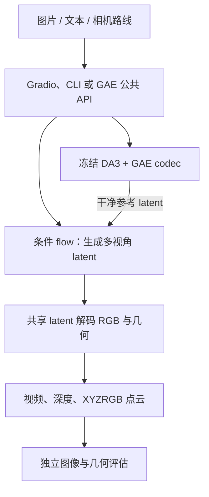
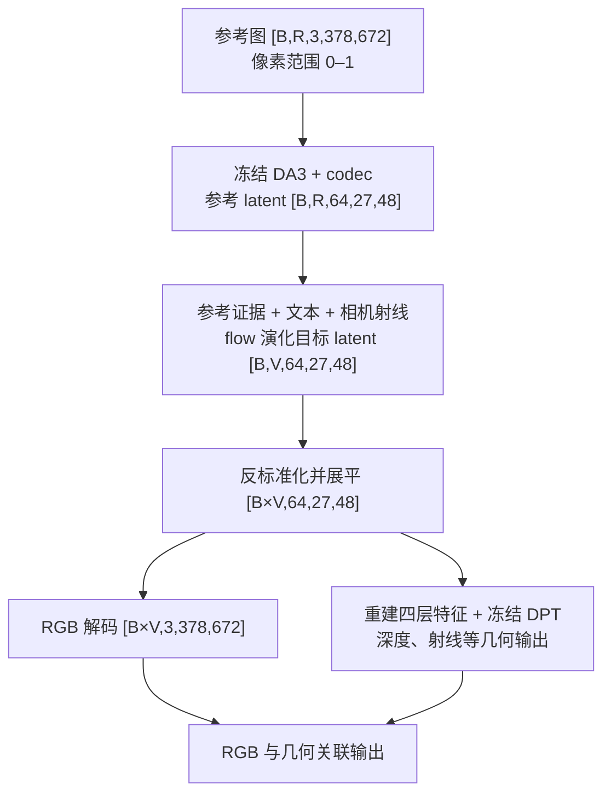
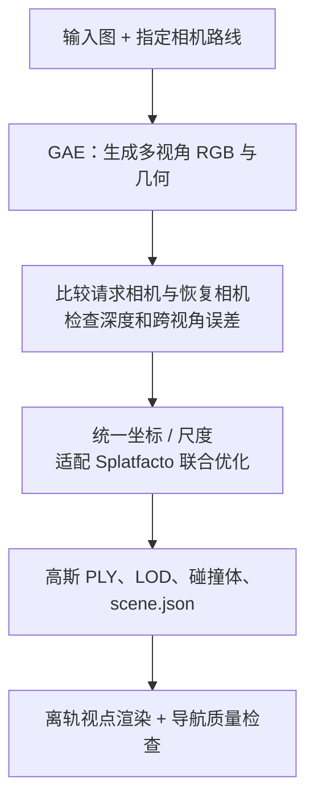

# GAE 架构与 Image2World 可借鉴项

评估日期：2026-10-25。依据本地 `D:/Github/GAE-GeometricAutoEncoder` 源码、Image2World 当前实现，以及作者论文、官方模型卡和许可证。此次为静态分析，没有运行 GAE 推理、测量显存或验证生成质量。

## 1. 判断

最值得借鉴的是三个相互配合的设计：**在生成过程中维持跨视角的几何关系；让用户先指定并预览相机路线；用独立方法检查生成结果的三维一致性。**

对 Image2World，GAE 是值得做学术实验的“单图生成更多视角”候选。它还不是经过验证的 Marble 替代品：生成一段相机可控的视频和对应点云，不等于得到封闭、清晰、可任意漫游、可碰撞的三维世界。我们现有的高斯重建、坐标统一、碰撞体、导航检查和 USD 导出仍有价值。

优先级建议：先借鉴评测与相机交互，再做独立的 GAE 生成实验；暂不投入自训练 codec / flow，也不直接替换现有后端。

后续落地：Image2World 已加入保留视角外观评测、相机 / 尺度来源导出和世界侧栏质量报告，见 [实现与使用说明](../../RECONSTRUCTION_QUALITY.md)。相机路线编辑仍需生成后端提供真实的轨迹控制能力；未添加无后端支持的生成控件。

## 2. 项目结构与技术栈

主要使用 Python、PyTorch、DA3、条件 flow Transformer；Gradio 承担演示界面，浏览器端 JavaScript 承担相机编辑。`pyproject.toml` 声明 Python 3.10–3.12、`torch==2.5.1`，不能据此认定兼容 Image2World 现有的 GPU 环境。

```text
gae/pipeline.py                    公共推理封装
src/stage1/gae_codec.py            几何特征压缩、RGB 与特征解码
src/stage1/da3.py                  DA3 编码器与 DPT 几何头
src/stage2/models/dit.py           条件 flow 与干净参考 token
src/stage2/models/dit_temporal.py  时序模型
src/stage2/models/camera.py        相机 Plücker 射线条件
scripts/demo/resident_engine.py    常驻模型与相机预览几何
scripts/demo/direct_camera.py      轨迹校验、插值与尺度估计
scripts/demo/camera_editor.js      浏览器相机编辑器
scripts/demo/pointcloud_view.py    XYZRGB PLY 与展示用 GLB
scripts/eval/                     图像、几何和跨视角评估
scripts/train/                    codec / flow 两阶段训练
configs/                         模型、数据、训练配置
```

## 3. 架构总览

**架构总览（Mermaid）**



**架构总览（文本细化版）**

```text
图片 / 文本 / 相机路线
          |
Gradio、CLI 或 GAE API
          |-- 冻结 DA3 + GAE codec -- 干净参考 latent --+
          |                                          |
          +---------------- 条件 flow <--------------+
                                |
                     共享 latent 解码 RGB 与几何
                                |
                     视频、深度、XYZRGB 点云
                                |
                        独立图像与几何评估
```

## 4. 核心模型及数据流

维度以本地 `configs/flow_gae64.yaml` 的 672×378 输入为例；`B` 为 batch，`V` 为视图数。已对照 `GAE.encode()`、`GAECodec.normalize_levels()/encode()/decode_rgb()`，以及数据集 `video_meta_scene.py` 的裁剪、缩放和相机内参同步处理。以下只画推理的阶段级维度；不将不同训练配置的分辨率混在一起。

**模型推理（Mermaid）**



**模型推理（文本细化版）**

```text
参考图 [B,R,3,378,672]，范围 0–1
    |
冻结 DA3 + codec -> 参考 latent [B,R,64,27,48]
    |
参考证据 + 文本 + 相机射线
    |
flow -> 目标 latent [B,V,64,27,48]
    |
反标准化、展平 [B×V,64,27,48]
    |-- RGB 解码 -> [B×V,3,378,672] --------+
    |-- 重建四层特征 + 冻结 DPT -> 几何 ---+
                                         |
                              RGB 与几何关联输出
```

上图使用概念上的 batch 布局。公共 `GAE.sample()` 当前接收 `[R,64,27,48]` 的参考 latent，返回 `[total_views,64,27,48]`，没有显式 batch 维；`GAE.encode()` 则保留 `[B,R,...]`。接入时必须适配这两种布局，并核对参考帧与目标视图数的关系，不能直接套用上图张量调用采样 API。

| 模块 | 代码位置 | 核心行为 |
| --- | --- | --- |
| 编码 | `gae/pipeline.py:320`，`GAE.encode()` | 归一化输入、提取四层特征，输出后验均值 |
| 特征压缩 | `src/stage1/gae_codec.py:885`、`:919` | 每层按统计量归一化，拼接后压缩；网格来自图像尺寸除以 patch 14 |
| RGB / 几何 | `gae/pipeline.py:362`、`:368` | 相同 latent 进入 RGB 分支与特征重建 / DPT 分支 |
| 采样 | `gae/pipeline.py:396` | 参考证据、相机射线、文本共同控制目标 latent |
| 参考处理 | `src/stage2/models/dit.py:169`，`GAEFlow.forward()` | 参考 token 保持干净，进入预测头前丢弃参考位置的输出 |
| 相机编辑 | `scripts/demo/direct_camera.py:13`，`end_view_poses()` | 校验图像归属、固定起点、结束相机和关键帧时间，生成 c2w |
| 点云写出 | `scripts/demo/pointcloud_view.py:9` | 只写 XYZ 与 RGB，没有高斯的尺度、旋转和不透明度 |

训练分两步：先冻结 DA3 编码器和 DPT 几何头，训练 codec 的特征重建、RGB、几何、KL 和表征约束；再冻结 codec，在逐通道标准化的后验均值上训练 flow。表征约束同时照顾语义与空间 / 跨视角结构。它说明“压缩后还可重建”不足以保证“适合生成”；但这是未来自研模型的研究方向，当前无需在 Image2World 复现整套训练。

## 5. 值得借鉴的五件事

| 优先级 | 设计 | 对 Image2World 的具体价值 | 实施边界 |
| --- | --- | --- | --- |
| 高 | 独立检查生成视图的三维一致性 | 补上现有 alpha 覆盖率无法识别的拉丝、重影、位姿漂移 | 借鉴评测协议，按我们的资产格式实现；不直接照搬研究脚本 |
| 高 | 生成前的相机路线编辑与预览 | 上传后选择起点、终点、关键帧和移动幅度，先看会暴露哪些未知区域 | 单图代理没有背面信息；预览只表达路径与已有表面 |
| 中 | 同一份表示同时读出 RGB 与几何 | 为多视角生成后构建统一世界提供更有结构的输入 | 共享 latent 有助于一致性，不能保证无错几何或正确的绝对尺度 |
| 中，先实验 | 单图 + 相机轨迹生成更多视角 | 探索本地补全看不到的区域，缓解 SHARP 只恢复可见表面的限制 | 必须验证大角度、回环和离轨视角；不能据论文推定可生成完整房屋 |
| 低，后续工程化 | 公共模型 API、常驻 worker、原子任务文件 | 新后端可包装成独立适配层，模型调用与世界发布分开 | 我们已有 GPU 锁、模型缓存、任务持久化和暂存发布，先复用现有设施 |

### 5.1 评测：把三类问题分开

GAE 的 `eval_3d_consistency.py` 用外部 VGGT 估计生成 RGB 的相机 / 几何，再测轨迹和重投影关系；`eval_geometry.py` 另测直接解码的深度与点云，并支持 Pi3。值得借鉴的是**不要只让生成器自己的几何头给自己评分**。外部估计器也有误差，应与已知轨迹、真实多视角数据或人工检查配合。

我们应保留三组结果：

1. 视觉一致性：固定新视点的画质、重影、重投影误差和相机跟随误差。
2. 几何完整性：孔洞、尺度漂移、浮点、地面稳定和碰撞体可靠性。
3. 导航可用性：沿用 `scripts/isaac-sim/vln_check.py` 的覆盖、连通性、绕行等判据，配合 `backend/tools/render_viewpoints.py` 的实际观测。

三组不能相互替代。闭合的碰撞体可能包着模糊画面；一段清晰的视频也可能无法产生可导航的空间。项目现有渲染器说明已经明确：“Coverage catches holes, not smear.”

### 5.2 相机预览与尺度

本地 Camera Studio 的实现值得研究：输入图像哈希绑定预览与提交，固定原图起点、最多四个中间关键帧和一个终点，关键帧落到实际生成帧，前后端采用对应的平滑插值。这样可减少换图后提交旧轨迹、路线未完成就生成、预览与采样路径不一致等问题。

其 `ResidentEngine.prepare_camera_scene()` 还用 DA3METRIC-LARGE 为预览估计场景尺度，`metric_depth_scale()` 用有效像素深度比的中位数估计统一缩放，并保存分位数。代码明确标注单位是 **estimated meters**。对我们的启示是统一记录估计尺度、来源与变换，不能把模型输出默认为真实米制测量。

`glb_preview()` 会居中、归一化大小并翻转坐标，适合展示。**它不是应直接导入导航 / 仿真的米制资产。** 应保留原始数据，并显式保存 OpenCV、Three.js / glTF 与 Isaac Sim 之间的变换。

## 6. 建议的学术验证路线

先以少量固定室内图、短路线验证生成质量，再考虑系统接入。可从 README 建议的单卡小配置 17 视图、25 步开始，但这只是候选实验参数，未证明能在本机 16GB 显卡运行。

**候选处理流程（Mermaid；尚未实现）**



**候选处理流程（文本细化版；尚未实现）**

```text
输入图 + 指定相机路线
    -> GAE 多视角 RGB 与几何
    -> 请求 / 恢复相机比对、深度与跨视角检查
    -> 统一坐标 / 尺度，适配 Splatfacto 联合优化
    -> 高斯 PLY、LOD、碰撞体、scene.json
    -> 离轨视点渲染、导航检查
```

`backend/tools/splatfacto_prototype.py:63` 已有 `prepare_nerfstudio_dataset()`，可作为适配入口。利用 GAE 的相机和点云作为初值 / 先验，有机会减少从生成视频重新做 SfM 的依赖；**请求轨迹不等于实际生成内容严格遵守的轨迹**，需比较恢复位姿后再确定相机是否固定、是否优化。

同时保留直接使用点云做几何分析的分支。为高斯优化准备相机时，原始 XYZRGB 点云可作为初始化，但不能仅靠改后缀或添加默认高斯属性就视为完成重建。Splatfacto 也不能保证修复生成帧之间的矛盾。

最小实验应包含：

- 同一批图片，对照当前 SHARP 以及已有的 Marble 结果；缺少同输入样本时不冒充严格比较。
- 分别测小平移、小转角，再扩大运动范围；把回到起点时的场景漂移单独记录。
- 除生成路线外，从统一三维资产渲染未参与优化的视点，检查是否仍能漫游。
- 使用有真实多视角观测的保留片段检验新视角重建；单图背面生成只评价一致性与可用性，不宣称恢复了真实背面。
- 记录首轮加载、后续生成时间、显存峰值、失败情况，以及重建 / 导航结果。实测通过才决定是否加入产品后端。

## 7. 部署与许可边界

- `app.py` 提供单卡入口；本地 `scripts/demo/run_fast_demo.sh` 则默认 `NGPU=8`，采用常驻分布式服务。存在单卡入口不代表本机显存足够；本次没有测量。
- GAE 依赖、CUDA 扩展与现有环境有差异。实验宜放在独立环境，先验证目标显卡与小配置，避免直接修改现有后端的依赖。
- `LICENSE.txt` 将公开代码、参数和权重限定为学术用途，并明确排除非学术、商业或生产用途。Image2World 的 MIT 源码许可证不会覆盖这项限制。可以研究设计思想并自行实现通用功能；直接复用 GAE 代码 / 权重须遵守其条件，不能默认作为可商用后端发布。
- README 说明发布的 flow 权重经过继续训练，不能保证精确复现论文生成表格的数值。性能结论以实际权重、硬件与实验记录为准。

## 8. 参考来源

- [作者论文：GAE](https://arxiv.org/abs/2609.24981)：几何原生 latent 与受控比较。
- [作者官方仓库](https://github.com/TencentARC/GAE-GeometricAutoEncoder)：模型方法、推理与评估入口。
- [官方 GAE-D64-1B 模型卡](https://huggingface.co/TencentARC/GAE-D64-1B)：64 通道 latent、672×378、81 视图的发布模型说明。
- [官方许可证](https://raw.githubusercontent.com/TencentARC/GAE-GeometricAutoEncoder/main/LICENSE.txt)：实际复用条件。

本地源码还含 Camera Studio、resident engine 与轨迹编辑等实现；相关判断以所读本地文件为准，不假定与远端默认分支完全一致。
